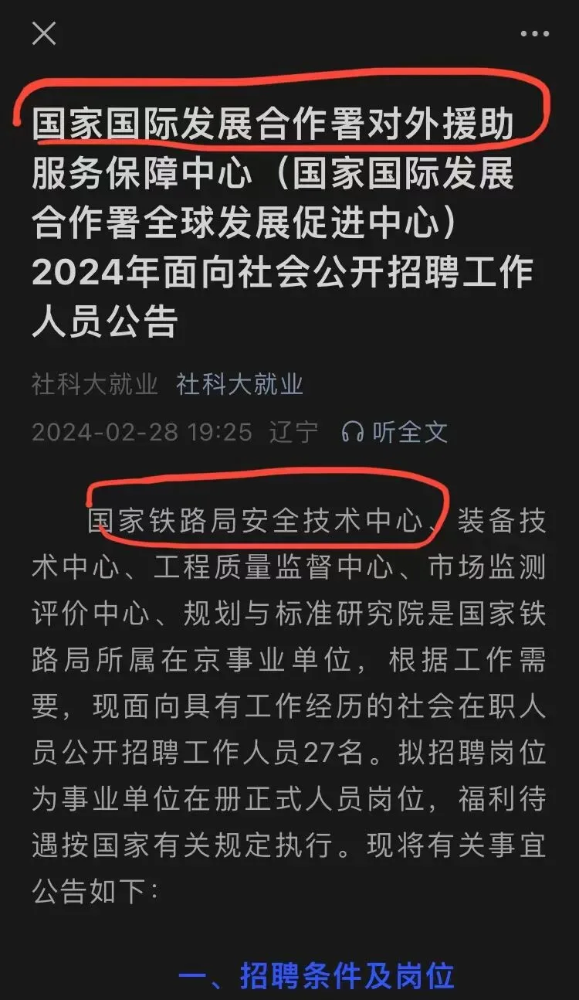

请相关部门及时关注并跟进问题。

## 1 就业

“#就业 吐槽，看到学校的招聘推送，简直大无语，完全文不对题，这种简单错误让人怀疑相关负责人的态度及工作专业性。”

## 2 缓考

“去年期末大家一直争论的缓考给分问题，怎么又无声无息了？新学期马上就要缓考了，希望教务处尽快给出缓考给分问题的应对方法，好让缓考同学专心备考吧”

## 3 校园网问题

“社论君你好，望京校区的网越维护越差劲，现在几乎连不上了，学校什么时候才能真正把校园网连接不上、网速巨慢的问题解决掉呢？或者直接解决掉校园网吧！谢谢！”
