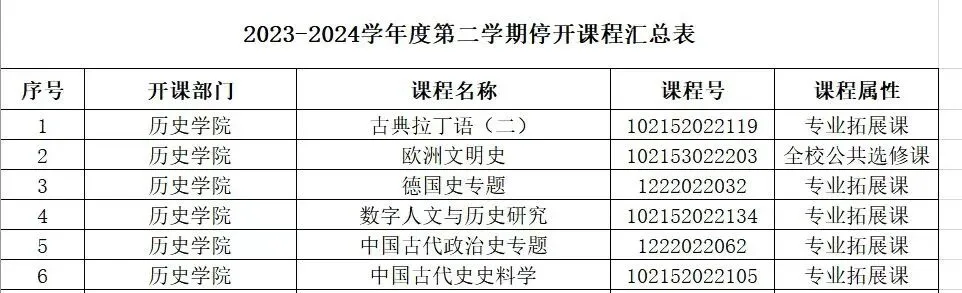

请相关部门及时关注并跟进问题。

## 1 教务系统

> “您好！我想反应一个问题，教务系统平均学分绩点及排名显示的是必修课平均绩点，而导出的成绩单显示的确实所有课程（包含选修）的平均绩点，请问这是有意这样的吗，我是大一的，可能不太明白，所以说到底应该参考哪个成绩啊？还是说是教务处老师不小心搞错了？ 另外：有些课被划分在培养方案外了，烦请老师们检查修改一下”

> “咱们教务处能不能用一点点心，这个里面3-6的课程都是上个学期（秋季学期）的课程，都春季学期再发停课的有什么意思？ 其次，明明目前教务系统里有些课选课人数不足5人，甚至是只有0-1个人，为什么这些课在正选结束后没有被停开？凭什么附件里面的这些课程要被停掉。如果要停开是不是应该有一个统一标准？我不相信教务处只是看不到而已，到底是装着对问题视若无睹还是怎么样，咱也很难说。”

## 2 供暖问题

> “投稿：望京校区暖气实在不太行，一楼的暖气片只能说有个温度而已，实在算不上暖和，不开空调根本冻得待不住，恳请校领导重视一下，这两天还没到真正的春天，还是很冷的，好好烧暖气吧，别的好政策就不强求了，只希望能住得温暖一点。”
