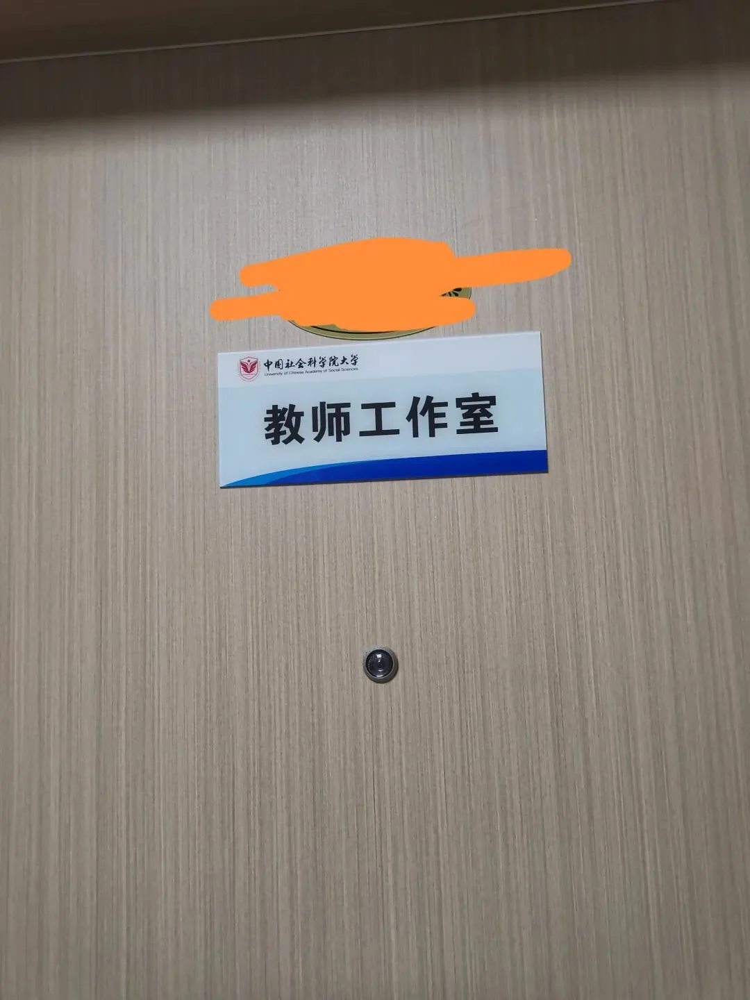
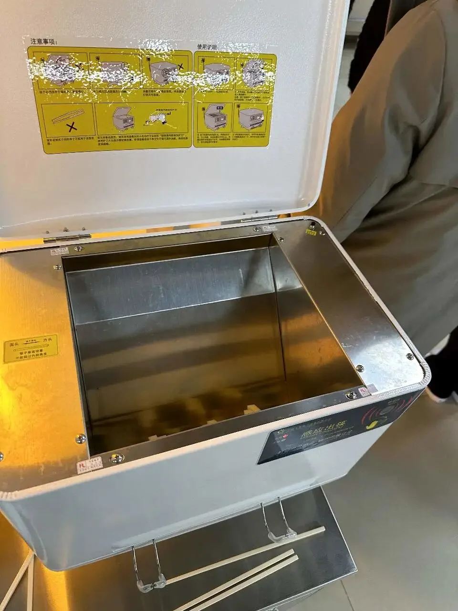
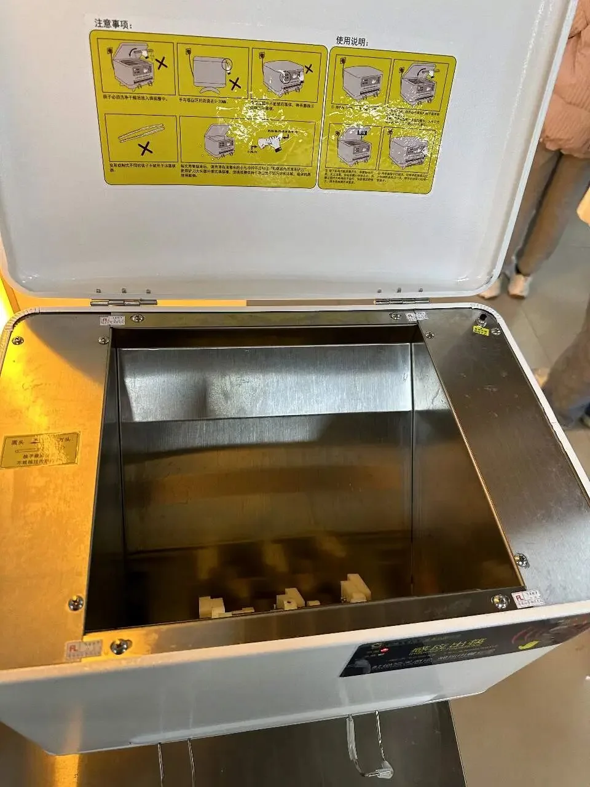
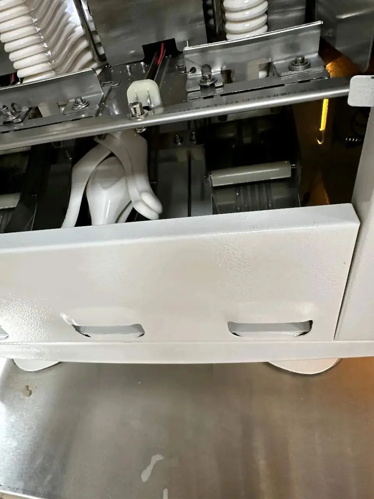

请相关部门及时关注并跟进问题。

温馨提示：各位读者朋友阅读本期内容的时候可以站着阅读，做到两脚跟靠拢并齐，两脚尖向外分开约60°；两腿挺直；小腹微收，自然挺胸。

## 1 企业邮箱

> “企业邮箱的管理员是哪个部门的啊？？？ 最近应该是管理员在后台勾选强制安全登陆的选项了！ 这样的话就没有办法用网易邮箱大师等邮件客户端了，因为这些客户端需要微信生成的实时密码。结果是非常不方便，耽误正常交流！！！ 经过查询和操作，这个强制安全登录，个人无法取消，非常难用。 能不能管理员后台维持之前的状态，让自己选择是否强制安全登陆啊！！！”

## 2 奖助补费

## “社论君投稿：

马上三八妇女节，网上有一些打折优惠活动，请问学校能不能在妇女节之前发放本月补助，让我们趁活动价买东西省点钱…”

## “助学金拖欠了五六个月了，这次可以麻烦老师们核对名单发放吗”

## 3 闲置资源

“7-8号宿舍楼每层这些没用的房间，已经锁了一年了，这学期打算继续锁吗？坚决不开放出来给大家当自习室？

（你们就是给这些房间取再多的名堂，也挡不住一直锁着的事实）

之前说在采购设备和走流程，真不知道啥设备和流程，都tm一年了，设备现造也造出来了吧！还是说根本就是怕管理麻烦？

这就是你们的举全院之力办好社科大？一个高校总共就那么几个自习室，而且大部分还是板房和地下室，明明有正常的空房间，却不拿出来给学生用，你们能办好社科大可是见了鬼了～”

## 4 教务问题

> “又到了一年两度的选课时间，奈何研究生系统实在是太老了，而且卡的要命，无论是从实用性还是美观上来说都太过时了，学校能不能拨款找人重新做一个系统哇，跟本科系统一样的就行，球球了”

## “投稿

近日听闻有司连老师授课究竟是坐着上还是站着讲都有强制要求，不得不说贵校的教学管理真是有点大病在的。是不是下一步就要规定大家上课要统一站军姿了？如果某些人对于教学管理的理解就这种水平的话，真是无槽可吐。只能说还是需要加大力度，最好再规定的详细一点，告诉大家上课的时候应该站成多少度、双脚分开多少距离，出一个统一的指导意见，方便大家实行。“相信”事情都这样做，才是举全院之力办好社科大，搞好科教融合的要义所在呢。

不得不感慨，你说要举全院之力办好社科大，我就阴奉阳违过度管理做违背大学教学管理规律的事来恶心全院全校。前有不懂学生学期均选几门课而加码检查，后又故犯教学管理规律要求老师站着授课。想来可能是有些人害怕社科大办好了、科教融合搞好了就难有自己容身之处。如果真是这样，那么的确应该下定决心好好整治一下这所学校的某些人了，也让大家看看究竟是谁在上下其手、阴奉阳违、蚕食动摇举全院之力办好社科大、搞好科教融合的根基。”

## 5 食品安全

“避雷咱学校超市卖的这个新品饮料，喝了窜稀，会成为喷射战士……（不针对超市，只是针对这个产品）图片来自网络”

## 6 食堂

## “三个拿餐具的地方，两个里面没有筷子，一个有勺子却不出勺子”

