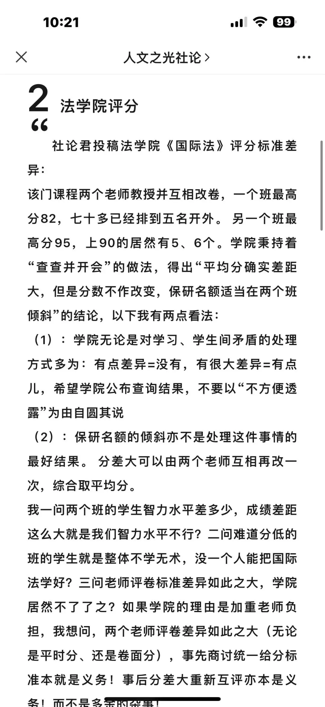

请相关部门及时关注并跟进问题。

## 1 课程问题

> “毛概课：这个我是真绷不住了。首先是老师的讲课方式，讲一句提问十个人，试问如果你提问我们找书就能把知识学会，我们为什么不自己看书？还要你干啥？就这么不想讲呗。其次，讲课真是，口口口口。四个道路？你要不要听听你说什么？四个现代化让你讲成四个道路，哪四条呢？太绝了。思政课就让你上成这样。强烈要求老师改变授课方式，提前备课。”

（注：该稿有些言论过于激烈，故以“口”代替。请读者朋友们自行体会当事人的愤怒）

“请问法学院对这篇文章里提及的《国际法》评分差距一事的处理方法是什么？已经开学了，老师也上班了，请给个解决方案，谢谢！”

（见《[【读者投稿】报备评分疑问多 宵禁缓考讨论忙](https://mp.weixin.qq.com/s?__biz=Mzg2MjcwNzQ1Mw==&mid=2247487682&idx=1&sn=eea9fa7360d000cd6f506cf47d027bf3&chksm=ce029b50f97512461c2226dcd66be9bffa949e709a494a0af5592aef3163a2881eef4dd323a6&scene=21#wechat_redirect)》第2条)

## 2 宵禁问题

## “宵禁是肯定要实施的，比起合理性，官大爷的权威更重要”

## “对成年人宵禁，我们是生活在什么很黑暗混乱的地方吗？”

（见《

【读者投稿】宵禁教学讨论不断

》第1条)
