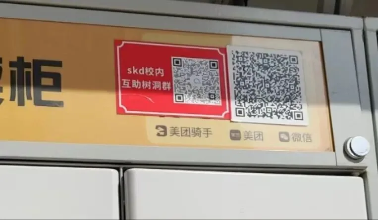

请相关部门及时关注并跟进问题。

## 1 研创计划

> “投稿：近期科研处研创计划申请已基本结束，各学院进行遴选答辩环节，但听说经济学院竟然有学生去年已经主持了一项科学研究项目，今年又申请一次并被赋予立项答辩资格参加立项答辩评审会，学校的通知写道科学研究项目的宗旨是对毕业论文进行资助，“科学研究项目：鼓励申请人根据本专业、研究方向和学位论文选题，在导师指导下，拟定研究课题并开展研究；对于具有创新性研究方法、研究领域的项目给予优先支持。”一方面只能说吃相难看，另一方面学院的审核机制也形如虚设。此外，该同学去年结项时竟然以与课题无关成果作为结项材料，成功拿到优秀，唏嘘不已...”

## 2 小广告

“某些小程序运营者麻烦要点脸，之前大范围收购二手群来做宣传就算了，现在还开始贴小广告了，还贴在外卖柜码的旁边，想赚钱也要点良心吧。”

## 3 宿舍

“（7、8号楼利益相关）建议将宿舍楼寝室卫生间改造成旱厕，既可节约水资源，更能有效解决高层中水不足、楼外污水外溢等种种现象，一举多得，乃万全之良策也。”

4

中期考核

> “匿名：博士中期考核毫无科学性可言，博士阶段大量精力都在专门的项目中做研究，现在学科研究领域日益精细化，却在考一些如同考研试题一样的通论内容，甚至考的内容跟博士的研究方向差别极大，这到底是想要培养什么样的博士？如果按照这种逻辑，建议全校教职工也搞中期考核，把事业编考试内容重考一次，不合格的全部劝退。”

> “博士中期笔试和二外必修都是这两年折腾出来的？真的有用吗？博士培养质量差的根源问题没有找出来。好多博士延毕，毕业找不到工作。根源在于没有论文。与清北人师的比起来，竞争不过人家。很多同学都是自己读了一个博士。有些专业课根本不开，多年不开，有些老师不管学生。社科院学术资源丰富，到社科大及学生这边的真正有多少呢？不从根源上抓主要矛盾，怎么能解决问题呢？博士本来就是培养科研型人才，而不是培养怎么考试。”

> “关于今晚推送，马院发表三篇论文的同学中期考核挂了，也想发表一些内部消息，据悉该生中期考核成绩与及格线相差甚远，申请复查后成绩并未有所改动，还强势要求参加国奖评选？并出现在初次公示名单中，请问这种同学都可以参评奖学金，那让我们这些勤勤恳恳复习，认真对待考试，无一挂科的同学有何存在意义？导师是业界大牛就可以为所欲为？后续被从公示名单上移除想必自己也清楚什么原因了吧？现在还想颠三倒四、混淆事实、煽动同学情绪来抗议？试问是何居心？试问真理何在？”

（见《[【读者投稿】进入更好的新阶段](https://mp.weixin.qq.com/s?__biz=Mzg2MjcwNzQ1Mw==&mid=2247487727&idx=1&sn=8c06aa00cf1aa2c05e25d19d394f17fb&chksm=ce029b7df975126bfc4469bd8dc63a8d440bf2430767ff81e6216e9853439ffc6cf056aa680d&scene=21#wechat_redirect)》第3条)

## 5 宵禁问题

“评双一流是必要的，学生和学校都需要这个名头，说只是来学习的未免有点太理想化，平民百姓应聘、升学、考编没这个名头会丧失掉很多机会。

但是！

宵禁真的是评双一流的必要条件吗？是学校给自己的不合理政策找背锅侠还是真的有这个要求？

显而易见的拉胯的科教融合、紧缺的学习空间、拖沓的行政、乱花钱的财政、“全管起来”的管理逻辑，这些恐怕才是评不上双一流的真正原因。

ps：校情通报没必要办了，反正都是自己夸自己。直接出通稿歌颂自己完事了，还拉一堆演员不嫌累吗？”

（见《[【读者投稿】进入更好的新阶段](https://mp.weixin.qq.com/s?__biz=Mzg2MjcwNzQ1Mw==&mid=2247487727&idx=1&sn=8c06aa00cf1aa2c05e25d19d394f17fb&chksm=ce029b7df975126bfc4469bd8dc63a8d440bf2430767ff81e6216e9853439ffc6cf056aa680d&scene=21#wechat_redirect)》第2条)

## 6 座谈会

> “针对昨天那位锐评座谈会的同学，我想说你属实是在凭空捏造了，作为学习社会科学的人，难道一点科学精神都没有，只凭主观臆测就能大放厥词吗？个人认为本科生座谈会谈的还是比较坦诚的，从本科招生、就业、推免、实习实践、学业导师、夏令营招生，到本科培养方案、学生工作、学生活动、校园文化、学生科研、海外交流等各方面问题都有同学提出各种问题和建议。座谈会的目的只是为了帮助新书记更快更好地掌握学校情况，以便开展接下来的工作，又不是什么决定学校生死命运的大事，大可不必这么跳脚。另外，关于派出代表的问题，但凡接触过学生工作的都知道，代表这个东西很不好搞，如果真是拿个大喇叭吆喝到处找代表，大家反而都默不作声、推来推去；所以指定代表可能是一个比较折衷的办法，而且你怎么就觉得老师指定的认为有代表性的同学实际上没有一点代表性，而自己偏激的言论就有代表性了？老师跟其他同学又不是瞎子，谁不是在这个学校上了几年学、读了几年书啊。”

（见《[【读者投稿】进入更好的新阶段](https://mp.weixin.qq.com/s?__biz=Mzg2MjcwNzQ1Mw==&mid=2247487727&idx=1&sn=8c06aa00cf1aa2c05e25d19d394f17fb&chksm=ce029b7df975126bfc4469bd8dc63a8d440bf2430767ff81e6216e9853439ffc6cf056aa680d&scene=21#wechat_redirect)》第5条)
