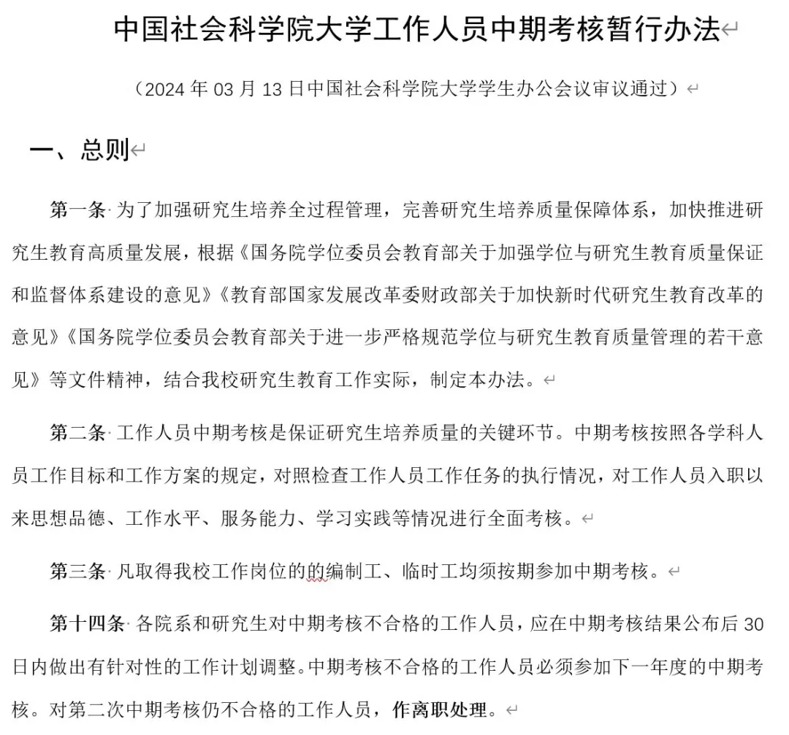

请相关部门及时关注并跟进问题。本公众号现已试获得留言功能接口，碍于微信公众号平台基本逻辑，留言可能难以匿名，请读者朋友们自行斟酌。至于稿件投稿方式不变，欲投稿请于后台点击“我要投稿”查看相关内容。

## 1 中期考核

> “关于博士生中期考核，我想问问学校是真的要逼死学生吗？非要把大家都搞抑郁了？首先，博士生科研压力真的很大，而且上半年马上要迎来开题，这关系到博士生的整个学业、职业生涯，需要大量的时间准备与思考，不是拍脑门决定的；其次，考试范围仅仅提到“一级学科基础理论必修课”“二级学科专业理论必修课”这未免太宽泛了吧，没有任何方向和针对性可言，请问笔试目的何在？；再次，在中期考核笔试内容如此宽泛的背景下，考试形式还是闭卷，大家带着科研压力，白天辛辛苦苦做科研，晚上不睡觉继续背那些所谓的基础知识，谁知道压死学生们的最后一个知识点是什么呢？；最后，我们对博士生的面试考核是可以接受的，向老师们汇报自己所选研究方向的理论掌握以及钻研情况、参与科研项目情况、学术交流与成果情况等，这个有助于学生的开题以及未来的学业职业规划。”

“针对今天晚上有发言称自己“勤勤恳恳复习，认真对待考试，无一挂科”，我不知道这位同学知不知道什么是博士，博士需要具备什么能力。这样的发言和一个本科生有什么区别呢？这不就是精致的平庸吗？没有成果不正是因为这种所有事情都按部就班地做，没有自己的思考和改变的勇气吗？

我虽然对马院三篇C的同学到底是什么情况不甚了解，但是很简单的道理是，导师是业界大牛并不能成为发C的充要条件，甚至于导师大牛会对学生论文的要求更加严格，必须是文章水平达到一定层次，否则岂不是砸了自己招牌。综合来看，这位同学的学术水平必然是碾压“精致的平庸”的。而一个把时间精力都花在学术上的学生，通不过这种粗放式的、面面俱到的考试难道不是理所当然？如若不信，就让各专业的教授去把本学院的所有本科考试都过一遍，看看有几个能都拿高分？

社科大对博士阶段的学生还停留在如此原始的考核方式上，只能说学校不行别怪路不平。估计都没有几个真的懂教学的人吧！”

## “同意今天关于中期考核的建议。抛砖引玉一下，希望同学们完善。”

（注：此项考核疑似并非学校施行制度，请读者朋友们谨慎识别）

（见《[【读者投稿】教学管理讨论激烈](https://mp.weixin.qq.com/s?__biz=Mzg2MjcwNzQ1Mw==&mid=2247487738&idx=1&sn=8409a79a5c95998216b4b8407cf75376&chksm=ce029b68f975127e7e8426b99ed0723665489649908f347c3808add131106130e85b0d64ba45&scene=21#wechat_redirect)》第4条)

## 2 妇女权益

“强烈建议我校在各个女厕所安装“应急卫生巾盒”，即一个盒子里面，放上卫生巾，以便来生理期的女孩子使用。维护女性权益，人人有责，希望有关部门尽快采纳该意见。”

## 3 自习室相关

> “望京校区有些同学自习的教室有了，知识也学到了，可是把没吃完的零食早餐茶叶蛋放桌肚里藏几天，臭的整个教室一股子死老鼠味儿，自己美美隐身。可见社科大望京校区学生最奢侈最难获得的东西不是时间空间和知识金钱，是素质，一个正常的成年人的素质。巨婴味儿收收。”

## 4 座谈会

“回第六条，“座谈会的目的只是为了…”说的太对了。就像有个稿件批评的那样，座谈会本来就是一折为了配合领导雅兴搞出来的演出，并没有什么真正的代表，只有不得不陪笑的演员。至于是否坦诚，谈了什么，相关负责领导做出什么承诺，如果要从一纸和谐的通稿中破解什么密码才能得到，这已经很悲哀了。

代表工作为什么难做，大家心理都有数，因为谁不是在这个学校上了几年学、读了几年书啊，是不是存在各种显性或隐性的舆情维稳迫害，大家当然不是瞎子。社科大并不缺少关心学校事务的人，也并不缺少需要关心的问题。在这种情况下还是明知故问为啥大家都失语的话，可以去问问负责学生工作的校领导关于“如何维护社科大舆情稳定”的相关经验，期待你的深入考察与采访总结。

至于这类演员是否具有代表性，任何有常识的人都不会给出一个肯定的答案。正如你所说的，每个人都不是第一天来社科大，怎么行政管理人员就指定这些人，不指定其他人呢？有问题每个人都可以批评，代表性可不是你或者我或者他一方说了算，而是需要大家进行公平地选且派才能做到的。的确，似乎各方面都有同学提出建议，但这些建议充分收集了大家的关切吗？是大家想要沟通的内容吗？相信一个连大部分人都不知道要召开的秘密座谈会做不到这一点吧，那么，这些建议又怎么体现民意呢？大家遇到问题，还不是只能想办法民主上书。由此观之，校方宣称为了教职工学生的工作做的有多失败，有多虚伪，自不必言。现在一想，如果醉心于以这种方式进行民主调研的话，那还真是令人大跌眼镜呢。

社科大发生的很多事情的确都不是生死攸关的大事，但正是这些小事日积月累，塑造着学校的整体风貌，从而决定着学校是死是活。从这一点上来说，每一次涉及校方和教职工学生的座谈会都不可能是小事。很好奇这位宣扬“座谈会不是什么大事”的朋友究竟是否能够代表官方意见。如果连官方都认为座谈会是小事的话，我看大家还是趁早散了，去考虑其他不会被轻视的办法吧。

这位朋友虽然常识匮乏，但搅混水的经验十分老道，又显得非常客观中立，我看就各取一字，称其为老且中。再加个温良的修饰语，这样应该十分恰切了，十分符合科学精神的精确性了。”

（见《[【读者投稿】教学管理讨论激烈](https://mp.weixin.qq.com/s?__biz=Mzg2MjcwNzQ1Mw==&mid=2247487738&idx=1&sn=8409a79a5c95998216b4b8407cf75376&chksm=ce029b68f975127e7e8426b99ed0723665489649908f347c3808add131106130e85b0d64ba45&scene=21#wechat_redirect)》第6条)
