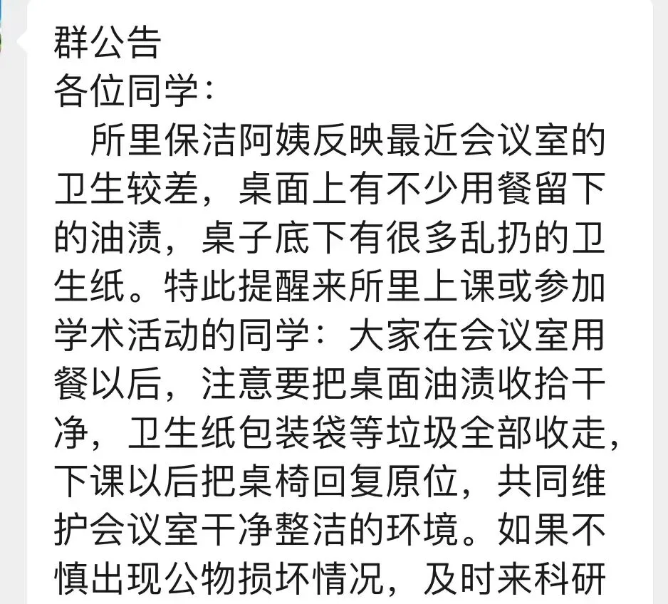

请相关部门及时关注并跟进问题。

## 1 新苗立项

> “某学院今年的新苗立项有点看不懂。且不论两个所谓的“数字人文”研究与院内某位专职教师研究方向的高度重合，再且不论两位同学与该专职教师的师生关系如何（并没有针对同学们的意思）。从学生的学术成长角度出发，本科生需要这样的数字人文研究吗？不进行基础的研究训练，而是在本科生阶段就开始如此的数字人文研究，这合适吗？如此操作是在消磨学生的科研热情与学术理想。”

“据消息来源得知文学院今年的16个新苗项目最后录取了11个，而历史学院的16个新苗项目最后录取了9个。想问问学校有关负责人这两个名额的差距是从何而来的呢？”

## 2 宿舍

“投稿:翻315网友评论，看到一个说自动洗衣机的评论破防了，直接指向我们学校合作的平台，问题之前有同学也反映过了，但是学校根本无动于衷，没有任何回复。

原评论如下: 胖乖生活，别的App是有广告，它是在广告里面找App，你根本想象不到广告会以何种方式出现，在你猝不及防之时就已跳转到其他App，每用一次就会问候开发者的家人是否健康。良乡校区7、8号楼全是这个APP，别的楼还不知道，每次洗衣服都很绝望，狠狠共情了!”

## 3 所内通知

> “所里的通知，什么都赖学生，桌子油了赖学生，厕所堵了也赖学生。学生想通勤三十公里去那地方？没有通勤补助没有餐补，学生在那儿吃个外卖都不让了？学生为什么不吃点健康的东西呢？难道是不想吗？再说了，谁天天在所里待着？应该不是学生吧？那帮人天天在所里不注意卫生，有问题了不想着找这些人反而让学生背锅，真就是欺软怕硬。而且，雇保洁阿姨干什么的？清洁不就是保洁阿姨的工作？（此处没有指责保洁阿姨的意思，一切都针对制定政策的人）保洁阿姨的诉求都能听，一看到学生的诉求就装死？我们交学费不是当孙子来了。希望有些人能明白。 ”

## 4 卫生巾议题

> “对于卫生巾议题，赞同前面同学的观点，应当扫码支付取用。但是要加一条，费用应当比其他渠道购买要高一些，避免所有人都图省事去用应急卫生巾，导致真正需要的人反而没的用。”

（见《[【读者投稿】外行与内行](https://mp.weixin.qq.com/s?__biz=Mzg2MjcwNzQ1Mw==&mid=2247487752&idx=1&sn=33646912145d161ee4ad8fa80e9485a0&chksm=ce029a9af975138c4c2ad164bd1cd9d77abf92b29250dcbe48a3e590cf3c0618bb8b5c6c449d&scene=21#wechat_redirect)》第3条)
