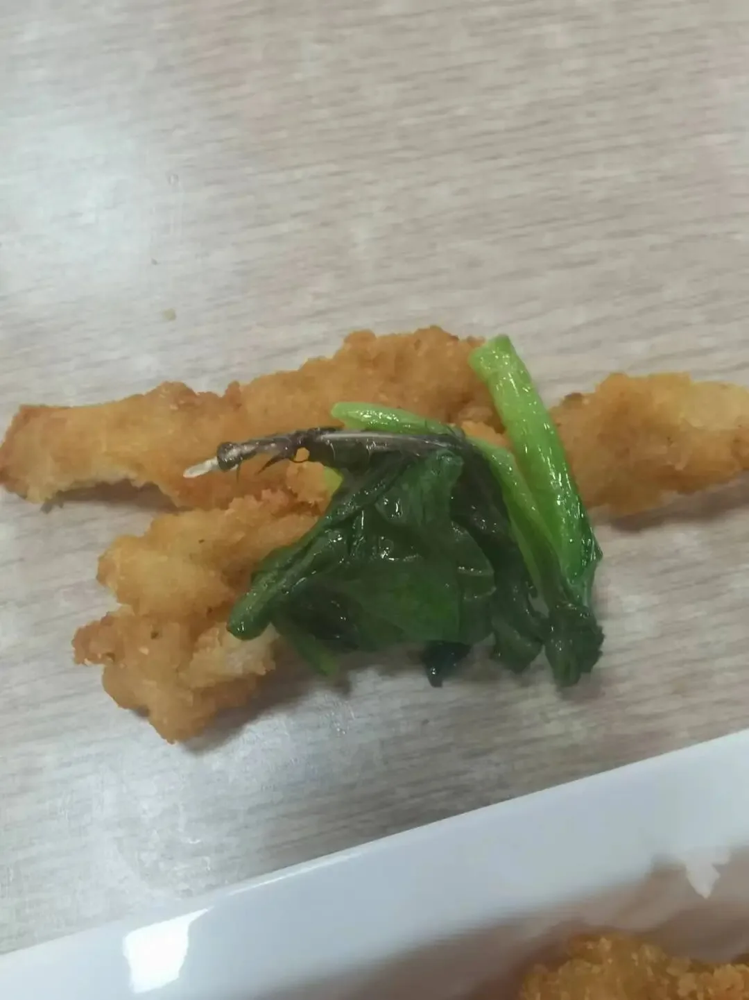
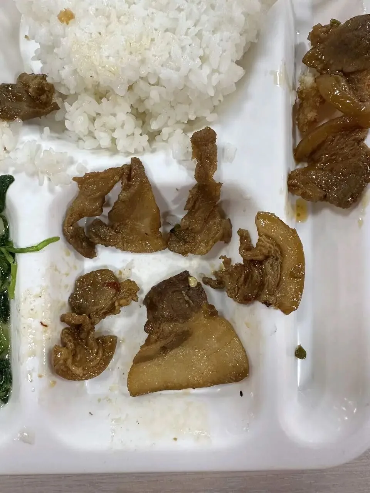
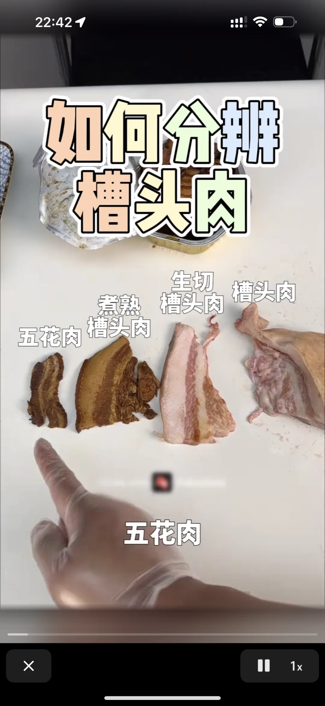

### 请相关部门及时关注并跟进问题

## 1 食堂

“不知道今天（注：3.23）一食堂有多少同学吃了这份用鸡毛洗过并炒熟的小白菜，食堂该整顿一下了。”

“想请问一下食堂，这份肉是出自猪的哪个部位？这个肉奇形怪状也不方正，味道也不对劲。另附五花肉、槽头肉对比图。”

## “一食堂今天（注：3.24）的饭是人吃的？一天比一天烂”

## 2 好课推荐

“希望规划评估处可以尽快推出”中国社会科学院大学好课推荐“栏目。上学期评教应该已经出来一阵了，应该让大家知道一下结果。

另外有个建议是，本科评教不能只表彰先进，对于某些评价不好的老师和课程，规划处和学院应该至少有些措施。不能总是评价不好还总是没有改变，那评教的意义在哪里？即使这种措施不方便公开，我想学院应该也要有行动。

当然，首先还是尽快推出表扬好课吧。”

## 3 中期考核

“针对上个社论中期考核的第一条，不知道你是什么身份，行政人员还是某位本科学生。我想说，每个人都需要进步，都需要有高远的目标，什么叫清北人师我们就比不了呢？社科大建立之前，社科院的博士是很受尊重的，有不少清北人的同学都会来社科院读博士，甚至于现在还有个别这样的情况。不得不说的是，正是因为办了社科大，导致社科院硕博的含金量下降了一个巨大的档次。如果仅仅是这样，我们也认了，你也说不如多读几本书，我们也想读书，是谁不让我们读书呢？是谁不让我们做科研呢？是谁在博一博二一直用各种手段打断大家的计划，干扰大家出成果呢？

咱们老实来讲，社科大本科生源质量已经断崖式下跌，在某些省份甚至跌了五十分，从中九水平跌到末九水平，显著弱于顶尖211。如果硕博再这样搞的话，我觉得社科大以后真的要完了。即便你评上双一流又能怎么样呢？首师大也是双一流，你以后就和首师大一个档次得了。”

（见《[【读者投稿】中期考核讨论深入](https://mp.weixin.qq.com/s?__biz=Mzg2MjcwNzQ1Mw==&mid=2247487824&idx=1&sn=b747e58e6e764dc4d4b73a90b7504c0e&chksm=ce029ac2f97513d445c9dba484c15bb3d7c79f064fe75df06de0f28a8889027e709a98e252c8&scene=21#wechat_redirect)》第2.1）

“针对昨天说和两位负责老师交流过的某位同学，其实我更倾向于认为你是行政人员。话里话外都是官腔。

座谈会在哪开的，有谁参加了，可以告知吗？为什么当问到我们2022级博士班班长，研委会委员，她表示从来没有听说过此事？那你们是怎么开会的呢？抽签开的？民意又是怎么收集的呢？

还有，我不知道什么叫做已经实施了，不会随意撤销。有错就要认，挨打要立正。你把你这个办法当圣旨呢？

另外，以社科大建立之前社科院的博士培养来看，这个锅就不要甩给社科院了吧，有必要去麻烦高翔院长吗？上次奖学金的事一团糟，社科大校长被院长臭骂一顿，这次还想重蹈覆辙？你作为行政人员，多少为领导考虑一下吧，这让校长看到了不得气死。

再次，这几天同学们已经给你们里里外外分析得明明白白了，尤其是上一个社论的最后一条，投票都投了多少次了，还需要怎样有理有据？我们截图下来发送领导吗？我们倒觉得可以，但是如果真的搞成这样，谁脸上都不好看吧。有时候多少给自己留点面子，你觉得如何呢？”

（见《[【读者投稿】中期考核讨论深入](https://mp.weixin.qq.com/s?__biz=Mzg2MjcwNzQ1Mw==&mid=2247487824&idx=1&sn=b747e58e6e764dc4d4b73a90b7504c0e&chksm=ce029ac2f97513d445c9dba484c15bb3d7c79f064fe75df06de0f28a8889027e709a98e252c8&scene=21#wechat_redirect)》第2.2）

“社论的各种投票都整了好几次了，希望行政人员不要回回都装看不见，每次说有座谈会，学生代表啥的，遗憾的是从来没看见过这些通知。

我真就不信有博士生中期考核愿意考一级学科的，博士研究深入到自身的领域里，你再去考一个不相关的除了浪费时间还是浪费时间。就像一个做日本近代文学的，你考他欧洲古代文学？

有些人真的不要假装博士发言了，深入自己研究领域是科研再正常不过的事，一级学科下面的东西不是都要精通，你去考学部委员一级学科他也肯定不是都会。这跟基础牢不牢有半毛钱关系？照这逻辑应该考高考试题啊，好好看书指的是看自己研究领域的书，不是再去看一堆和自己领域无关的书（现在这个情况，甚至还要看考研的书），懂？

中期考核不是考研，希望行政部门认清楚，要是真想倾听意见，以后请公开通知！一个愚蠢的决定，浪费所有人时间，霍霍一届又一届，不骂到狗血喷头，坚决不改。

就像之前的必修二外，真是脑袋被驴踢了，才能想出来的决策。”

> “对于中期考核，最近各位同学讨论热烈，不只是简单的否定，也给出了不少极具建设性的解决方案，遍览各种建议，我以为＂借鉴其他高校的成功经验，如北京大学的给选题进行小论文答辩方式，促进学术写作和成果产出，提高博士生在就业市场的竞争力＂极具可行性。众所周知，博士阶段，小论文是极重要的一个关键枢纽，如果小论文确定了，写好了，既可为下阶段的开题铺好路，也是构建大论文的核心环节。故以一篇小论文作为中期考核之依据，切中博士生培养的最终目标。期待领导重视这个方案！谢谢！”

> “学校能发个补充文件取消一下中期考核笔试吗？让大家选择以第一作者发各自专业的Cssci论文来替代。我们现在科研任务非常重，还要外出调研，我想发点论文，好好读几本自己研究方向的书，争取能找个好点的工作，能够自己养活自己。”

> “作为一个毕业生，还是想说一下，社科院学生的素质不差，不少本硕双一流，同时学习也很努力。博导很厉害，很多业界很有名气。为什么社科院博士的文章产出质量差数量低？不要把重担都放到学生身上，要把导师的积极主动性调动起来啊。否则，无论是中期考核还是发几篇C毕业，最后受苦的都是学生。”

（见《[【读者投稿】中期考核讨论深入](https://mp.weixin.qq.com/s?__biz=Mzg2MjcwNzQ1Mw==&mid=2247487824&idx=1&sn=b747e58e6e764dc4d4b73a90b7504c0e&chksm=ce029ac2f97513d445c9dba484c15bb3d7c79f064fe75df06de0f28a8889027e709a98e252c8&scene=21#wechat_redirect)》第2条）

## 4 沟通渠道

“昨日有同学说“渠道都是非常畅通的”。但从实际情况来看，这一点非常令人存疑。文中主要列举了座谈会，直接找行政人员与校长信箱三个方式，但这三种方式效果如何都有待商榷。

首先座谈会，这个之前应该有不少同学批评过，大意不外乎说座谈会作秀的成分大，大搞密室政治，形式大过意义。如果社论同学方便的话，烦请找找之前的链接贴一下，感谢。

其次找行政人员，这个效率也很低。直接找行政人员首先有可能根本找不到人。学校行政下班时间本来就很早，然后又有各种会各种事，很可能扑空。就算找到了，行政人员职权也十分有限，问题很有可能被推诿塞责，被踢到其他部门去，或者回复向上反映一下。遭遇这样的“鬼打墙”，往往使得一个问题要跑几个星期都得不到解决，经常没有了下文。就算没有被推掉，得到的回复也可能会是空洞的，无助于实际问题解决的，甚至变成了“诉苦大会”。这样一圈下来，能获得解决的问题基本上都是行政人员极其有限职权以内的一小部分问题，像中期考核这类学校层面的问题显然难以解决。

最后这个校长信箱。我真的怀疑背后有人在操作吗。之前笔者自己就曾给校长信箱反映过问题，第一次得到了“收到”二字，既没有解决问题的承诺，也没有任何进一步的回应；所以后来笔者又再次就这个问题进行了反映，结果这次直接连回复也没有了。时至今日，问题依然存在，没有得到解决，这让人很怀疑校长信箱的作用。至于其他校领导的沟通方式，如办公室位置、联系方式等，没有在公开渠道中找到，至少非常不明显。不过相信学校内部行政人员都有干部通讯表，这个东西是否公开，也要看学校的决心了。

综合来看，“渠道都是非常畅通的”，似乎只是一种空谈。不过既然校方放话说“这些领导都非常乐意听取学生的意见”，“如果是不合理的政策，也不可能因为所谓面子问题和维持权威而继续”。那么笔者也很期待学校能有所表达，比如在中期考核、宵禁问题等等一系列老大难问题上，都能拿出行动。”

（见《[【读者投稿】中期考核讨论深入](https://mp.weixin.qq.com/s?__biz=Mzg2MjcwNzQ1Mw==&mid=2247487824&idx=1&sn=b747e58e6e764dc4d4b73a90b7504c0e&chksm=ce029ac2f97513d445c9dba484c15bb3d7c79f064fe75df06de0f28a8889027e709a98e252c8&scene=21#wechat_redirect)》第2.1）

（见《[【读者投稿】进入更好的新阶段](https://mp.weixin.qq.com/s?__biz=Mzg2MjcwNzQ1Mw==&mid=2247487727&idx=1&sn=8c06aa00cf1aa2c05e25d19d394f17fb&chksm=ce029b7df975126bfc4469bd8dc63a8d440bf2430767ff81e6216e9853439ffc6cf056aa680d&scene=21#wechat_redirect)》第5条）

（见《[【读者投稿】中期考核讨论忙 留言功能试运行](https://mp.weixin.qq.com/s?__biz=Mzg2MjcwNzQ1Mw==&mid=2247487745&idx=1&sn=0becc7b7f8e574d841cb7257282bf825&chksm=ce029a93f97513855963ff3a6f17a28708dc036a88ab444b3eda6dad15907b56937c3212369d&scene=21#wechat_redirect)》第4条）
