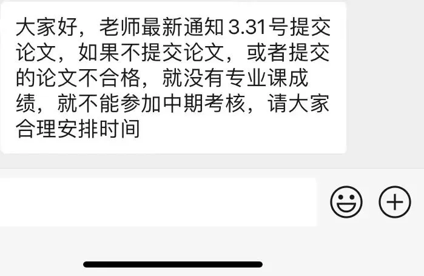

请相关部门及时关注并跟进问题。

## 1 历院讲座

“关于历院公众号发布的讲座汇总。24日发布的讲座中，有的报名参与的截止时间早于公众号发文章的时间，希望运营可以多操点心”

## 2 宿舍

## “投稿寝室主管部门：

早上吹风机能不能提前至7点，现在天亮的越来越早，起早跑步、实习的同学很多8点前就出发了，寝室吹风机属于违规电器无法使用，再加上洗漱间的吹风机8点才通电，早上洗头的同学很痛苦，只能顶着湿漉漉的头发出门。”

> “（良乡校区）近期宿管因各项工作频繁敲门“请求”进学生宿舍，对大家生活带了些许不便。宿管阿姨非常客气礼貌，时间也都是在上午九点左右，或者下午两点之后，但是博士阶段很多同学的作息时间可能各有不同，这一个月以来因为消杀、贴标签、安全检查等事项要求进宿舍，我们感觉私人空间有些许被冒犯到。如果是必须是由的话，可否尽量攒在一起进行？时间可否安排得更合理些？”

> “投稿良乡校区，最近宿管有事没事就要逛一下宿舍，次数明显增多，今天安全检查明天清点人数。这些事情按理说是每学期的常规操作，难道不能一次性全都做好吗？非要跑好几趟，既麻烦宿管又麻烦学生，社科大的行政就只会以低效低能来恶心大家吗？”

## 3 食堂

> “一食堂：最近是怎么回事？前天有同学投稿肉疑似槽头肉，昨天在食堂的菜里吃出了毛，还有一个同学早上在饭里吃出虫子？请问，你们良心何在？我们付了钱就给我们吃这个？一食堂如果不做出回应不整改，至少我是不会再吃了”

（见《[【读者投稿】渠道是否畅通](https://mp.weixin.qq.com/s?__biz=Mzg2MjcwNzQ1Mw==&mid=2247487830&idx=1&sn=c364004cf05d34928b5c672408f74fb8&chksm=ce029ac4f97513d22873a21b3b36632d1338131d9ade620480c60a2c0f8b7011673e51ea280d&scene=21#wechat_redirect)》第1条）

## 4 中期考核

> “对于中期考核，我有一个想法。在我刚来社科大的时候，当时还是疫情。张政文校长给我们开会，告诉我们他的办公地点，说如果有事情就去找他聊，他随时欢迎。我可以把近期大家的社论上发表的言论以及投票结果整理出来，做成一份文档。就是不知道有没有愿意同去的，如果大家有其他想法和建议也可以都去说说，咱们人多一点会更全面。如果有本科生想就宵禁去聊一聊的，也欢迎加入。”

> “最近对中期考核的讨论好像只是博士生不满一样，之前那个投票居然只是投支不支持取消2022级博士生中期考核。硕士都没法投，一方面不是2022级博士，但另一方面又不是跟自己无关。硕士也是希望取消中期考核的好吗？学校规定毕业论文开题要在中期考核之后，所以开题一般要到研三上学期了，这是我见过最晚开题的学校。但是研创计划又有申请时需要开题报告的规定，并且还优先支持研二，博三的学生，但这些人在申请研创项目的时间段内绝对开不了题，所以只好在结项时补交，这难道不是学校的政策在互相打架吗？来社科大的这段时间，给我的感觉是政策制订得轻率，执行不合实际的时候又只能随机应变。奖学金的事儿就不提了，校内的各种社团活动加分，出去参加学术论坛不加分，硕士要像研究员一样发c刊才能加分。最近科研处还给报研创计划的同学请学部委员开了一个“学术大家谈人文社科研究”的系列专题培训，这里不是对老师有意见，只是有些疑虑。这个培训不是给一个专业开的，那老师能讲多深吗？科研处是出于什么目的办这个培训呢？担心同学对项目无法入手？无法结项？报了研创计划的同学都提交了申请书，其中应该有研究计划或思路吧，如果能够立项成功为什么会有这种担心呢？还不如尽快开个会说明一下如何获得经费，不久之后就有一个论坛要参加还想问下如何报销呢。”

> “（因投稿人声明撤稿，此条稿件作废）中期考核投稿。为了上赶着凑学校中期考核的要求，财经院突然今天发了这个通知。一周内必须交上四篇学术论文，交不上或者不合格都直接失去参加中期考核的机会。虽然这四篇论文是上学期布置的，但有几个博士生有能力在短短几个月时间内写出前沿文献综述+微观金融+金融计量+DSGE分别为主题的四篇学术性文章？最后逼不得已赶进度花大量时间去糊弄去抄交上四篇学术垃圾。然后这个通知的时间是不是也太突然了。都不想多说什么了，毕竟社科大什么魔幻的事情都会出现。”

“也想针对吆喝大家投票中期考核的某同学，说几句鄙人了解的情况和看法。据说这位作为曾经一脚踢坏宿舍闸机（不知最后赔偿了没？）的高人，实乃本校硕士毕业，硕博连读后要挟学院以硕士三高成绩免修了博士三高（也不知免修成绩按什么规则计算的），咱学院对待本校考上的学生就可以如此无原则无底线袒护吗？拿着这种免修的成绩也能和我们一起申请奖学金吗？当同学们都在上三高课的时候，自己却高枕无忧。现在要中期考核了，是担心自己过不了吧？假公济私利用大家都不想考试的心理为自己赚吆喝吧？

窃认为中期考核不应该成为学校和学生对立的手段。211、985高校绝大多数实行这个政策，有的高校笔面结合，有的高校实行末位淘汰。不是要建设一流文科大学吗，连中期考核都取消了，还能一流吗，恐怕二流三流都算不上吧，哈哈。建议学校考虑咱们的实际情况，科学合理优化中期考核政策，而不是简单的一刀切，有人闹一闹就取消。对这种漏网之鱼最好的方式就是末位淘汰，不然将来走出去也算是“社科学子”，丢不起这个人啊！”

> “入学近两年的观察，加上之前对社科院研究生院声望的长期耳闻，感觉从博士二外到中期考核都是社科大闹，还不如不办啥社科大，保持一种特色，目前的这所所谓的大学做不好行政等服务工作，还不够捣乱的！这种大学办它作甚！？怪不得这所谓的大学成立后，还有研究生毕业后只称自己为社科院研究生院的学生，不提什么社科大。”

（见《[【读者投稿】渠道是否畅通](https://mp.weixin.qq.com/s?__biz=Mzg2MjcwNzQ1Mw==&mid=2247487830&idx=1&sn=c364004cf05d34928b5c672408f74fb8&chksm=ce029ac4f97513d22873a21b3b36632d1338131d9ade620480c60a2c0f8b7011673e51ea280d&scene=21#wechat_redirect)》第3条）

## 5 沟通渠道

“校长信箱还是有人回应的（不是每一条），但不管是校长信箱还是接诉即办，哎！解决的都是鸡毛蒜皮的小事，任何触及实质的东西都改不了。

中层推诿成性，态度很好，事事有回应，但不怎么改（当然，有些是客观环境改不了）。

这个管理真是挺令人迷惑的，就感觉已经陷入了拳头打棉花状态，没有一个高效且合理运转的行政机器，所有人都在应付，这个样子下一届双一流也评不上……不如把行政承包给隔壁北理工吧，专业的人做专业的事。

ps：求求有些人不要再装“学生”扰乱视听了，学生已经被折腾的很惨了，问题不解决，光搁这跟学生打舆论战，而且特别擅长搞一些话术，把学校的管理“菜”变成学生“菜”，挑拨学生间的对立，这对社科大有什么好处？？？

问题解决了，口碑自然变好，希望把精力用对地方。”

（见《[【读者投稿】渠道是否畅通](https://mp.weixin.qq.com/s?__biz=Mzg2MjcwNzQ1Mw==&mid=2247487830&idx=1&sn=c364004cf05d34928b5c672408f74fb8&chksm=ce029ac4f97513d22873a21b3b36632d1338131d9ade620480c60a2c0f8b7011673e51ea280d&scene=21#wechat_redirect)》第4条）
