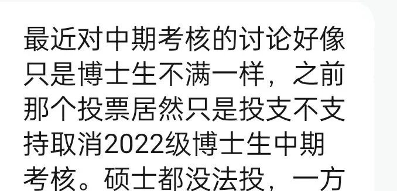
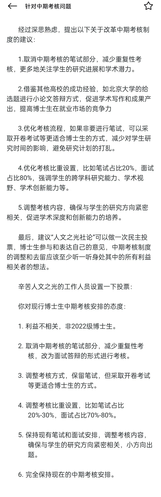
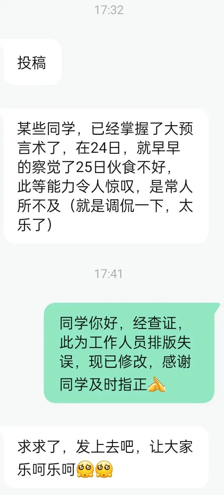
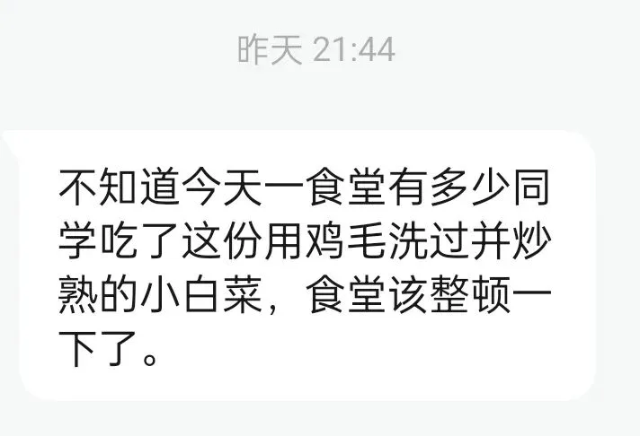

人文之光社论关注到有读者朋友对近期稿件存在一些疑问，现说明如下。

## 1 投票问题

有读者朋友反映2024.3.23期稿件投票只针对博士生，但中期考核涉及范围较广，稿件疑似偏颇。

（见《[【读者投稿】中期考核讨论深入](https://mp.weixin.qq.com/s?__biz=Mzg2MjcwNzQ1Mw==&mid=2247487824&idx=1&sn=b747e58e6e764dc4d4b73a90b7504c0e&chksm=ce029ac2f97513d445c9dba484c15bb3d7c79f064fe75df06de0f28a8889027e709a98e252c8&scene=21#wechat_redirect)》）

实际上，2024.3.23期稿件的投票是投稿人投稿内容，公众号秉持读者导向的原则，依照投稿人稿件设置投票。

只是出于节省版面的考量，在排版时并未将这个部分排入内容，造成了误会。

## 2 排注问题

有读者朋友反映2024.3.24期稿件排注出现了失误。

（见《[【读者投稿】渠道是否畅通](https://mp.weixin.qq.com/s?__biz=Mzg2MjcwNzQ1Mw==&mid=2247487830&idx=1&sn=c364004cf05d34928b5c672408f74fb8&chksm=ce029ac4f97513d22873a21b3b36632d1338131d9ade620480c60a2c0f8b7011673e51ea280d&scene=21#wechat_redirect)》第1条）

（说得好，奖励社论君上去丢人）

在读者朋友指正后社论君（大预言家）瞳孔地震之余立刻翻看了相关内容。后经编辑部查实并讨论，认为该问题的确存在，系当期排注失误，我们已在当天的稿件中进行了修改，现相关谬误已修正。

经核实，原稿件中并未有时间相关字眼，只是排版时为了方便读者朋友们更好理解一食堂（3.23烂3.24也烂）的问题全貌，所以加上了注。

借此声明两件事。公众号没有预言家的存在，我们也不知道食堂以后还烂不烂了，本公众号不是社科大神秘学最新同好会，望周知；稿件中若出现任何小号字体内容，如无特殊说明均为公众号人员排版时自己加注。

（犯下这种失误，社论君你大脑不会发烧烧坏了吧）

图一乐之余，公众号全体成员在此郑重向所有读者朋友致歉，我们将会检讨整改，避免此类问题的再次发生。

没有批评就难以进步，公众号全体成员也借机再次感谢对公众号相关建设提出疑问的读者朋友们。创办公众号难免会遇到这样那样的问题，而正是在大家的鞭策监督之下，公众号才会越办越好。
