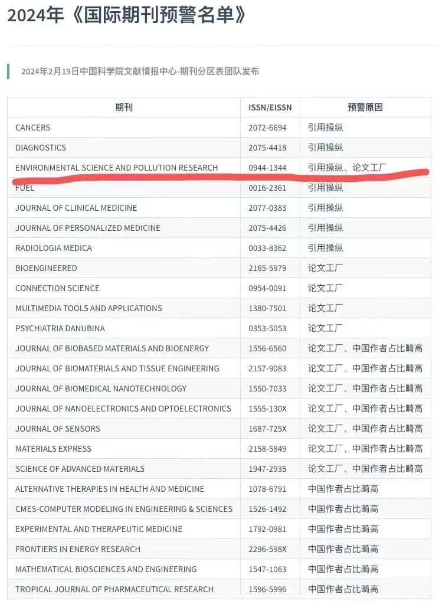

请相关部门及时关注并跟进问题。

## 1 科研问题

“投稿科研成果奖励：学校学生科研成果奖励中竟然有中科院预警期刊，希望学校科研处仔细辨别。”

## 2 食堂问题

## “食堂最近怎么都没有土豆丝啦？我一个山东人没有土豆丝可怎么活？投稿！”

“在大家都在反应一食堂安全问题时，接诉即办突然就突兀的出现表扬评论...不得不让人怀疑

一食堂卫生安全问题到底什么样，大家都心知肚明。也不要说一食堂很实惠就可以不注重食品的卫生安全，实惠不应该不安全的借口。”

（见《[【读者投稿】混沌的管理 魔幻的校园](https://mp.weixin.qq.com/s?__biz=Mzg2MjcwNzQ1Mw==&mid=2247487856&idx=1&sn=91572440859906cc016897bbcf507bfa&scene=21#wechat_redirect) 》第3条）

## 3 宿舍

> “社论君好，想和投稿3.25第2条的同学说一下。宿舍住着很多人，不是每一位都能早上7点起床的。前一天晚上洗好头，吹好，第二天早上头也不会油的，还是很干净整洁。作为一位住在吹风机附近的同学，真的完全不同意吹风机早上7点开始。”

（见《[【读者投稿】混沌的管理 魔幻的校园](https://mp.weixin.qq.com/s?__biz=Mzg2MjcwNzQ1Mw==&mid=2247487856&idx=1&sn=91572440859906cc016897bbcf507bfa&scene=21#wechat_redirect) 》第2条）

## 4 中期考核

## “对对对！从来没听说过硕士还要中期考核的，不知道官大爷从哪学的。

博士中期考核是各高校都有，但是像社科大这样考一级学科的也是离谱。

这些完全偏离常识的事情在社科大堂而皇之的施行，并且不骂到一定程度不改，社科大管理层真该好好反省反省了。

其实以前研院也不咋滴（当然，没有那么折腾学生），除了刚开始建院那段时间，后面是越来越不管学生了，培养的好不好全看导师个人，现在大学只是把问题暴露出来了，也未尝不是一件好事。社科院的名气来源于导师，但是培养学生上那是真的拉胯。”

> “一看到社论上有人说：“怪不得这所谓的大学成立后，还有研究生毕业后只称自己为社科院研究生院的学生，不提什么社科大。”不禁狠狠共鸣了。出去开会介绍自己，基本上都说是社科院XX所的学生，有认识导师的就会聊几句，根本不敢提什么社科大，不然都没人和你说话。之前和人大、北大的同学聚餐，有些不明真相的同学说社科院怎么样怎么样，自己也觉得与有荣焉。就有一次一个北大的同学席间提了好几次社科大如何如何，当时那种屈辱感和大家异样的目光，虽然有些搞笑的小作文写得很夸张，但是当时真的，一点都不夸张。”

“自3月9日至今，社论几乎每天都在更新关于研究生中期考核的讨论，这几天以来言辞越来越激烈，“沉默”地阅读很久后还是想说几句直抒胸臆的话。首先自己是一名研究生。研究生中期考核（综合考试）尤其是博士研究生的中期考核其实是一项一流高校已经普遍执行的培养工作规定（详见公开资料《清华大学攻读博士学位研究生培养工作规定（2019年版）》第十五条之博士生资格考试、《北京大学博士研究生培养工作规定（2022年版）》第七条之学科综合考试、《中国人民大学研究生手册（2023年版）之学科综合考试》）。高校相关之规定论述如下：“博士生资格考试是正式进入学位论文研究阶段前的一次学科综合型考试。资格考试重点考查博士生是否掌握坚实和宽广的学科基础和专门知识；是否能综合运用这些知识分析和解决问题；是否具备进行创新性研究工作的能力。资格考试通过后方可进行论文选题报告”。

若还是有疑惑，详见《国务院学位委员会 教育部关于进一步严格规范学位与研究生教育质量管理的若干意见（学位〔2020〕19号）》第十三条之“坚持质量检查关口前移，切实发挥资格考试、学位论文开题和中期考核等关键节点的考核筛查作用”、第二十六条之“国务院学位委员会、教育部加强运用学位授权点合格评估、质量专项检查抽查等监管手段，省级学位委员会和教育行政部门加大督查检查力度，加强招生、培养、学位授予等管理环节督查，强化问责”、第二十七条之“国务院教育督导委员会办公室、省级教育行政部门进一步加大学位论文抽检工作力度，适当扩大抽检比例。对连续或多次出现“存在问题学位论文”的学位授予单位，加大约谈力度，严控招生规模。国务院学位委员会、教育部在学位授权点合格评估中对“存在问题学位论文”较多的学位授权点进行重点抽评，根据评估结果责令研究生培养质量存在严重问题的学位授权点限期整改，经整改仍无法达到要求的，依法依规撤销有关学位授权”相关规定要求。中期考核（综合考试）的必要性不言而喻，结合近年来论文抽检上级管理部门对培养环节的督查等相关结果来看，研究生管理严抓教学培养的紧迫性更是不言而喻。严格执行中期考核制度是必然的规定动作，结合实际做细节优化和局部调整应当是学校办学的自主权，所谓投票和民意的意义并不明晰。

以上内容可能是普及概念性质的，研究生培养管理可能存在着这样或那样的问题，请研究生同学尤其是博士研究生同学拥有基本的调查研究素养，分析一下同类专业相关高校具体学院（系）如何执行的中期考核政策，一味地抱怨，可能不会有对学校和对自己较好的结果。当然也不排除有昨日社论中提到的个别硕博连读生因为自己离开课程学习过久后，关注到去年奖学金评定舆论的基础上，想要以此“撬动”中期考核规定改变。倘若真的改变，“沉默”的同学们可能真的会无语，也会让关注并且了解内情的人们感到荒唐。当时奖学金评定细则的舆论是为了改变不合理的早就不适应学校引导培养学生人才的学工口相关部分规定，而严抓教学做好中期考核也是为了改变早就不适应学校引导培养人才的教学口相关部分规定，弱化忽视中期考核才是开“历史倒车”。说句不好听的要是哪个学位点给取消了，搅动社论正常建言献策的人、只看舆情不看实际的人真的要背负历史责任。

当然，上述分析是想泼泼冷水，有些发言可以私下说说，严抓教学确实使大家搞小论文的时间少了，维护自身受损的利益可以理解。但不要公开地搞得小院博士生都是“嘴强王者”一样，让真正思考过中期考核这个问题的师生们耐心进行调查研究后向有关部门提出建议亦或是在社论上发言。自己也没有太多的研究，不敢妄言。顺便想说一句，不管是博士研究生还是硕博连读生，老研院“春风第一枝”的荣誉和历史传统是想让大家牢记要做有家国情怀、学术底蕴的哲学社会科学研究人才，不是让乱开炮，搞历史虚无主义说“社科大影响了老研院，这种大学办它作甚”这种话，说实话真的不想读带有大学章印的同学们也欢迎尽早申请退学，帮助完成上级管理部门之“宽进严出”要求。还是想说，“没有切实调查尽量谨慎发言”。例如直觉上看发了论文也不一定代表你符合相关研究的基本能力了，希望大家能帮助给中期考核规定“打好补丁”，不要让致力于搞好小院研究生培养质量的师生们“心灰意冷”。”

“回“入学近两年的观察”这个稿。这个稿给人一种所谓清澈的蠢的感觉。明眼人都不难看出，这种言论不仅无助于中期考核问题的解决，反而让人徒增误会，让真正的问题遮蔽不显，令无尽的误解分化力量。

但是这种人能说他坏吗？想来也不是，因为它仍然指涉而非回避了大家共伐的问题。这种言论不妨被称之为不正确的真心话，是较为表浅的批评方式。从防止对立的层面来说，它的确是不正确的；但是它又的确是真心的，即在宣泄对学校发展现状的不满上是真心的，因而其实它最终和大家所试图评的问题是一致的，那就是为何现今的社科大会如此之烂。当一番话陷入既假又真的处境之中时，实际上是想以谈论的方式谈论那些本来无法谈论的问题。那么一个深层的空间由此打开，只有在一种更高维度上进行深层分析，才能拆解出这类不正确真心话背后的东西。回到这番谈论，整个矛盾其实喻示着向一些我称之为社科大的“敏感问题”、或其他人称之为深层次的问题的折越，不妨稍作分析。

不再多言，让你我回到校史校情中去。吊诡之处实际在于较之于研院社科大却拥有行政。曾经的研院几近没有行政，现在的社科大拥有很烂的行政。社科大的确拥有水平很烂的行政，这点毋庸质疑、无需辩护；但曾经的研院则是一个没有行政的状态。老研院的辉煌部分和当时的行政管理无涉，有些可能和当时的基本无行政有关。

首先必须且一定要指出，在我国现行高等教育体系的大环境下，拥有行政管理是必然前提，打造高水平的行政管理才是问题要害。生且走在大路上的人就只能昂首阔步地向前走下去，在路上感觉到自己变成实际上而非名义上的一流行者并拥有一流双腿，这应该是行者自己能做到的事情。所以现在要诊断的是学校为什么走不动道了，为什么走起来这么别扭，为什么锻炼不出这样的体魄。在这个拥有高水平行政管理的前提下，似乎老研院行政曾经的状态并不能是一个稳态，而且其实也并不值得怀念。

为什么这么说，让我们再来构想一下什么叫高水平的行政管理：知道自己什么需要管，什么不需要管。所谓“知道”，对于一所人文社科类研究性大学的行政而言，想来应该是理解什么是大家需要的，什么是大家不需要的，尊重科教规律，摆正自身位置，激发广大师生教职工的内生活力，去做一个敢于抓大放小的空间建造者。“需要管”，意味着能够打开一个空间；“不需要管”意味着不是框死这个空间中的一氢一氧。如果大家能够在这个开放的空间中尽情而非时刻想着行政指导命令应该怎样地呼吸，那么一所高校的辉煌自然会慢慢积淀。

对于老研院这种缺乏管理的状态下，不能否认有些本来不该管的事情恰巧在无行政的状态下没有出问题，所以现今社科大的弊病当时很少见，但是当时的一些弊病在假如有管理的状态下其实也不会出现了，毕竟有所管理了。

现今的社科大则面临一个低水平行政管理的问题。最大的问题是它意识到不管不行，但不知道怎样管才行，而且还莫名警惕与自信，把所有提醒这样管不行的声音都打成妄图夺走自己权柄的阴谋，并立基于此进行管治思考。笔者无疑细究这种不安全感背后那强硬撮合下深深裂痕的历史心理，或者为某几方拉一下偏架，只是想指出现在这种管法是不行的。目前看下来就是行政管理人员和教职工学生之间相互折腾，每个人都很累，有些人在其中趁乱上下其手，但学校整体起色不大，甚至走向倒退，走向并不实际符合一流文科大学的情况。因为原本没有的问题现在有了，一些原本没解决的问题现在还是没解决。究其根本，在于行政没有那么高的水平，管但是乱管理的情况非常常见。学校需要有懂高水平高等教育的人来进行管理，无论后勤教学抑或其他。

同时还要指出的是，目前研院和学校之间还有很多弥合上的问题，概言之就是很多原本没有问题的地方被平添管理了，但其实需要整合并统一管理的地方没法整合进来，希望这不是无能为力的结果。

最后想要指出的是一种时空会以可能性织就一个领域，在领域内的任何人因此都在这个领域内关联。在社科大这个领域之内，所有事情都是关联起来的。任何部分都不可能逃避任何问题；且解决任何问题都是对敏感问题有益回应。比如中期考核这个问题，看似与本与硕博的一部分无关，但难道社科大的本不会有念社科大硕博的情况，还是社科大的硕博不会有自己升级的那一天？再比如宵禁问题，看似与硕博无关。但谁又敢保证一直这样下去哪天闸机就不会对大家同样封闭起来？而这些问题，学校中每一个“小”问题其实背后都会有某些敏感问题的体现，解决这些小问题实际上也是大家一起在拆解深层次问题中做出了一个探索。说到底，大家没什么根本性的歧视或分歧，每个已经是或者将要是在这个领域内相遇的人，谁不想要自己的母校是一个加分项，是一个能在别人面前骄傲的理由呢？”

（见《[【读者投稿】混沌的管理 魔幻的校园](https://mp.weixin.qq.com/s?__biz=Mzg2MjcwNzQ1Mw==&mid=2247487856&idx=1&sn=91572440859906cc016897bbcf507bfa&scene=21#wechat_redirect) 》第4条）
