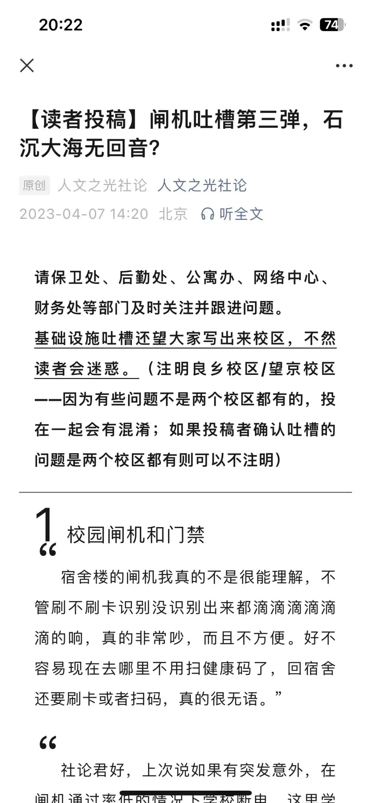
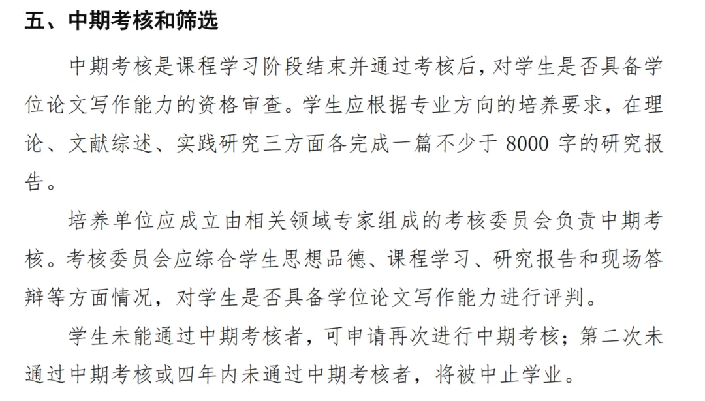

## 请相关部门及时关注并跟进问题1 闸机问题

> “去年花了几十万，争议非常大的闸机，还不到一年，现在很多同学进出门都识别的特别慢，有时候半天还出不来，还要宿管阿姨帮忙用遥控才能开，当时负责的人不出来解释一下？”

## 2 自习区域

> “最近学校将增瑞幸非常高兴，但是强烈希望瑞幸和学校方面不要改动瑞幸旁边的自习区域。因为众所周知我校的自习资源比较紧张，而这里又是为数不多的气氛较为舒适自由的半开放自习区域，作为一个比较容易感到紧张焦虑的学生，我非常喜欢这片区域带给我的舒适，万望瑞幸和学校方面不要对这片区域进行改造，比如减少座位、改变布局等，根据经常在这里自习的同学的反馈来看，这里目前的布局大家都比较满意。而对于社科大第一家咖啡，社科大的学生一定会鼎力支持瑞幸进驻，即使不设专门的咖啡座也不会影响瑞幸的生意。还希望学校能从学生实际出发，不要改造校园驿站的自习区域”

> “今天学校方面的人（不知是什么部门）突然来到校园驿站的自习区域，开始改动桌椅布局，声称是觉得布局太乱，座位拥挤，然而这些人完全没问过在这里研讨自习的同学的意见，没有提前规划过，来到现场才开始现想现搬，看他们搬动的成果，位子变少了，中间作为隔挡的柜子被移走到墙边，整个空间变得一览无遗，互相之间的干扰性增强了，试问这是达到什么整齐、增加位子的效果了？！还增加了一个所谓的值班人员位子，很大一个台子占了原本好几个研讨的位子，声称学生可以找这个台子的人咨询，试问这里会需要什么咨询？！诉求：中间隔挡的柜子恢复原位，咨询值班台子撤走，还给学生一片清静。在这里研讨的是学生，不是某些一拍脑袋就乱挪东西的行政人员”

## 3 中期考核

> ““一看到社论上有人说：“怪不得这所谓的大学成立后，还有研究生毕业后只称自己为社科院研究生院的学生，不提什么社科大。”不禁狠狠共鸣了。出去开会介绍自己，基本上都说是社科院XX所的学生，有认识导师的就会聊几句，根本不敢提什么社科大，不然都没人和你说话。之前和人大、北大的同学聚餐，有些不明真相的同学说社科院怎么样怎么样，自己也觉得与有荣焉。……”—-关于这一条真的是狠狠共情了。在社科大四年真的是从最开始的满怀期待一点点到丝毫不抱希望了，科教融合得乱七八糟，能够看出社科大想要一把子包揽研究生的各项任务，但却永远是事与愿违，每次都是自己发让人心梗的通知还要求即时反馈，但凡少一点拖延多动动脑子为老师学生考虑一些都不至于这样。活干不明白不说，还连累所里的系秘老师多了很多不必要的工作量。学生处行政处要是老师活干不明白就别干了吧，哪怕是每学期招几个学生这点活早都干得明明白白了。”

“昨天那个大言不惭地说：“研究生中期考核（综合考试）尤其是博士研究生的中期考核其实是一项一流高校已经普遍执行的培养工作规定”，你搁这避重就轻啥呢？北大确实有博资考，但是人家入学前就给你通知到位了，参考书目也划定了，还有一些985，人家是通过面试的方式来考核。你看看你社呢？现在都tm还有一个月了，屁都没有，出题人有吗？考核范围有吗？参考书目有吗？你让我们考啥呢？一个一级理论课、二级理论课，你搁这套娃呢？纯属胡整嘛。

再者说了，你社就是个破四非，装什么一流大学啊，一流大学就像你这样的？你先把双一流评上再说吧。领导班子天天实事不干，就知道胡整，就你这还叫唤啥呢？还沉默的同学，咋了投票结果不能给你展示一下没有沉默的大多数吗？还是你非要装瞎呢？很显然，再这么搞社科大是吃枣药丸。”

“近日，关于学校博士中期考核制度的讨论引发了广泛的争议。在这场争论中，一位辩护者试图以“每个学校都有中期考核”来为笔试形式的政策辩护。然而，这种论点存在着严重的逻辑漏洞和混淆概念之处，我将在下文中提出理性的反驳。

首先，辩护者提到每个学校都有中期考核，试图将学校之间的差异化为中期考核形式的合理性。然而，他忽略了一个关键事实：虽然每个学校都有中期考核，但考核的形式却存在多样化。举例而言，像我们学校采用的笔试加面试的形式与其他学校采用的面试、小论文答辩等方式有着本质的区别。

您所提到的清华大学，我找到了清华大学某学院具体的中期考核办法：资格考试应该在入学后三年内完成。资格考试内容：每个博士生提交1份6000-10000字的项目研究立项报告并进行答辩，成绩为百分制。官网链接https://life.tsinghua.edu.cn/rcpy/yjsjy/pyfa.htm#:~:text

北京大学某学院中期考核具体方式如下：

链接：https://grs.pku.edu.cn/docs/2021-06/20210618104532071494.pdf

肯定每个学校甚至每个学院都有不同的中期考核方式，但是有中期考核≠都是笔试加面试。望周知。

（就算有的学校同学采取笔试的形式，但是考察范围和考察方式也未必与社科大这种大而泛之的笔试有可比性）。因此，将不同学校的中期考核形式等同起来是不合适的，这种论点只是混淆了概念，无法为笔试制度的合理性提供充分的支持。

其次，我们必须认识到，博士生阶段的中期考核应该是为了评估学生的研究能力和学术素养，而不是简单地通过笔试来检验学生的记忆能力。笔试形式的考核容易使评价偏离了应有的轨道，无法全面地反映博士生的研究水平，只能考核“应试能力”。相比之下，其他形式如面试、小论文答辩等更能够客观地评估学生的研究能力和学术表现。因此，辩护者的论点缺乏充分的逻辑支持，不能为笔试政策辩护提供合理性。

综上所述，学校以理性和客观的态度对待这一问题，寻求更合理、更科学的中期考核方式，以推动学术研究的健康发展。

另外需要说明的是，这位辩护者试图贬低那些对制度不满的同学，称他们“嘴强王者”“乱开炮”“没有切实调查尽量谨慎发言”。然而，他自己明显也是在闭门造车，没有研究过每个学校每个学院中期考核的细节，没有对该制度的不合理性进行深入调查和思考。相反，他不过是在站在学校管理者的一边，盲目地为一个违背民意且不合理的政策辩护，这种行为简直令人吐血。您真的能代表“沉默的大多数”吗？”

“这两天看到硕士博士同学一直在讨论中期考核，但是说句实话，学校的政策不会因为你们吵两句就改变。中期考核是一定要推行的，咱们看看那些985高校，很多都有中期考核或者博资考，学校通过这种方式，也是增加学校的治学水平。一说起社科大，大家就觉得哪里哪里不好，社科大要提升办学实力，大家又疯狂阻挠，可不能这么玩啊。

就中期考核而言的话，一定是要制定标准化的考核方式。一级学科、二级学科都是要兼顾到的，具体的占比呢，可以由学院制定细节，出题人的名单，也要尽快下发。大家也不要觉得，一级学科太宽泛，二级学科离得太远什么的，你想想你以后去大学教书，人家学生提问一个问题你都回答不上来，那多丢脸不是。

另外的话，关于中期考核的淘汰率呢，也是应当要控制在合理的范围内。不能说，一个不合格的都没有，那中期考核就失去了意义。也不能说，不合格的人太多，影响到大家的正常毕业，得不偿失。总之呢，各方面要协调好，共同促进中期考核的规范化、标准化。大家就安心备考，不要想东想西，反而浪费时间。”

（见《[【读者投稿】一种屈辱感？》](https://mp.weixin.qq.com/s?__biz=Mzg2MjcwNzQ1Mw==&mid=2247487872&idx=1&sn=9b3bde85a175b5d6c01240b36ca32c4c&scene=21#wechat_redirect)第4条）

## 4 切割感

“近期看社论，发现又有一种切割的风气。原先是中青和社科大本科切割，现在又是老研究生院和社科大切割。照这么割下去就再按照高考分切割？

割来割去真没意思，无非是想证明曾经的自己多厉害了。”

（见《[【读者投稿】一种屈辱感？》](https://mp.weixin.qq.com/s?__biz=Mzg2MjcwNzQ1Mw==&mid=2247487872&idx=1&sn=9b3bde85a175b5d6c01240b36ca32c4c&scene=21#wechat_redirect)第4条）

## 5 食堂问题

“食堂的熟油辣椒能不能换回以前的？作为四川人真的很难接受现在这种细的辣椒，一点都不香”

“投稿：今天食堂一楼的荷叶蒸鸡块，打包回宿舍打开一看瞬间震惊！饭堂能不能好好管管卫生，我6块钱打的菜把我看吐了我真服了。”

（见《[【读者投稿】一种屈辱感？》](https://mp.weixin.qq.com/s?__biz=Mzg2MjcwNzQ1Mw==&mid=2247487872&idx=1&sn=9b3bde85a175b5d6c01240b36ca32c4c&scene=21#wechat_redirect)第2条）
