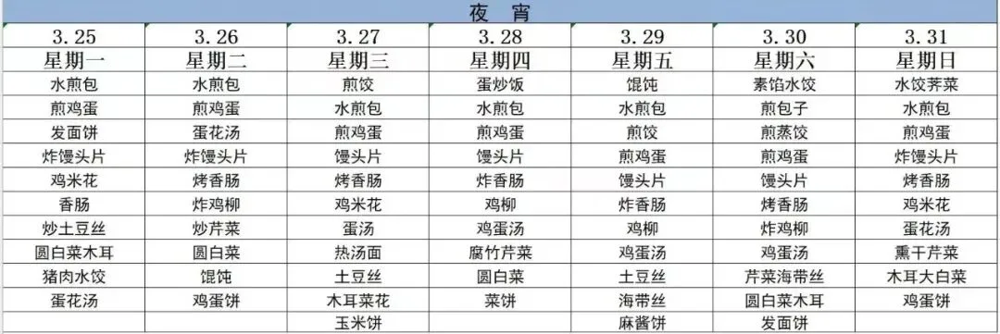

请相关部门及时关注并跟进问题。

## 1 运动会

“学校这一学年度都不举办运动会是为了偷懒吗？体育是社会科学的一部分，但从历年的情况来看，社会科学院大学对于体育方面的关注度和重视程度相比于其他高校有着较大的差距。每一学年一次运动会是每一个学校（不管是小学、中学还是大学）的惯例，既是一个学校常规惯例的大型活动之一，也是体育教学重要的一部分。

去年的运动会本在四月份进行，由于大风蓝色预警（虽然当天也有其他高校的运动会依旧正常进行），调整到了炎热的六月，开幕式和闭幕式取消，由于天气过于炎热，参加的同学相比于报名少了一大半，顶着烈日参加比赛的同学身体也难受，还有部分同学皮肤晒伤。运动会后相关负责老师告知学校后面准备在秋季举办运动会，但在本学年度上期却并没有举行。截止目前看来本学年度下期也还没有进行运动会相关的组织安排工作，难道更改日期就可以暗中偷懒一学年不举办运动会吗？培养人文社会科学拔尖人才的研究型大学对待学校大型体育活动如果是这种态度的话那可真是太令人遗憾了。”

## 2 食堂问题

“食堂：可以让食堂早上多准备一些早餐嘛，每次八点半左右，玉米、红薯、牛肉包这些全没了。八点半也不算很迟吧，希望食堂可以稍微多准备一些早餐备货～～”

“光好，这一周食堂都没有疙瘩汤，炸鸡块也很少，希望一食堂统计一下大家爱吃的宵夜品种，多多增加，毕竟午餐已经很痛苦了”

（见[《【读者投稿】失明的问题》](https://mp.weixin.qq.com/s?__biz=Mzg2MjcwNzQ1Mw==&mid=2247487884&idx=1&sn=af6fd75b409a90ba734cefb4b0a206e4&scene=21#wechat_redirect)第5条）

## 3 驿站桌椅

“刚看了下驿站这边，桌子摆的没什么问题啊，没有些同学说那么严重啊，你想讨论问题、自习都没问题啊，而且驿站本来也不是固定自习区。怎么就让你说得没法活了一样”

> “校园驿站研讨区相关。继昨天学校某些一拍脑袋行政人员来驿站胡乱改变布局之后，今天出现了保洁阿姨来同学学习的桌子边瞪同学不让学习的情况，说这里不是自习的地方。试问，学校里哪里是不可以学习的地方？试问，你们设置的占位子的大咨询台有一点作用吗？它该存在在这里吗？纯粹浪费人力物力！办好社科大，第一条件是保证好同学们的学习。现在却出现了这样奇怪的状况，让学生心寒”

（见[《【读者投稿】失明的问题》](https://mp.weixin.qq.com/s?__biz=Mzg2MjcwNzQ1Mw==&mid=2247487884&idx=1&sn=af6fd75b409a90ba734cefb4b0a206e4&scene=21#wechat_redirect)第2条）

## 4 中期考核

> “关于中期考核。最近关于中期考核的讨论很热烈，这里提供一个供大家参考的事件背景。近年来，某某部接连查验抽检本校硕博论文，发现质量极其糟糕。在这一情况下，校领导高度重视，展开了守护学位论文底线的整顿活动，其中，中期考核便是重点项目。换句话说，整顿中期考核的目的是为了学位论文的最终质量，因而，评价中期考核是否成效，得看它是否促进了学位论文的改善。聚焦这一问题，有助于集中讨论的火力。”

“针对最近社论讨论的中期考核问题，今天发了研究生中期考核延期的通知，希望学校研究的新方案是像不发新生奖学金奖学金那样把专硕排除在外。”

（见[《【读者投稿】失明的问题》](https://mp.weixin.qq.com/s?__biz=Mzg2MjcwNzQ1Mw==&mid=2247487884&idx=1&sn=af6fd75b409a90ba734cefb4b0a206e4&scene=21#wechat_redirect)第3条）

## 5 切割感

## “回应切割感。

其实自我认为从另一种角度来看也很好，师兄师姐其实也只是阐述了一个事实，我们提前认识一下外面的世界，早作准备也好，也可以避免对社科大的“幻想”和不切实际的期待。就算师兄师姐不说，我们在社会上也会亲身经历，他们说了等我们出了社会也会少很多落差感。

所以支持和期待本科毕业的师兄师姐多多分享自己的经历啦”

“我一直有个问题不太明白，学校为什么挂两个牌子呀？社科大和社科院研究生院，不是矛盾么？难道是因为各所在培养上还有一定的话语权么？现在研究生院明明是归社科大管理呀？可是最高明的管理不是无为而治么？既然老研院已经接近无为而治了，这真是大（计划）环境下的一朵奇葩！世外桃源！虽说培养出来的学生可能鱼龙混杂，但毕竟是能出虫，也能出龙呀！这不就是理想的教育生态么？自由生长，适者生存。后来办这个社科大，努力要把研院全面计划管起来，怎么不能把老研院的好传统继承下来吗？如果说老研究院一无是处，这不合逻辑和历史事实吧？现在的严加管理，怎么觉得这才是开历史倒车呢？照社科大这几年的发展史看，不禁让人怀疑，这真能管出来一个高水平的研究生院？当然，从博士二外改为选修看，学校领导还是从谏如流的。学校毕竟是学生的学校，学校不是管理者的学校，何况管理者是固定的，水平有限，而学生是流动的，水平正处于上升期，草鞋没样边打边像，所以学校特别是咱们社科大的发展，能听取学生们的呼声，大力吸取学生们的智慧，才是正确的发展之道吧？教学相长。匿了，谢谢！

看到今天有人提到中青政和老研院。补一句长期憋在心里的一句臆想的话：当初，让培养干部的中青政的老师来管理一群类自由主义的老研院。这配对，真的是绝了！哈哈，祝学校越来越好！匿了，谢谢！”

（见[《【读者投稿】失明的问题》](https://mp.weixin.qq.com/s?__biz=Mzg2MjcwNzQ1Mw==&mid=2247487884&idx=1&sn=af6fd75b409a90ba734cefb4b0a206e4&scene=21#wechat_redirect) 第4条）
