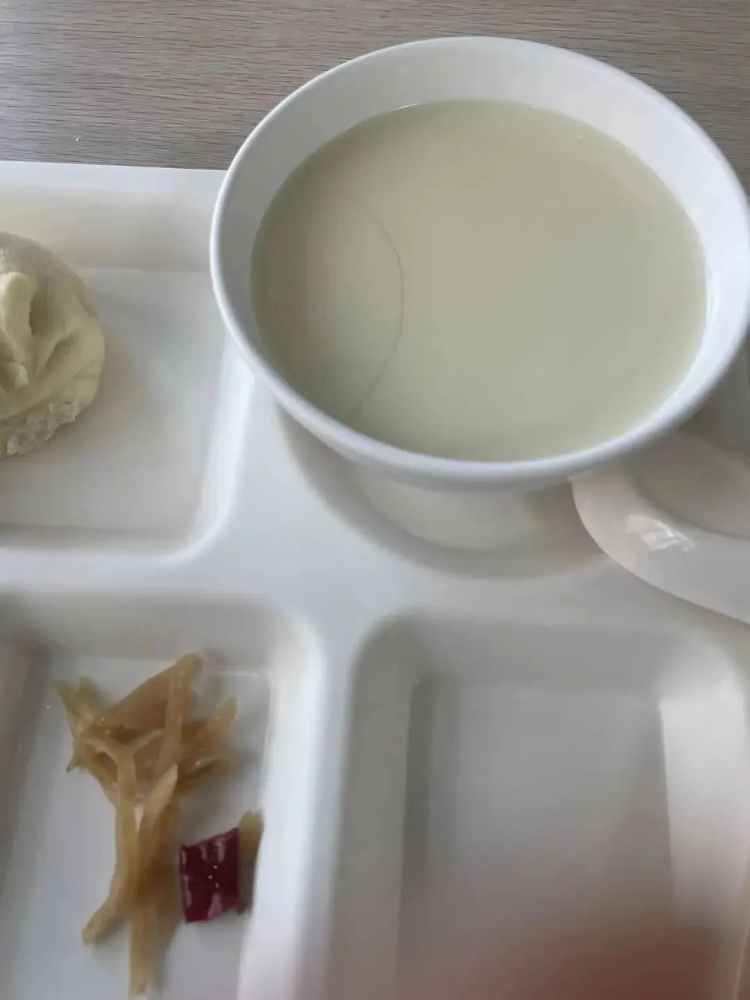

请相关部门及时关注并跟进问题。

## 1 马骨干学费

## “领导想想别拖了，2022级马骨干第一年所收的学费住宿费啥时候退？？？”

## 2 学校管理

“话说学校还真是随心所欲呀，政策说变就变，那合着只有21级的是冤大头呗，硕博连读三高，二外，中期考核，21级的每一项都经历了，当时也反应过不合理之处，结果学校置之不理，结果到了下一届就开始改，真是服了。能不能不要朝令夕改，每一级学生的命都是命，每一个学生的时间都是时间，不想总是被当做学校的实验品。

没有淋雨撕伞的意思，只是希望学校以后出政策能够谨慎一些，别总是拍脑袋，多少考虑点学生”

> “社科院下属这么多单位，也就是社科大事情最多。原因出在哪里？希望相关部门多反思一下。按照…要求办好社科大，已经过去多少年了，本科本科办不好，研究院研究院办不好，问题究竟出在哪里？在校的、毕业的学生出去都不好意思说是社科大的学生，都说是各研究所的。原因究竟是什么呢？”

## 3 中期考核

> “作为一名博士生，我认为中期考核是有必要的，也非常理解学校提高培养质量的初衷。不过，笔试确实不合适，尤其是一级学科笔试更不合适。现在，录取博士生都是看论文等申请材料，博士生就业看的也是论文。如果是想针对性地提高研究生培养质量，可以考虑小论文➕面试的方式进行。面试的时候，除了学术问题，老师可以针对小论文提出建议 ，这样既可以给学生压力，对大家应该也更有帮住。”

“看到社科大愿意整改不合时宜的政策，大家都很高兴。关于中期考核，我汇总了一下大家之前提到的，以及在社科大博士群里大家所讨论并形成共识的一些建议，以供参考。

首先，大家的诉求是一定要取消笔试。纵观全国，博士还以笔试形式淘汰学生的高校已经寥寥无几。北大的博资考，某些学院确实存在笔试，但是在入学前，北大就会列出书单和考核范围，博士生有一年的时间来准备。其专业性和深度绝然不是社科大所谓的“一级理论、二级理论”这种考研考法能相媲美的。既然我们目前还做不到，那就不如不做，否则既增加学生负担，也增加老师负担，还对大家都没有用。

第二，面试可以保留。在这个基础上，大家提出了两个看法，第一个是以汇报学习进度和博士论文指导的方式来进行。因为社科院很多老师采取放养的模式，导致学生在博士论文选题、写作方面存在较大问题。所以我们可以借面试这个契机和老师沟通确定自己的博论选题，对9月份的开题答辩也有良好的促进作用。第二个是以小论文的模式答辩。就自己博论方向写一篇小论文，其目的是让培养老师了解自己的写作和驾驭文献的能力。面试环节可让培养老师就此文章提出评析，这样做一是有助于同学们产出高质量的科研成果，同时也有助于帮大家把好开题关和博士论文写作方向。

总之，一切都是以学生的科研为基本导向，如果学生发文多、成果好，也能促进社科大在评选上的优势。”

（见《[【读者投稿】校园后勤疑问多样 教学管理讨论继续](https://mp.weixin.qq.com/s?__biz=Mzg2MjcwNzQ1Mw==&mid=2247487897&idx=1&sn=6842045d571eabef213a6a85830b14c7&scene=21#wechat_redirect)》第4条）

## 4 食堂问题

> “在这个中期考核被暂缓的普天同庆大日子，我想恳请大家关注一下3.24那天发的槽头肉那个事情……作为一个非常爱吃炒五花肉的人，已经恶心好几天了，希望能蹲到食堂辟谣，或者专家实锤，唉……服了哇”

（见《【[读者投稿】渠道是否畅通](https://mp.weixin.qq.com/s?__biz=Mzg2MjcwNzQ1Mw==&mid=2247487830&idx=1&sn=c364004cf05d34928b5c672408f74fb8&scene=21#wechat_redirect)》第1条）

## “一食堂的卫生条件真的令人堪忧。（本人是长头发）”

（见《[【读者投稿】校园后勤疑问多样 教学管理讨论继续](https://mp.weixin.qq.com/s?__biz=Mzg2MjcwNzQ1Mw==&mid=2247487897&idx=1&sn=6842045d571eabef213a6a85830b14c7&scene=21#wechat_redirect)》第2条）

