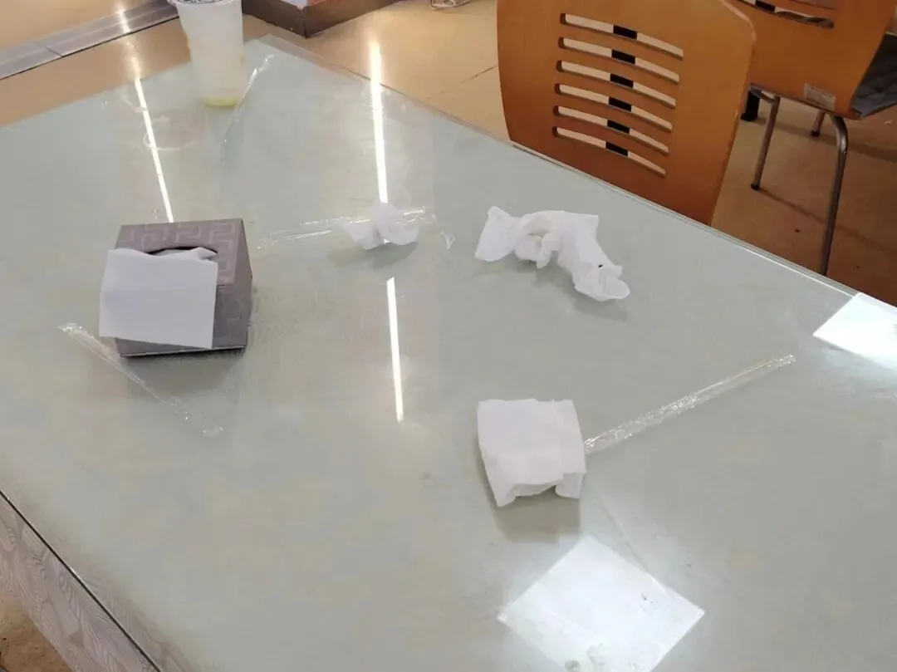
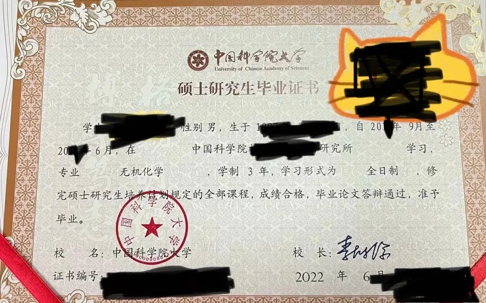
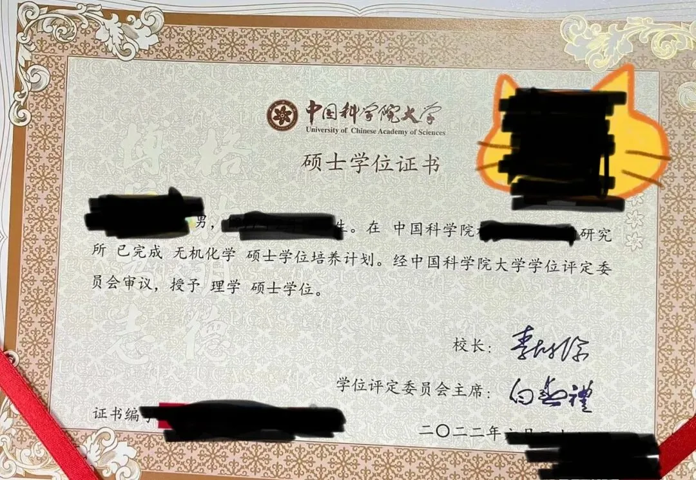

请相关部门及时关注并跟进问题。

## 1 待遇补助

“希望学校能对标其他高校，譬如邻校首师大，尽快提高博士生每月补贴。让社科大的学生不用为生活费发愁，潜心科研。”

“有谁能关心一下博士群体的身体健康和精神健康？身边很多同学一检查浑身是病，很多同学年轻轻轻就有三高等各种疾病了，还有一些同学有或轻或重的抑郁症状。社科大的博士补贴一个月1250，除了够吃学校的饭，真的穷！都二三十岁的人了，真的不好意思给家里要生活费，很多同学博士还出去做兼职。希望学校能够关心一下同学们，哪怕是精神上的。给我们创造一个自由的学术研究环境，让我们好好读几本书发几篇文章找个好工作吧。

另外，社科大本科分数线一直在下降，不要总是找各种借口。双一流没评上，建校晚，没赶上，毕业生没工作等等，那你学科评估都不敢参与，算什么？是的，自愿原则。除了你哪个学校不参与呢？？？谁都可以对不起，千万不要辜负本科弟弟妹妹对理想和未来的期待，他们值得！本科阶段是人生观价值观世界观形成的重要阶段，一定要尽全力给他们提供最好的条件！”

## 2 宿舍

> “小编好：想反应一个问题，洗衣房的小程序体验感太差了。到处是广告不说，最近还弹出来免广告特权（想法子赚钱？）。要知道学生们的钱都是家长们的辛苦钱，至于这么糟蹋吗？不知道学校后勤部对此有什么感想。”

## 3 食堂

> “你好，投稿。二食堂（风味餐厅）一直不怎么收拾餐桌，这种情况大概持续几年了。用餐高峰，餐桌使用率挺高的。一食堂这么多餐桌都能及时清洁，希望二食堂能顾及这方面～当然也呼吁同学们及时把纸巾等垃圾带走”

## 4 学位证书

> “建议我校毕业证 学位证 参考国科大的两证，添加研究所名，因为至少硕博事实上就是各研究所进行的深度培养，改革两证内容以此进一步推进科教融合，在肯定研究所与大学的培养成果的基础上，加强研究所与大学合作，并加强各单位校友的联系。”

## 5 博士面试

> “吐槽应用经济学院某专业博士生面试 通知时间为下午三点到七点半组织博士复试，本来面试到晚上六点之后已经是一个不寻常的事情了，结果复试开始是并没有负责老师进行有序引导，导致晚开场十五分钟。面试进行到中途（五点半时），有老师进来说稍微休息一下，之后又有老师询问有几位同学需要订饭，得知距离结束时间还早。有人询问九点之前能否结束面试，老师告知“争取吧”。 想请问该负责单位，如果明知面试时间长，为何要定在下午三点才开始面试，并且在原计划中没有预留供老师同学就餐时间。朝令夕改，这样的“机动调整”、“灵活处理”和“人文关怀”不要也罢。 最后，由衷感谢老师们在给面试老师订饭的同时，不忘为同学订饭🙏”

## 6 学校管理

> “对于昨天21级博士生同学的发言，我想说，学校领导和学生其实是两个割裂的群体。我们切不可抱有“青天大老爷”思想，认为学校领导天然地应会做好维护学生权益、保障学生学习生活。学校领导很多时候，并不了解学生的具体情况，因此这就需要大家的磋商、拉扯，才能促成事件向更圆满的方向发展。在此也感谢各位在社论上积极为中期考核发声的同学们，是大家的坚持不懈，发言、投票，才促成了学校向更好的方向发展，也保障了同学们的权利和时间。”

（见《[【读者投稿】原因是什么？](https://mp.weixin.qq.com/s?__biz=Mzg2MjcwNzQ1Mw==&mid=2247487908&idx=1&sn=f5e479e15fd066693e1ca6eda9d108dc&scene=21#wechat_redirect) 》第2条）
