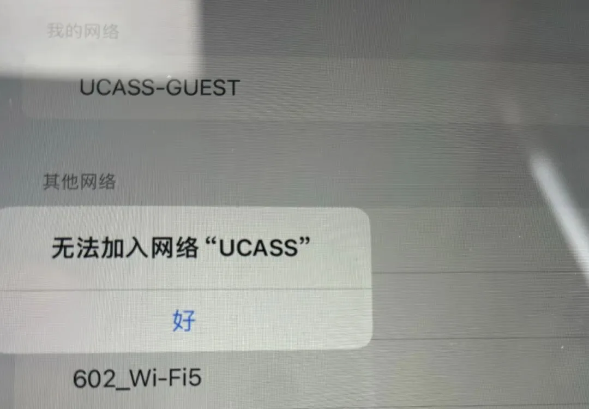
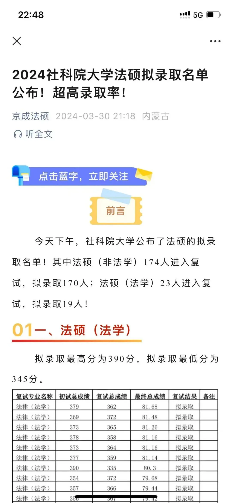
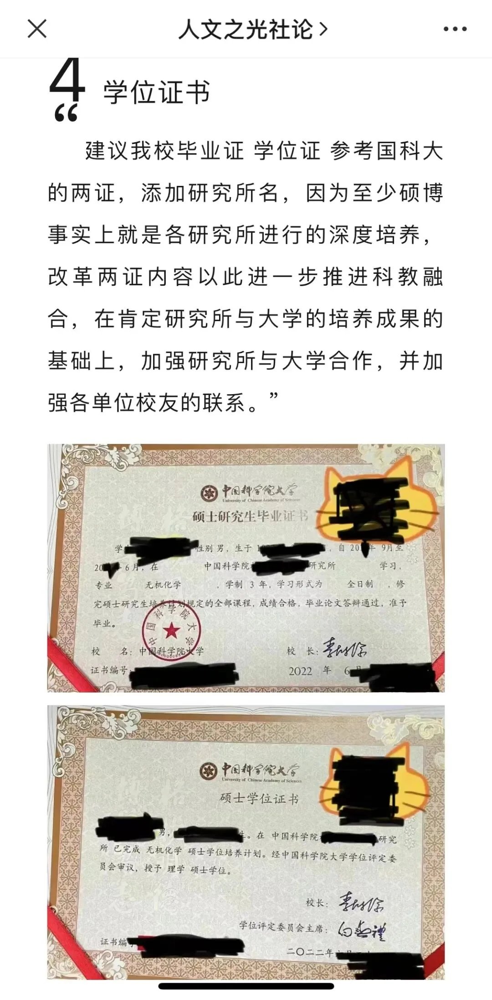

请相关部门及时关注并跟进问题。

## 1 科研奖励

## “投稿：去年科研奖励拖了半年直到年底才发，希望今年财务不要闹出什么问题”

## 2 课程问题

“今年规划评估处好课推荐怎么弄了三期就没下文了？这个每学期感觉不应该只是把好课和评教分数列出来，如果可以的话应该对这些课加以介绍和展示，把历年来评价特别好的课协同教务处和开课学院做一个重点展示。包括不限于采访老师、介绍教学计划等等内容。这个东西不仅是给校内看的，还是咱们学校宣传的工具，一所大学好不好主要在教学和科研上，别人不知道你教学好在哪那咋弄？

建议教务处把原来的官网上课程大纲的页面恢复起来，这个里面能看全所有学期的课程情况，而不是现在校园门户里面的只能看见一个学期的，使用起来极为不方便。如果说以后要合并到校园门户的“全部课程查询”里的话，也请教务处和系统公司商量一下，怎么把整个培养方案的课程装进去，这样便于大家随时查询——而不是只能查一个学期的。

另外，既然按照本科课程的统一部署，所有课程已经都改为16周。原有的已经上传的课程大纲里面还有相当多没有按照16周安排的课程。这些应该尽早调整，不要每次都到学期末教务忙、老师忙的时候才开始搞。建议教务处回合各个学院，把培养方案中还没有改为16周的课程进行清查，请开课老师（课程负责人）进行调整，统一改成16周并划分课时。咱们的教学计划经过这几年应该是比较稳定的，不会说大片的课到开课前才能确定人，早点确定完成大家都方便。”

“某学院的某课，开的十分不行，超级大拼盘，大家都不愿意去上，还强制签到，是真不要脸啊，这种课早点停了吧

贵校中层管理团体，这行政手段耍起来真是威风无比”

## 3 食堂

> “总结一下本学期食堂问题： 第一，异物问题。在一食堂吃出异物都不是一次两次了。诸如头发，洗完工具的毛。 第二，食品安全问题。上次那个疑似槽头肉的，食堂还是没给解释。 第三，味道问题。真难吃啊。早餐的豆腐脑是真难吃。中午晚上的菜好多都重油，一点不健康。 学生已经够难了，天天在北京忍受干旱大风，求求让我们吃点好的吧。”

## 4 校园网问题

“望京校园网：3.30号一整天，一分钟也连不上网，总是显示不可用，身边同学的也都卡的不行。我想问网络处的你更新了个啥啊？”

## “能不能不要一直搞什么修复网络，望京这边好几天都没网络了”

## “望京网络：这两天的网络怎么回事呀，一直在断、在绕圈，能不能把网络搞好呀！！！”

## 5 录取率问题

> “只想说，看到这个标题真的很难受，社科大已经沦为接收伤心落榜学子的最好去处了，反正大部分都是给钱就上，超高录取率是因为报名人数都不够准备录取人数，而且分数一年比一年低，真的完了，完了呀”

## 6 证书问题

## “再支持一下毕业证、学位证增加研究所的那条建议。

同学群里聊天建议要向国科大学习，既要办好大学，也要尊重研究所培养学生的事实，要在毕业证和学位证上体现出社科院各研究所履行的培养职能，同时也能体现出大学的学位授予职能，这样才能体现出科教融合的特色，才能明确社科院各单位之间在教书育人上的分工合作。

还有同学说：他们亲戚说你们毕业证应该要写社科院吧 只写大学不合实际 这不就跟普通一本一样了嘛”

## “特别同意并支持这条，可以的话再推一次”

（见《【[读者投稿】生活问题要注意 待遇水平需改进](https://mp.weixin.qq.com/s?__biz=Mzg2MjcwNzQ1Mw==&mid=2247487929&idx=1&sn=afbe78c3cf59b7094812a9dae3930ec4&scene=21#wechat_redirect)》第4条）

## 7 待遇补助

## “投稿：

惊闻我们有些好大儿公开尊称呼吁提高补助的同学为爹，本着礼尚往来的中华礼仪，替各位父亲应下，问问这类儿子：

1.一年1.5万作为国家对中央部属高校最低补助标准，有什么什么可骄傲的。这是国家助学金，问问学校出了多少钱？这类人自己看看贵校各种奖助水平在同类高校是不是拔得底筹的？

2.去打听下，知不知道其他高校每年都有不等额研究生培养奖学金，有些人听过吗？别老在辛瓜地转悠，也去庞各庄吃吃别的瓜？

3.整天举大旗高站位，看看所宣传对应的高校，哪个没有校长奖学金，我们有啥？我们有脸说是吧。哪个没有各种类型的奖学金（企业的、个人的），为啥呢，有一个原因是他们觉得去拉企业觉得丢人，不符合身份，这不是我一个学生说的。拉钱丢人，学生争取也被有些人说丢人，这类人能去替问问领导们咱丢的是一个人吗？人物们灯火通明，学生们去捡柴照亮，这叫啥，驴粪蛋子表面光、尿罐子镶金边——光那个嘴儿好、事不关己，高高挂起、何不食肉糜。

4，有些人别以为傍上了谁就以为自己变凤凰，其实你永远是这个层次，所以少舔。既然这么替学校着想，求求去问问新建的宿舍楼为这么快脱皮漏水，为何楼前的路一遍遍的挖，那新修的路一个个补丁是道德的沦丧还是人性的扭曲？有空请去质问相关方，是见不得好吗？是不想让学生少折腾嘛？是花的A4纸印的钱吗？

这些可是学会了堵嘴的本事？有这闲空，多挑挑村口的大粪，给辛瓜地上上肥，免得人物们也把你抛弃了。

同学们吐槽都能被某些人挂起来骂是做爹，这些人可真是学会了堵嘴的本事啊！有这闲空，多挑挑村口的大粪，给辛瓜地上上肥，免得人物们也把你抛弃了。”

（见《【[读者投稿】生活问题要注意 待遇水平需改进](https://mp.weixin.qq.com/s?__biz=Mzg2MjcwNzQ1Mw==&mid=2247487929&idx=1&sn=afbe78c3cf59b7094812a9dae3930ec4&scene=21#wechat_redirect)》第1条）

## 8 中期考核

“看到学校发中期考核延期通知，还是愿意听学生意见的。希望能够尽快发布通知取消笔试，让同学们尽快投入到博士论文选题和论文写作发表的过程中去。博士群体面临的各种压力，相信读过博士的人都懂，没有读过博士的人也听说过。取消重复性的没有意义的笔试，给与学生更多的时候做科研，读文献。博士考核不仅仅只有考试，可以多元化和多种形式。

博一博二各种考试，浪费了至少两年时间，哪有时间读书？对于中期考核随意组合几个题，对于博士论文有什么意义呢？需要投入大量的时间精力做这些没有意义的事情。且有些是拼盘课，复习也没有办法复习。而且你考这些东西，即使开卷，有什么意义呢？有什么意义呢你说？即使没有发文要求，我们要找工作，要生存，要就业，要养家糊口，要去给别人竞争，我们自己也要强迫自己去发文章。多读几个自己研究方向的书，做一些学术边际贡献，这才是博士培养的价值所在。”

> “仅代表我个人回应一下3月30号最后一条这位同学的观点。在你眼里，2021级的博士就是活该是吗？2021级的就该当冤大头吗？你是以为你发个帖子就不给你中期考核了吗？温馨提示你一句，还没有明确通知不给你笔试呢（微笑）。”

（见《【[读者投稿】生活问题要注意 待遇水平需改进](https://mp.weixin.qq.com/s?__biz=Mzg2MjcwNzQ1Mw==&mid=2247487929&idx=1&sn=afbe78c3cf59b7094812a9dae3930ec4&scene=21#wechat_redirect)》第6条）

## 9 学校管理

“支持今天的发言，学校领导和学生确实是两个团体，割裂可能评判太过，还是有一些沟通渠道。

但是社科大目前的一切合理之处，几乎都是同学们一而再再而三呼吁的结果，新来的同学绝对想不到以前大家仅仅为了让图书馆实现现在的开馆时间（尽管现在开馆时间也不长），骂了他们多长时间。

其他的诸如自习室、食堂、住宿、拼盘课等等吧，没有一件事是未经抗议改善的。千万不可抱有“青天大老爷”的想法。权益一定要积极争取，更何况他们还不一定搭理你呢。

行政大爷肯定又觉得我在挑拨对立了，对立不用我挑拨，你们做好了，大家也不会对立。

哪个学生不想让社科大好呢？阻碍社科大变好的是谁呢？“

（见《【[读者投稿】生活问题要注意 待遇水平需改进](https://mp.weixin.qq.com/s?__biz=Mzg2MjcwNzQ1Mw==&mid=2247487929&idx=1&sn=afbe78c3cf59b7094812a9dae3930ec4&scene=21#wechat_redirect)》第6条）

## 10 校园驿站

> “强烈请求撤去校园驿站的校园咨询台。原因：1.校园驿站这里只是同学们研讨的地方，并没有什么需要咨询的事务来设置这样一个地方 2.校园咨询台的台子很大，至少占去了原先的六个研讨座位的位置，减少了很大一个让同学们研讨的空间，浪费空间 3.特意设置校园咨询台的值班人员浪费人力，也是浪费相关老师的宝贵时间”

（见《[【读者投稿】校园后勤疑问多样 教学管理讨论继续](https://mp.weixin.qq.com/s?__biz=Mzg2MjcwNzQ1Mw==&mid=2247487897&idx=1&sn=6842045d571eabef213a6a85830b14c7&chksm=ce029a0bf975131d3d80e64544aa6228cfaaf5233bf17d782c92260f71d7358cdf4bfd9eaaa3&scene=21#wechat_redirect)》第3.2）
