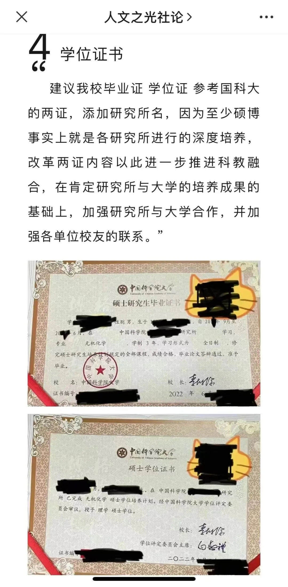

请相关部门及时关注并跟进问题。

## 1 宿舍

“从去年起，1-4号楼的查寝十分频繁（不清楚其他楼是否也如此，不敢妄下评论）。就算居住的是学校寝室，但宿舍毕竟也属于私人空间。

私人空间经常性地被一群不认识的人、在不定时间，甚至在不知情的情况下，随意开锁进行参观检查，既让人感觉隐私权被随意践踏，也让人十分没有安全感。

曾经询问过后勤处，所谓的安全检查以何种频率进行、由何人执行，所得回复只有：定期、宿管。具体什么时间不能告知，具体什么人也无法确认。

学生是在这里学习的，不是被作为犯人接受监管的，请学校认真考察一下，如此频繁且有不够透明的所谓的“安全检查”，到底有没有必要，且执行过程是否合理。”

“宿管隔三差五安全检查敲学生宿舍门，整个楼道从头到尾都听到如此嘈杂的打扰，大凡学校把基本安全保障做到位，也不至于这样天天骚扰人！”

“看不到硕博学生每周被查宿舍一次的必要性在哪里。大家都多大年纪了，非要每周被陌生人强制进入房间最少一次吗？这个是监狱还是宿舍？又不是军校跟人家瞎凑什么热闹呢？

问宿管阿姨就是“我们也是工作，都是上面要求的。”请问诸位领导们觉得这种奇葩的每周查宿舍工作起到什么实际作用了吗？可以把您们的工作精力多放在评双一流和为学生提供优质学习、生活环境上吗？

真的请不要再搞这些没任何意义的形式主义工作了，这都什么年头了。”

“又打着安全检查的名义来敲宿舍门，到底是要查什么？所以我们住在宿舍是有多不安全，是有人要杀人放火还是我们这些可怜的学生要杀人放火？”

## 2 食堂

“求求了。食堂做的太糟糕了。把一食堂二楼的人都调到一楼来吧，一楼还空了好多窗口。把二楼承包出去吧，跟二食堂形成竞争吧。做的都是啥啊。”

## 3 国际化

> “建议，学校应该尽快推进更高水平的国际化，尽快加入到qs等国际排名体系中，并且增设一些海外导师上课的英文授课课程，2019/20学年做的很好了，希望能够进一步增加比重。”

## 4 证书问题

“看了这条才知道社科院大学的双证居然不加培养的研究所，这真的是一个很大的、急需修补的bug。尤其对硕博而言，研究所才是与学生保持血肉联系的所在。再次顶一顶这位同学的投稿，值得被学校相关部门看见。

（见《[【读者投稿】各类问题层出不穷 奖补考核争议不断](https://mp.weixin.qq.com/s?__biz=Mzg2MjcwNzQ1Mw==&mid=2247487938&idx=1&sn=8ac83532f0a6cc9d9afde70c26495142&chksm=ce029a50f9751346ac910e901a18988ba215a5ee31c8f70cec7e3979438486e728200f00328d&scene=21#wechat_redirect)》第6条）

## 5 中期考核

“投稿：回复那位为21级博士做“冤大头”鸣不平的同学，如果总是要照顾过往者的不平衡感，那么一些制度就绝不会有任何进步可言！

可以不含糊的说，今年中期考核取得的成果主要是一些22级硕博生们努力推进并赢得了诸多同级和其他年级同学支持的结果，去年并不是没有抗争(社论上应该也有记录)，但很可惜并没有得到切实的推进，或许一切变化都要经历漫长的酝酿过程吧。作为一个其实没有全力推进这次转变的22级博士，我一开始并不乐观，因为学校已给出考试通知，我觉得无济于事了。但有人提醒我，或许只要具体要求没有出就还有希望。我心想那就投票吧，反正没什么成本，反正情况不会比现在更糟了，即便自己没沾上光，能造福下一届也行。取得现在的成果也给了我信心，所以我觉得那些前几天一直筹划提意见的同学肯定也是抱定了一些好的信念，而不是什么逃避考试的心理。

这位同学既然说21级是“冤大头”，那么相当于也承认中期考核是不合理的，如果仅仅因为没有搭上这趟车就要大发埋怨、就要唱衰，真的不必要。去年22级博士也有很多人因为二外栽了跟头，今年看到变成选修了不会委屈吗？但是难道就可以因为这个就主张倒行逆施？与其现在大部分学生的对立面，为了自己的心理平衡去指责学校朝令夕改，或许不如试试让学校为那些曾因此事受挫的同学给予一些弥补吧。

（见《[【读者投稿】各类问题层出不穷 奖补考核争议不断](https://mp.weixin.qq.com/s?__biz=Mzg2MjcwNzQ1Mw==&mid=2247487938&idx=1&sn=8ac83532f0a6cc9d9afde70c26495142&chksm=ce029a50f9751346ac910e901a18988ba215a5ee31c8f70cec7e3979438486e728200f00328d&scene=21#wechat_redirect)》第8.2）
