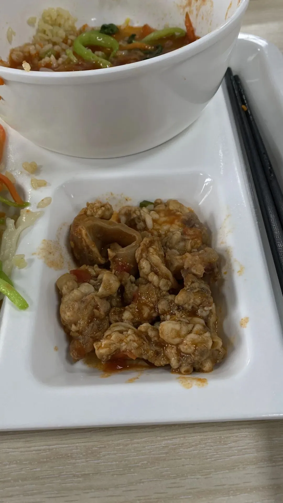
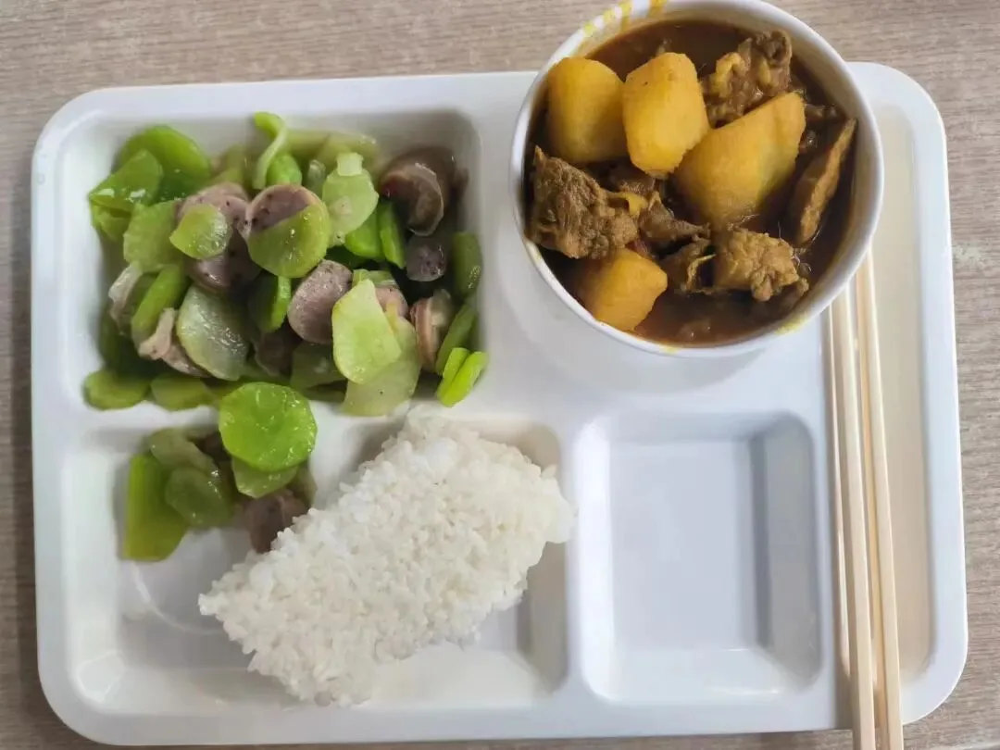
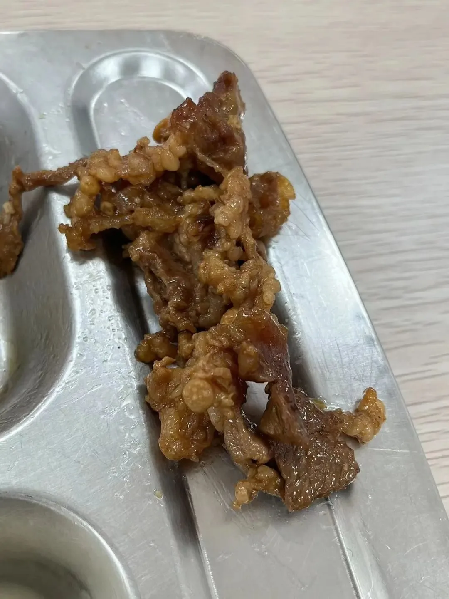

请相关部门及时关注并跟进问题。

## 1 校园安全

> “#投稿#良乡—操场，我记得之前良乡操场晚上会有照明灯，晚上11点关。今天来跑步，发现8点多就没灯了？现在天气回暖，锻炼同学比较多，还是希望学校后勤注意开灯，以免同学们因视线不好而受伤。”

## 2 宿舍

## “求强烈建议学校在每一栋宿舍楼安置公共盥洗室。

目前遇到的状况：

1.室友在睡觉，不敢洗漱，怕影响他人休息；

2.室友在盥洗，我只能在旁边等。

在以前的学校有公共盥洗室的前提下，洗漱、吃饭、图书馆，基本不会耽误太多时间。现在每天要等室友洗漱完了，我才能洗漱，然后再去图书馆。这中间耽误的时间怎么算？我不洗漱，难道要顶着一嘴口臭直奔图书馆学习吗？为什么可以改造出公共洗衣房，却改造不出来一个公共盥洗室？希望学校尽快入手，不然会严重影响学生的日常生活及学习时间。”

## 3 食堂

> “本人十分同意“一食堂作为补贴食堂不应该承包出去，而应该继续保持其大锅饭的出餐形式”因为社科大的补助真的挺少，食堂饭菜太贵对学生不友好。然而，一食堂是否真的“干净卫生”“肉都是好肉”实在应该商榷。相信不少学生都在一食堂吃出过异物以及疑似“淋巴肉”，这明显是食材处理不干净的表现，而且不是个例。我们一码归一码，价格是价格，卫生状况是卫生状况。附一张自己上周吃出的疑似“淋巴肉”图片，一份番茄牛肉里竟然一半都是这种疑似“淋巴肉”，真的很恶心。”

## “夸夸良乡校区一层食堂，今天的咖喱牛肉味道很好。”

## “问：望京4.3晚饭的花菜炒肉怎么看着这么像淋巴肉…….

（见《[【读者投稿】教学生活讨论不断 证书问题热议持续](https://mp.weixin.qq.com/s?__biz=Mzg2MjcwNzQ1Mw==&mid=2247487955&idx=1&sn=61a81f7c3343f53a5d4f0d1b0f3e5cfa&chksm=ce029a41f97513578ce7a8568c59a2342462b7a157dc874235a2d71ad3a61f911acc67eaf7f1&scene=21#wechat_redirect)》第3条）

## 4 证书问题

## “社科大学办的不如人家，连毕业证也不如人家，能不能学学先进经验啊。”

（见《[【读者投稿】教学生活讨论不断 证书问题热议持续](https://mp.weixin.qq.com/s?__biz=Mzg2MjcwNzQ1Mw==&mid=2247487955&idx=1&sn=61a81f7c3343f53a5d4f0d1b0f3e5cfa&chksm=ce029a41f97513578ce7a8568c59a2342462b7a157dc874235a2d71ad3a61f911acc67eaf7f1&scene=21#wechat_redirect)》第4条）

## 5 中期考核

> “非常赞同这位同学建议，既然改革就改革彻底一点。从学校下放到学院，还是要取消这种重复性没有意义的笔试。希望把权力交给各个研究所，各研究所都有40多年的培养经验了，改为各个研究所自行组织面试。全面提高硕博培养质量，鼓励多发文章。对学生，对学校，对就业都是有很大益处的。希望社科大不要过多剥夺和干涉各研究所在硕博培养包括招生等过程中的主动权和自主权。”

（见《[【读者投稿】教学生活讨论不断 证书问题热议持续](https://mp.weixin.qq.com/s?__biz=Mzg2MjcwNzQ1Mw==&mid=2247487955&idx=1&sn=61a81f7c3343f53a5d4f0d1b0f3e5cfa&chksm=ce029a41f97513578ce7a8568c59a2342462b7a157dc874235a2d71ad3a61f911acc67eaf7f1&scene=21#wechat_redirect)》第1条）
