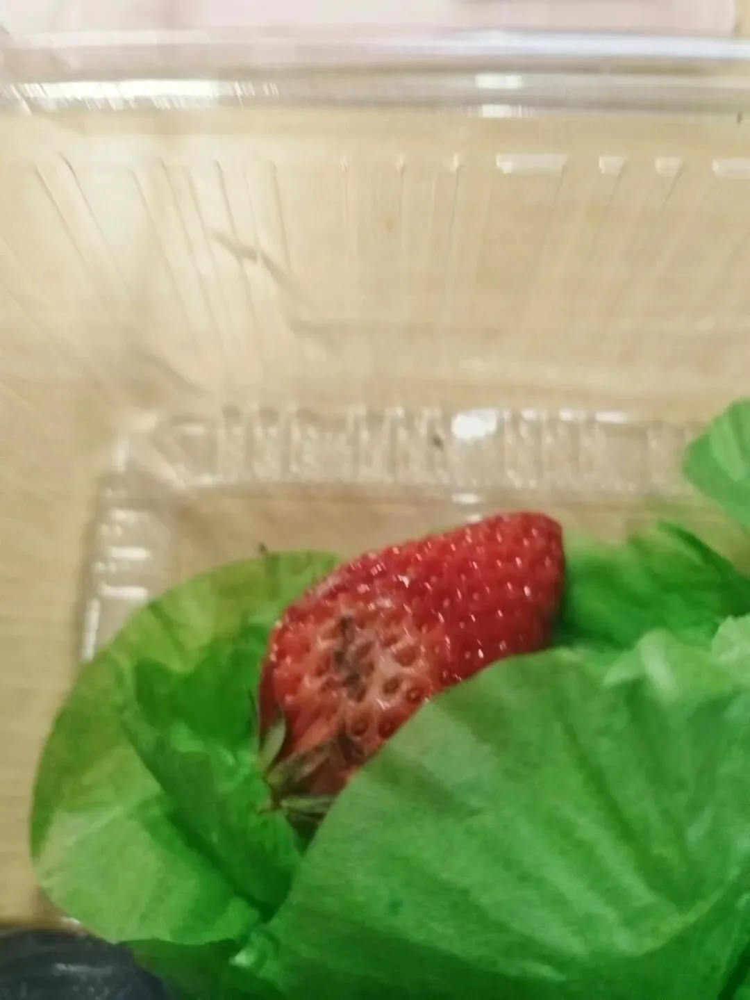
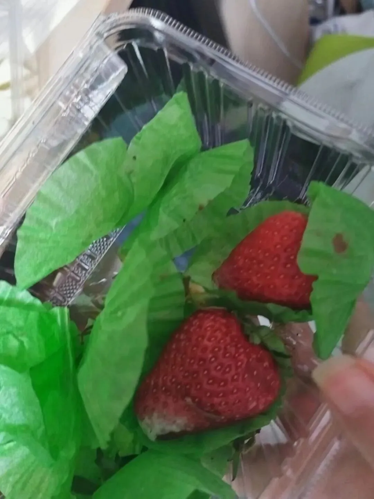

请相关部门及时关注并跟进问题。

## 1 打印点问题

“学校怎么还不新增图书馆以外的自助打印点啊，都反映好几年了吧，那么必须的东西，还搁这论证呢？这要是校长需要，你们怕不是立马解决了”

## 2 食堂

“望京食堂今中午（注：4月4日）的麻辣香锅算什么荤菜！全是藕和土豆片！我翻了又翻，荤的明明只有我这颗想吃肉的心！”

“一食堂今天中午（注：4月4日）卖的玉米粒虾仁是什么情况啊，五块钱的菜找了又找才在玉米粒中找到四个小虾仁。老有人说一食堂菜品便宜，我看这性价比也不高啊。”

## 3 学校超市

> “小心避雷良乡校区一食堂地下那个什么信什么超市的水果叭，之前舍友买了一盒草莓感觉很不错，我们今天（注：4月4日）就又去买了，结果舍友那盒有两颗长毛，我的这盒也有一颗，都不知道是放了几天的了。学校什么时候能进驻一家质量有保障的超市啊”

## 4 校园驿站

“感觉校园驿站的瑞幸电机柜子（可能是这个用途）装了之后噪音非常的大，感觉震得脑瓜子嗡嗡的，挺影响这里研讨学习的，想问下有没有可能学校和瑞幸方面有降噪的方法

## 5 抽烟问题

> “［抽烟问题］自从本人21入学以来，望京三号楼楼道持续地源源不断地有人在抽烟，包括此时此刻三号楼的三层靠近食堂一侧的楼道，通过摄影头很容易定位到这些人是谁，希望学校老师严格执行校规校纪，拿出具体措施（而不仅仅是阿姨每天在群里提醒），维护每一位师生的健康。”
