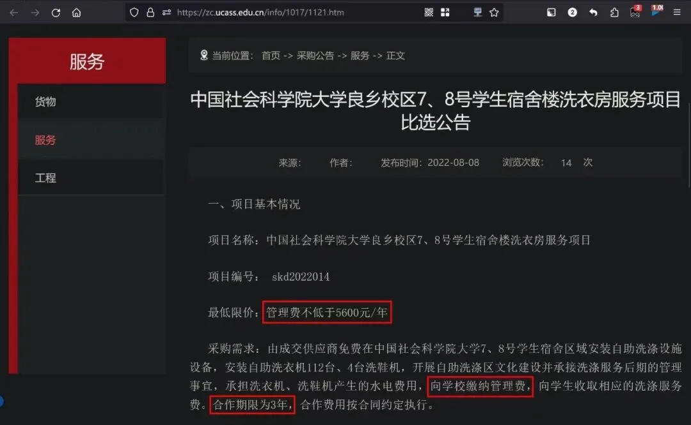
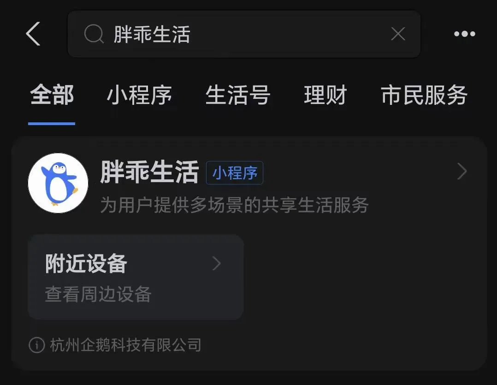
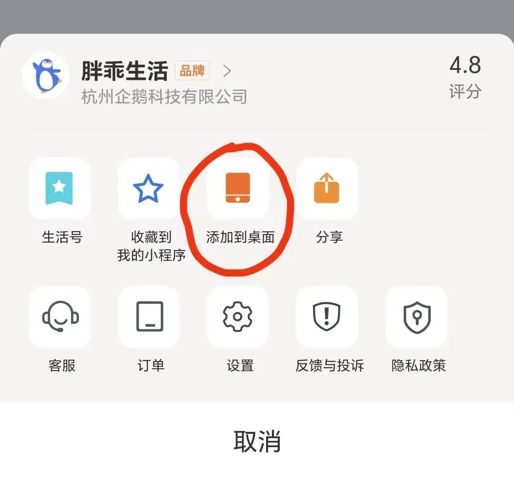
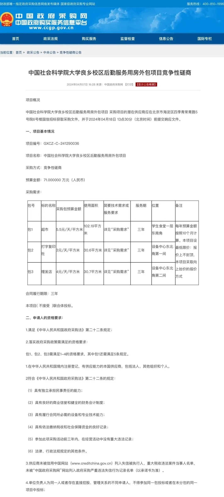

请相关部门及时关注并跟进问题。

## 1 洗衣软件

> “社论君你好。之前有同学反映过胖乖生活app广告过多的问题，现在有一种解决方案。打开支付宝，搜索“胖乖生活”小程序，点击进入。这个小程序和app一样可以正常扫码洗衣，而且没有任何广告。点击右上角三个点，选择“添加到桌面”，即可当成app来用。 根据社科大招采中心网站2022年的公告，7、8号楼洗衣房签订的合同是3年，所以短期内还无法更换承包商。这一家的产品国内很多高校也在用，他们的行为呢也引起了很多学生不满，隔壁北理工的公众号“贝塔驿站”，在2023年2月连发两篇推文，专门讨论了这件事情。所以这件事学校不一定能解决，得靠其他办法。”

## 2 图书馆

> “图书馆可不可以多添置几个存放物品的柜子，每次闭馆的时候柜子都满了，甚至有的同学会选择提前放物品进去占空柜子。和图书馆老师反映过，老师说后台显示整个图书馆的柜子并没满，首先学生看不到哪个柜子不满，其次不可能在闭馆的时候跑遍三个楼层挨个试哪个还能放东西。”

## 3 教室建设

“建议学校更换、清洗研教楼的纱窗，很多纱窗都坏了无法使用，部分好的纱窗灰尘很大，影响正常使用，防蚊虫。”

## 4 猫猫

“建议今天在中国政府采购网看到了学校招标信息，包含研缘超市、北门打印店和理发店。想知道研缘换走了以后小猫猫会带走吗，可不可以发到今日的推送里，麻烦了”

## 5 宿舍

> “投稿：今日查寝过程经历了被已经进门检查的老师惊醒的尴尬，不知道是否有同学经历过类似情况。所以建议诸位，如果失眠或熬夜补觉，最好穿好睡衣，保持好的睡相。毕竟你也不知道会被谁看到……”

> “今天推送第三条狠狠点赞了 五分钟之前回宿舍 一上二楼就被楼道里的烟味呛到 非常浓烈 已经不是第一次在楼道里闻到烟味了 自己抽烟给其他同楼人抽二手烟 怪大方的嘞”

（见《[【读者投稿】行行好吧，我是学人文社科的](https://mp.weixin.qq.com/s?__biz=Mzg2MjcwNzQ1Mw==&mid=2247488001&idx=1&sn=683ba9d2394a48fbe65cb9d2b9e1a47e&chksm=ce029993f975108590702eee69f39afe0580701fc79c42eb41cf687aed77cbd801e885068c25&scene=21#wechat_redirect)》第3条）
