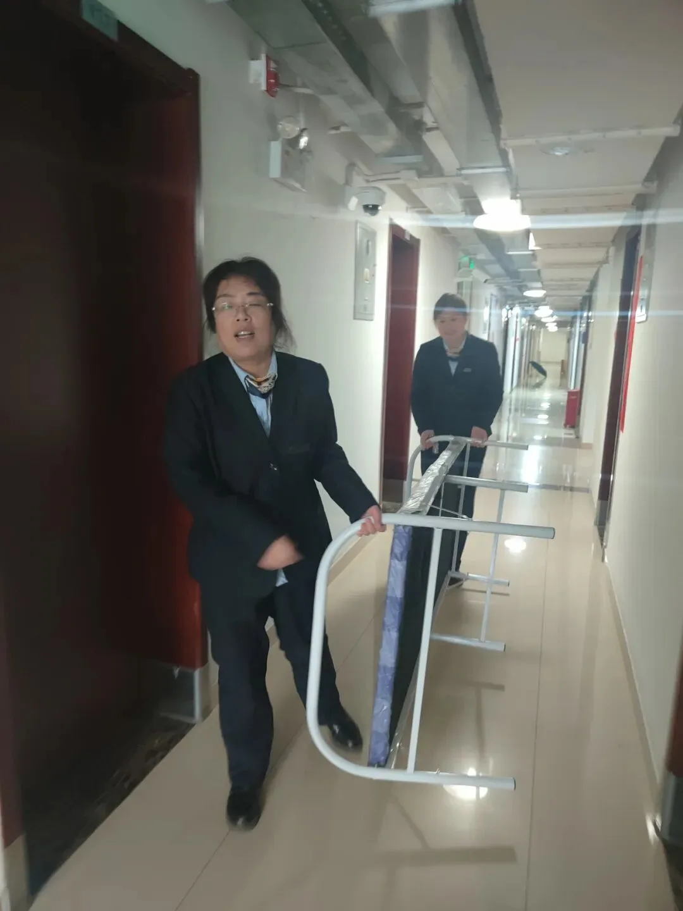

请相关部门及时关注并跟进问题。

## 1 奖助补费

> “博士1250的补助真的不够一个月开销……一年级的时候返所次数又多，往返城里的开支也没办法报销，因为生活拮据课业紧张，业余时间都要去兼职赚生活费。捏着指头过日子还怎么安心做学问啊。”

“今年的两会多个专家共同提议大幅提高博士生补助待遇，这是科教兴国的必然趋势。希望学校真正发扬人文之光的精神，让这项惠民政策落地生根。”

## 2 人员表扬

> “社论君你好，在此是想真心的感谢我们女生宿舍2号楼的宿管景阿姨和翟阿姨的，永远是那么平易近人。每逢天气骤变，都会提醒，下雨前也会将我们晾晒的衣服收回，看似平常的小事，不厌其烦地提醒我们。同学骨折，无法上下床，告诉他们后，第一时间帮我们收拾宿舍，送来折叠床，又是特别感动的一天，让我们找到了家的感觉🌹”

## 3 超市

“万一研缘不干了，猫猫会被带走吗？……而且地下的超市普遍比研缘贵，为什么只招标研缘那儿不招标地下”

## 4 食堂

“一食堂大白菜不到位啥有一股芥末味，百度一查，说这种是泡过药的，不健康。有点吓人了”

“下面这张图是我已经扣掉很多之后拍的，勺子上面还有湿乎乎的米饭，不知道是如何清洗的，希望一食堂加强卫生管理”

5

研代会

“

同意今天对研代会时间的吐槽！！！我也是和导师有一个重要的差要出，本来说好了要一块出发的，结果现在只能我一个人做半夜的车去！研代会这么重要的会议肯定不是昨天才拍脑袋定的时间，为什么不早一点通知学生？这个节骨眼要找人代替参会也找不到，难道老师们的时间是时间，学生们的时间就不是时间吗？！

”

（见《

【读者投稿】不仅仅是能力问题？

》第4条）

## 6 校园网问题

> “望京校园网真的很离谱。3月份从9号开始用，各种刷视频玩手机到月底还有20-30G。4月份莫名其妙两天用了10G，到9号就只剩10个G左右了，这还是我频繁使用流量的结果。搞不懂这个月的流量怎么跑这么快？！我担心我50G连半个月都撑不住？就很离谱”

（见《[【读者投稿】不仅仅是能力问题？](https://mp.weixin.qq.com/s?__biz=Mzg2MjcwNzQ1Mw==&mid=2247488025&idx=1&sn=9db0480e7423e3a2cd2f1cda49ec80c5&chksm=ce02998bf975109d7baba9f87001604da9cce63c52f1f36297abd47012ab6e095c3de5d067c1&scene=21#wechat_redirect)》第8条）

## 7 图书馆

“有关图书馆柜子问题，经常在图书馆二楼自习，二楼靠近卫生间的柜子几乎每次闭馆的时候都是满的，也就偶尔临近放假时还有空位。”

（见《[【读者投稿】不仅仅是能力问题？](https://mp.weixin.qq.com/s?__biz=Mzg2MjcwNzQ1Mw==&mid=2247488025&idx=1&sn=9db0480e7423e3a2cd2f1cda49ec80c5&chksm=ce02998bf975109d7baba9f87001604da9cce63c52f1f36297abd47012ab6e095c3de5d067c1&scene=21#wechat_redirect)》第2条）

8

宿舍

“

给这期稿一狠狠点赞了。真的迷惑这所学校负责后勤保障与校园安全的行政管理者究竟在想什么。实质问题视而不见，形式主义搞到飞起。对于大家吐槽已久的补助问题、增添自习研讨空间、宿舍合理管理等种种日常学习生活中的实际问题百般推诿、视而不见；反而却用形式主义的频繁查寝、坚持门禁等事情内耗在这所学校学习与生活的每一个人。有的时候真的怀疑这所学校的行政管理人员是不是外星生物，居住在一个和大家平行的朱门里面。”

（见《

【读者投稿】不仅仅是能力问题？

》第1条）
