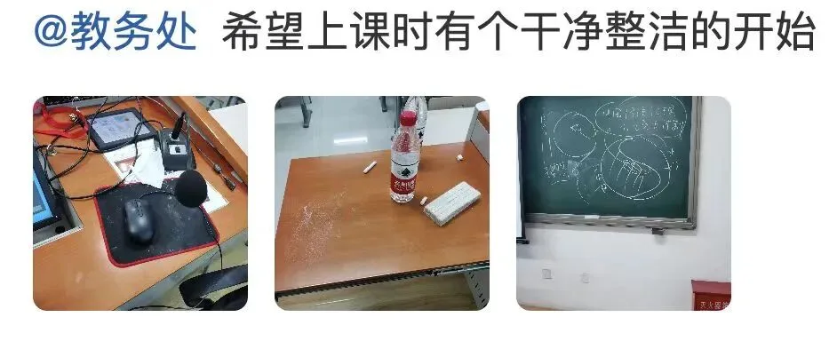
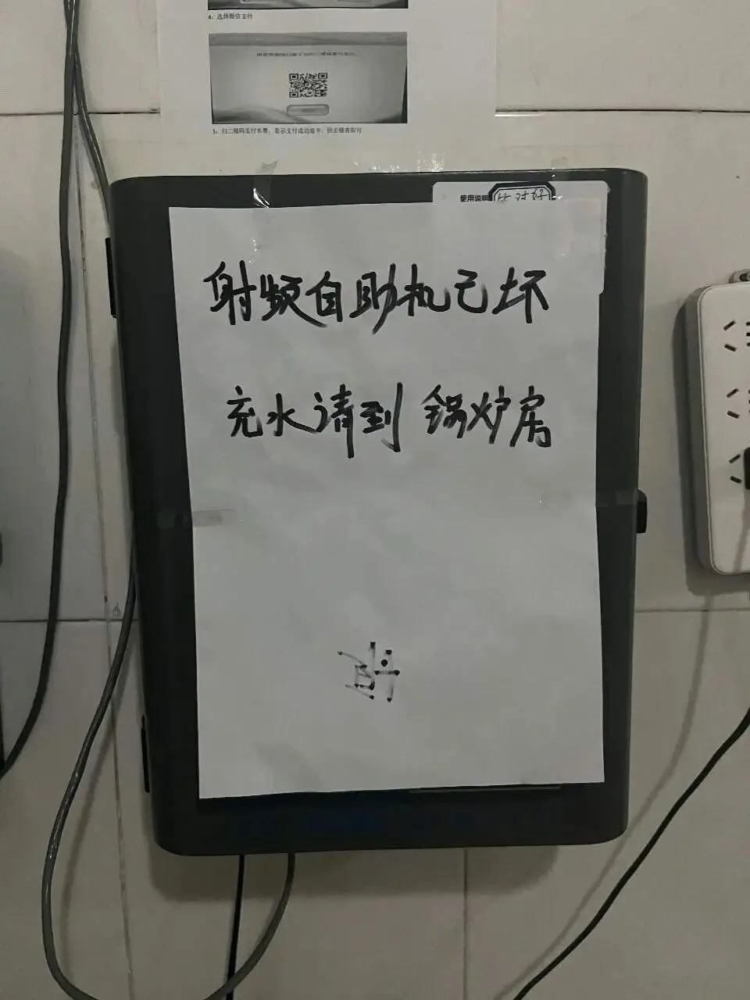

请相关部门及时关注并跟进问题。

## 1 评奖评优

## “【标准化问题】

社科大17年建校以来，许多地方都十分模糊，给了不少班委和学院自由操作的空间，就本科奖学金一项，主要权力在班委。

听说学工要组织本科生奖学金细则评定，我个人认为很有必要。作为19级本、23研，我觉得本科四年中各项评奖评优是否公平，基本取决于班委是否有责任心。

遇见只知道玩乐的班委，那奖学金评选就糊弄过去了，很多同学碍于面子也不会再反映，不知道各位本科同学有没有类似的感受。一些最基本的程序正义，比如申请人候选材料公示，也不是每个班都能做到。

好比是本科生三等奖学金中的“突出贡献奖”，我本科班的时候班委们研究学生手册，发现能担得起这个奖的同学少之又少，于是会在没有同学满足申请条件的时候把这个奖的名额分配给其他三项相对有标准的三等奖学金。班委包括班级同学都觉得能拿这个奖太难了，很容易“德不配位”，所以很支持对名额的划转。

但我觉得肯定有别的本科班把突出贡献奖简单的以投票方式过去，这样其实会磨灭一批做出社会工作/学术科研工作但得不到承认的同学的积极性。各位本科同学其实可以以此为例，看看你们班之前评出的突出贡献奖的那些同学，做出了什么【突出贡献】。

以此为例，我个人觉得，一项评奖评优在社科大能否有效进行，最大范围体现公平，需要以下几个要素：

1、负责任且有能力的班委

2、能够上心班级工作的班主任

3、积极进行班级事务参与并发声的同学

在实践中，班主任可能没有那么多精力，同学们可能碍于人际关系，所以主要落脚点还是班委身上。是班长的“一言堂”，还是班委们共同商量。如果没有清晰的规则，由某一个人决定谁符合资格（不公示），名额分配（比如把名额给到模糊的突出贡献），那奖学金的分配实际上可能成为某一个人维护自身人际关系的工具。

说到这里，我又想骂骂社科大，它对本科评奖评优的模糊处理，既损害了一些同学的公平，又给负责任的班委增加了许多负担。

入校第五年了，终于知道该标准化了。猪撞树上你知道拐了，股票涨起来你知道买了，大鼻涕流到嘴里你想起来甩了，我真想问问前几年你们干啥呢。

吐槽完归吐槽完，还有一个问题需要明确，最重要的，【本科生入党推优标准】问题，据我所知权力还是下放到各学院（班），我不认为这是一种好办法，学校如果觉得筛选党员不如奖学金分配重要，那你就继续眯着；另外一个问题，【优秀毕业生评选标准】，这是本科各位同学争的最后一个荣誉，也比较重要

我虽然是研究生，但我依然希望本科学弟学妹能在一个公平、清晰的环境中成长。有些责任是学校要负的，不应逃避，要不然要领导班子是干啥的。

现在的本科奖学金评选是面向全体本科生收集意见，也可以拓宽渠道嘛，我们这些留在本校读研的现在和本科没有利益冲突，我们的意见也可以听取，甚至说我们四年的评奖实践成果要好于现在的本科同学们，那我们是如何执行的，学工处也可以看看。

吐槽归吐槽，希望能更好。”

## 2 教室建设

“做为学生的我们就不应该主动擦下黑板么？这大学怎么上成这样？要不要把你们中学老师请过来看看这条意见？还是你们教过的学生么？笑死了……”

## 3 宿舍

> “投稿：建议在每栋宿舍楼安装充热水的机器，不安装的话要么学校换成插卡洗澡，要么让负责的物业公司滚蛋。 这件事情没有任何反驳的余地，对每一个同学都好。如果非有人喜欢洗澡到一半出来充热水还遇到机器坏了，那我只能说这个人就是贱命，祝它余生都能碰到这种事情。 对于这种百利而无一害的事情，如果依然得不到落实，要么是学校出了反同学的内鬼，要么就是有人在背后撑腰。为了不给背后撑腰的人添麻烦，请相关方落实。”

## 4 校园网问题

“我拜托学校不要在修什么网络了，如果高校有网络排行的话，你社的网就和大专一样，本来教学水平就是一坨，现在网络水平更是稀烂”

（见《[【读者投稿】问题制度不减宿管温暖](https://mp.weixin.qq.com/s?__biz=Mzg2MjcwNzQ1Mw==&mid=2247488036&idx=1&sn=9ff2e016fc30bade12e00cf574cbe798&chksm=ce0299b6f97510a04f5f169addc16b7adbd17baf23a70b9343cce06c69a99b944cb6453470bb&scene=21#wechat_redirect)》第6条）
