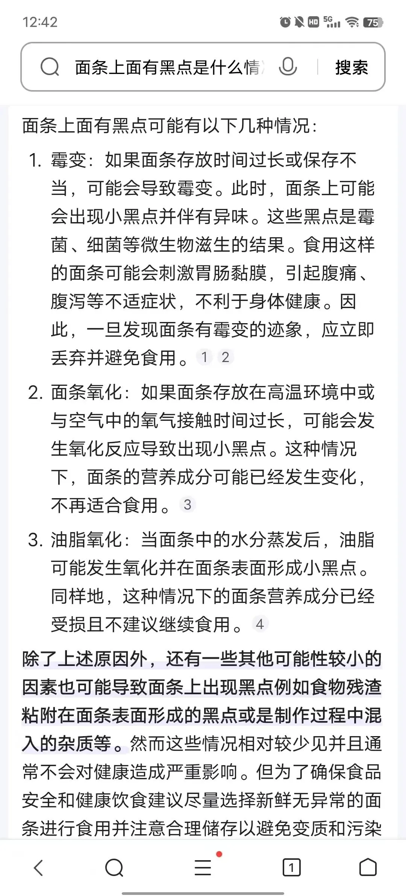

请相关部门及时关注并跟进问题。

## 1 校园网问题

> “良乡校区校园网问题：1 无缘无故突然断网；2 时不时的连不上网；3 流量突然就用的很快，在平时使用习惯没有任何改变的情况下。4 建议网络服务部老师做好校园网流量检测平台。希望学校能加强对网络中心的管理，给学生清净的网络空间。”

## 2 管理问题

## “其实，讲真，到目前为止社科大学生有什么过分要求吗？

不过就是要求一些正常的教学、生活秩序，这在其他高校可能都不是问题，还要先了解学校能做什么，学生来读书还是调研来了？要是办不了大学就tm别办了！拿出查寝和安闸机那个劲头，怕是没啥不能办的！ 就拿之前强制二外和笔试一级学科中期考核（我说的是考核内容，不要曲解成对“中期考核”的否定）举例，可能教务处还会特别自我感动自己知错能改，但这个在正常高校里，属于根本就不会犯的错误。”

## 3 食堂

> “前段时间看到有同学投诉一食堂，还以为是偶然事件，在我印象中一食堂一直是便宜干净的，直到今天中午。在食堂一楼要了柳叶面，结果发现好几条面上有黑点，不知道是不是发霉，当然我希望只是灰尘，灰尘我都可以忍！🥶百度了一下，灰尘的概率不大。食堂无论菜品是否丰富，价格高低，至少至少保证食品安全吧？”

## 4 预算

> “回昨天预算问题一条。想谈谈社科院资源的多少和学校能否恰当地利用这些资源并非一个问题。针对学校能力这一点来看，不错，社科大是一所背靠社科院资源的高校，这也是学校在大力宣传的一点。可如果这所学校不去推动自身的优化，又怎能很好地承接来自社科院的资源？学校行政现在这个烂样子，怕不是社科院有多少资源都不够校方行政管理者糟蹋的。不须放眼长量，仅从这学期怨声载道的宵禁问题、中期考核问题、查寝问题等问题来看，只知道折腾教职工学生，耗费大量资源却没有管理实效只有形式主义的问题就已经展现无遗，而这个问题的根本则在于校方行政管理的水平低下。 只有拥有有能的校园行政者才能用好社科院的资源，这和去谈有什么资源的问题并不冲突，而且在当下学校的形势之下更为重要。还记得在这个公众号上曾经看到过这样一句话：“定期查寝检查卫生，是社科大沦为三流大学的第一步”。一个三流的社专，又从哪里可以给承接社科院的资源找出一个理由呢？假使社科大再沉沦于如此现状，哪怕一百年（如果这所学校能活一百年的话），哪怕有一百个社科院的支持，相信也依然不会有太大的改观，仍然是令人寒心而失望的三流社专而已。 再一想，假如真的非要社科院“神兵天降”才能处理好诸如寝室管理、后勤安全这类校园日常管理事宜，将是一件非常可悲的事情。如果情况已经发展到这所学校任何改变都需要直接由社科院才能推动的话，那么校方行政管理人员又有什么存在的意义呢？还是尽快从哪里来回到哪里去吧。 回到预算问题上来。关于寝室预算的问题肯定和后勤保障、校园安全这方面的行政管理者脱不了干系，因为资源是拨下来的，怎么分配形成预算可主要是校方行政自己定的。假使预算有任何不合理之处，那么是谁管理不善，甚至上下其手，想来不必多言。”

（见《[【读者投稿】春季升温烦恼多多](https://mp.weixin.qq.com/s?__biz=Mzg2MjcwNzQ1Mw==&mid=2247488048&idx=1&sn=fa985eb54bf7e6ab3dae7774d31ac1dd&chksm=ce0299a2f97510b4d0fa9a0251f5ed5c9a0afeddbd3b728e712b5dbbb82e597da6fbcef93686&scene=21#wechat_redirect)》第4条）
