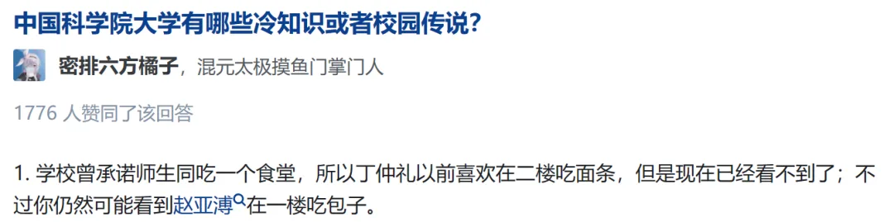
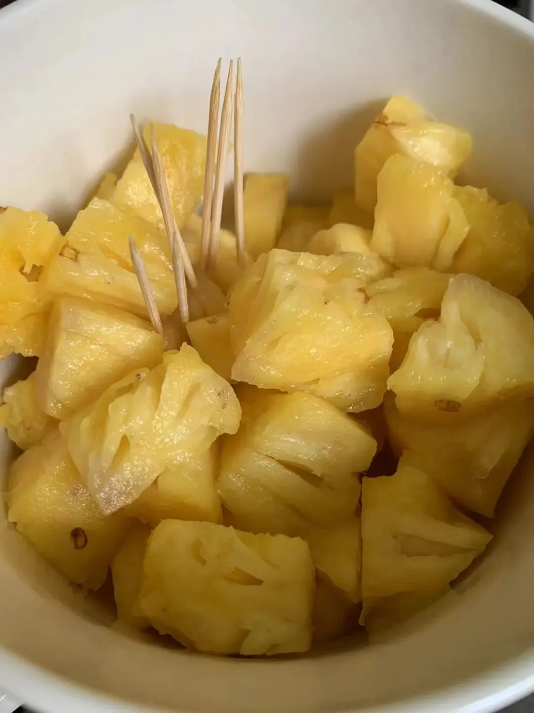
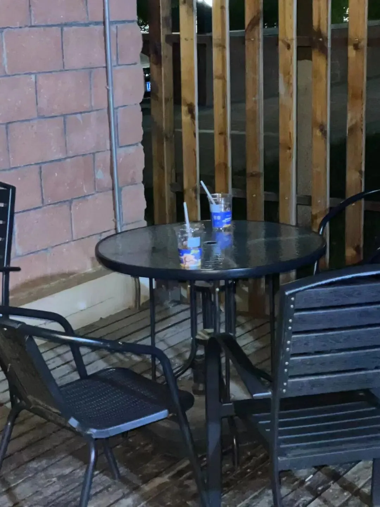
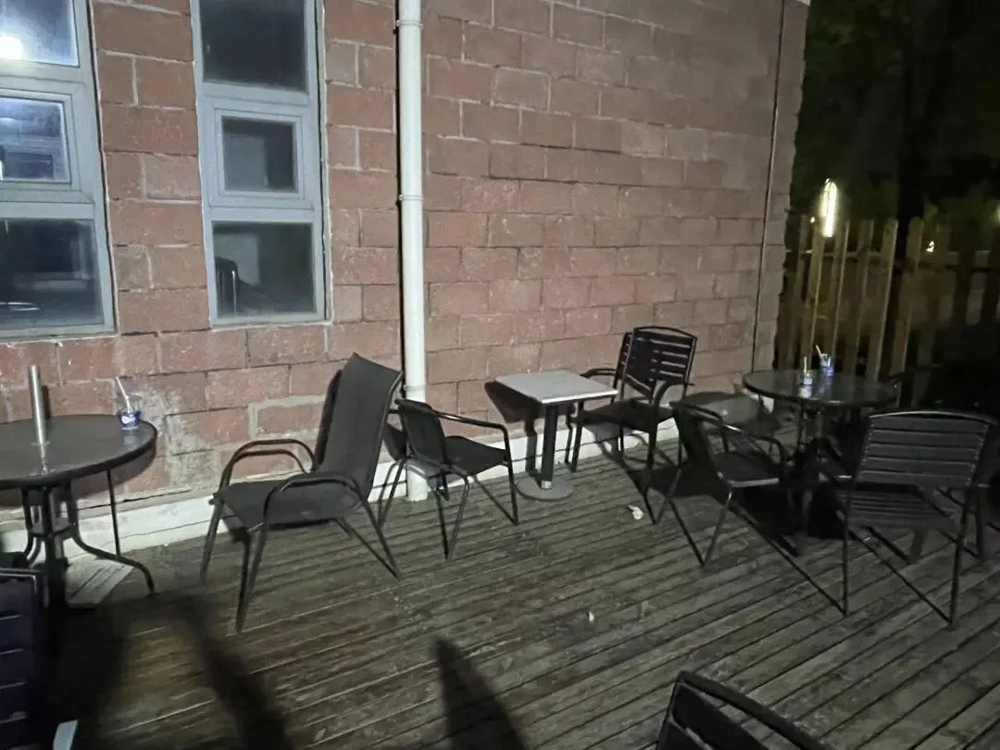

请相关部门及时关注并跟进问题。

## 1 校园网问题

> “你好，我还是想反映一下望京这边校园网的问题。自从上次校园网维护更新过一次开始，校园网一直处于非常不稳定的状态，甚至现在连普通的上网查阅资料都无法满足。希望可以好好处理一下这个问题！谢谢！”

“想咨询一下，同学们有没有遇到过新学期开学，电脑死活连不上校园网的情况？关机重启，忘掉网络再重连都不管用，还有什么办法吗？连接后显示无网络。求教！谢谢”

## 2 食堂

“现在白天越来越长，另外很多同学都在实习。望京校区7点就闭餐，应该是全国闭餐最早的校区。恳求食堂领导能不能延后闭餐时间。”

## “偶然看到一个国科大的冷知识，我想社科大师生同吃一个食堂，食堂问题也就都解决了”

> “夸夸帖！望京食堂现在服务太好了！上次找经理帮忙加热了贝果，这次又帮忙削了菠萝，不仅帮忙切成小块甚至帮忙泡了盐水插好了牙签！太贴心了！非常感谢！学校食堂服务真的有在不断进步！”

## 3 补课问题

> “关于体测补课，首先对于大四的同学，人家可能已经算好平均分达标了，最后考的时候就没太在意，你就浪费人家时间整这东西？对于我这种体能差的人，还想几周的课就能提到合格？看起来比让我补几周的课绩点直接提升1都天方夜谭，不知道贵校以前有没有过这种规定，莫名其妙，没听过哪个学校有整这样的。”

## 4 证书问题

> “【支持毕业证学位证维持现状，反对添加研究所信息，不要邯郸学步画蛇添足。】 之前有人投稿，主张模仿其他某学院大学在毕业证上添加研究所，但私以为这是东施效颦，可能不符合我们skd现实。因为我们现在教学研究管理以大学学院为主，研究方向也以一级学科和二级学科划分，有比较鲜明的导向，科教融合也是主张突出大类方向，因此现在的毕业证学位证上是学校专业足矣。当然这也并不能否定研究所的栽培，对研究所导师不吝赐教心怀无上感激，可以通过论文合作者、论文致谢等其他方式来体现，无需再在毕业证学位证上体现，否则会显得不伦不类，也增加学校管理成本和压力。同学的投稿，值得被学校相关部门看见。”

## 5 宿舍

## “你好，说一下换宿舍问题。

按学校要求，调出的同学必须和同级住一起，不能单开一间。

第一种情况，我一个人调出，会被换到已有一个人的宿舍。那么问题来了，这个人为什么住单人间？如果原先是两人间，一人调走，为什么他没有被合并到其他人的宿舍？这是否属于后勤的遗留问题？

第二种情况，我找好其他宿舍的同学，准备和他换到一间新宿舍。按学校要求，两个原宿舍必须合并，不然换不成。也就是说，相当于两个宿舍的人员对调。问题是，申请调出的，一般在宿舍居于弱势地位，如果他能要求舍友做出改变，不至于申请调出，更别说让原舍友搬宿舍。后勤的这种无理规定，把自己的管理任务转嫁给了学生，让学生处理好后续本该有他们负责的工作。又或者简单粗暴地封死了学生的调换意愿，直接给他们省事。

以上无论何种，都是懒政的体现。宿舍矛盾重重，后勤还种种阻挠。又不是让你们亲自搬东西，只消你们动动鼠标签个字，就这么难吗？”

## 6 教室安排

“社论君你好，请问望京校区教学楼和图书馆的空调是否已启用？天气直逼30度，上课都上到中暑了，学校是否可以视天气情况启用空调呢？谢谢！”

## 7 卫生清洁

## “投稿不清理垃圾

驿站门口，4月16日晚上，有2桌共3个喝完没自己带走的瑞幸杯。4月15日早上听到驿站保洁阿姨对瑞幸店长说现在卫生工作量变大，希望同学们能自觉一点清理垃圾，特别是外面的桌子。”

## 8 管理问题

“这几天同学们一直在社论上骂社科大行政，我觉得似乎有些言过其实了。虽然有一些政策有不合理的地方，但是社科大毕竟知错能改，这就已经善莫大焉了。以我个人感受而言，去找行政老师办事的时候，老师们态度都很好，很热心，我觉得已经很难得了。如果大家有什么不满意的地方，可以广泛提出意见，以过往经验来看，还是都能得到答复和解决的。

另外就是，真的不要觉得，如果社科院插手，社科大就会面目一新。像我们这些在综合类大学待过的人都知道，任何一个大学都有一堆破事。且区别在于，如果你在一个学生两三万的综合类大学，根本没有人在意你的意见。别说校长了，学院院长你都见不到的。”

（见《[【读者投稿】在管理迷宫中奔忙的人](https://mp.weixin.qq.com/s?__biz=Mzg2MjcwNzQ1Mw==&mid=2247488072&idx=1&sn=0e76357835f16e208716f05fb8d17ede&chksm=ce0299daf97510ccc2d92fedc8592c2eb2687332bd732ee1b4cd8a10e3c84f9b560d22be6557&scene=21#wechat_redirect)》第3条）
