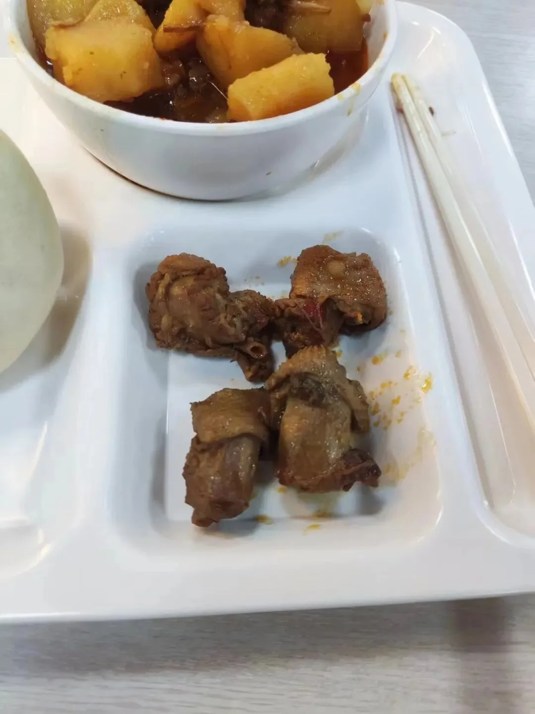

请相关部门及时关注并跟进问题。

## 1 证书问题

> “对意见四想笑 哈哈 您真是后知后觉。毕业证学位证的事过去好多天了，请重新发一下大家的投票结果，都研究生了有点创新好不，加研究所名怎么就不伦不类了，我们就是要体现中科院 、社科院办大学的特色，不仅要体现在人才培养上，更要体现在证书等方方面面，谢谢”

> “反对4关于毕业证学位证的问题，那是你自己的“私以为”，人文之光投票结果可见同学们的意见，论文致谢非必要内容，非公示属性，在毕业证学位证体现研究所内容，属于公示性质，就是要态度鲜明的表明培养过程，能充分体现科教融合特征，国科大是科学院办大学的先行者与典范，社科院、农科院、中医研究院等办大学都需要学习中科院办大学的经验，科教融合不能否认研究所的培养实际与成效，毕业证学位证并非画蛇添足，也并非不伦不类，科学院办大学就是要体现创新性，而不必效仿传统大学证书内容，且证书颁发权限教育部已经下放至各大学，因此需要根据自己办大学的特点革新毕业证与学位证。”

“反对今天关于毕业证学位证的意见四，那么多人投票绝对数量的支持添加研究所信息，请学校正视同学们的意见，向国科大学习，添加研究所信息在毕业证学位证上”

“【关于毕业证、学位证添加研究所名称的讨论】私以为与其讨论是否要添加研究所的名称，不如直接讨论学位证由“社科院”授予、毕业证由“社科大”授予，或者双证都由“社科院”授予的可行性，又或毕业证由“社科大”授予、学位证由“社科院”授予。个人以为，仅从院校方面看，社科大作为一所双非院校，在毕业找工作时能带来的优势显然不如其他985高校。尤其是在当前求职过程中，部分高校和企业在卡三个985，使得双非出身变得比较被动。而如果由社科院授予学位证，则可以抛开院校这一评价体系，反而凸显社科院作为国家首批高端智库的优势。

另外，关于添加研究所名称一事是否是画蛇添足、邯郸学步，我赞同的确要由学校的具体情况决定。本科阶段的培养可能主要是由各学院管理。但不能否认的是社科大硕博的培养则与各系所直接相关，导师所起到的作用与本科阶段截然不同。尽管社科大走向科教融合、各系所由学院统一管理的现实摆在这里，但这并不能代表某些同学的建议是东施效颦。究竟是西施还是东施也要等真正效仿之后才能定论。而这一建议究竟是简单的模仿，还是能够体现学校的特色和优势亦不能妄下定论。

至于添加后的双证是否是不伦不类，我相信国科大的例子大家也自有定论。这里只讲一点个人看法，添加研究所名称既能体现社科院的优势，又不需要变更学位授予单位，何乐不为？

除此之外，向大家提供除国科大外的研究机构，或称之为智库，授予学位的例子，包括军事科学院和中国现代国际关系研究院等。

以上仅是个人愚见，大部分来源于个人的教育经历和感受，主观成分较多，有感而发，请大家理性讨论、批评。（也是一些不同的意见，也值得被学校相关部门看见）”

（见《[【读者投稿】在管理迷宫中奔忙的人](https://mp.weixin.qq.com/s?__biz=Mzg2MjcwNzQ1Mw==&mid=2247488072&idx=1&sn=0e76357835f16e208716f05fb8d17ede&chksm=ce0299daf97510ccc2d92fedc8592c2eb2687332bd732ee1b4cd8a10e3c84f9b560d22be6557&scene=21#wechat_redirect)》第4条）

## 2 管理问题

## “笑死了，这位同学是得了斯德哥尔摩综合症吗？还是新生没被霍霍过？

改，没错，关键那错误犯的特别离谱啊，而且不民怨沸腾坚决不改，一届一届学生都是无关紧要的牺牲品？

21届学生还在校呢，你来宽慰一下他们：虽然霍霍了你们，但改了，下次中期考核就不那么折腾了，二外也不强制了，你们别太埋怨。

还有那些来社科大更早的被霍霍的更惨的。

社科大行政一作妖，那简直就是毁灭性的破坏力，正如之前同学投稿：“教务处还会特别自我感动自己知错能改，但这个在正常高校里，属于根本就不会犯的错误。”

希望下次这位同学被霍霍的时候也能那么心开意解。

另外，不要比烂。”

（见《[【读者投稿】难似登天的易如反掌](https://mp.weixin.qq.com/s?__biz=Mzg2MjcwNzQ1Mw==&mid=2247488080&idx=1&sn=cb7b828ef62a01ba174313b4f7ffdea9&chksm=ce0299c2f97510d45498abfa5f6b6c01ed9305be3cebe5142e23cf8386458b4e904e3c36a377&scene=21#wechat_redirect)》第8条）

## 3 宿舍

“按照社科大的垃圾规定，必须两个人住一间宿舍，可为何还有那么多人住单间？后勤办的人都瞎了吗？咋不管理，咋不整合？要你们干啥？？？？”

> “狠狠点了上次同学说换宿舍的事，宿管常言：要换两个人一起换，不能空出床位，只能空出宿舍，可是哪里那么好找人对换？空出床位怎么了？管理上有困难？比一周一次查寝骚扰学生还要困难？有那功夫天天查30岁博士寝室，不如想想怎么便利学生，而不是变着方法难为学生。不要手里有一点点权力，还要不作为去难为学生，学生真的很不容易了，30岁挤集体宿舍，本来宿舍也不是征求学生自愿自己挑的，既然有问题为什么宿管不给调换？？真的很醉。想问问不给调换的依据在哪里。虽然目前没有调换宿舍的要求，但我相信有一大半的学生都会因为作息，噪音等问题有过想法，宿管是不是只会坐办公室拿着鼠标点几下然后说不行？敢不敢公开到底哪些宿舍是空着的？学校天天增设心理咨询，想没想过学生觉都睡不好？因为没有足够的调换宿舍自由，心理负担并不小？有没有想过从根本解决问题而不是学生心理有疾病了再去治？”

（见《[【读者投稿】难似登天的易如反掌](https://mp.weixin.qq.com/s?__biz=Mzg2MjcwNzQ1Mw==&mid=2247488080&idx=1&sn=cb7b828ef62a01ba174313b4f7ffdea9&chksm=ce0299c2f97510d45498abfa5f6b6c01ed9305be3cebe5142e23cf8386458b4e904e3c36a377&scene=21#wechat_redirect)》第5条）

## 4 食堂

> “看到有同学反映学生食堂和教职工食堂分开的问题，让我想起来在我读本科时候，的确是没有老师和学生分开吃饭一说，老师想在学校吃饭，就去学校那几个食堂刷卡就行。当然，饭也种类多，丰富又美味，价格也亲民。”

> “【关于昨天望京食堂餐食时间延后问题】 记得望京食堂有专门给实习学生点餐的微信群 群内每天有这方面的工作人员海哥发布菜品和价钱 同学可以问一问身边有没有进这个点餐群的同学邀请您进一下群呢？另外晚餐时间或早或晚也是很难面面俱到，目前望京食堂晚餐时间我觉得也是很科学的，一是学校出于科学晚上饮食时间考虑太晚吃饭对同学的消化系统也无益，二是也会增加食堂运营成本，夏天如何保障菜由于长时间供应放置不馊，冬天如何保障菜由于长时间供应不冷。再者晚餐供应时间变晚，也会间接导致食堂工作人员由于保障师生晚餐供应而自身晚餐时间向后延。”

## “给一食堂点赞！小小的一碗家常鸡脖随便一夹就是四个鸡脖子。”

（见《[【读者投稿】难似登天的易如反掌](https://mp.weixin.qq.com/s?__biz=Mzg2MjcwNzQ1Mw==&mid=2247488080&idx=1&sn=cb7b828ef62a01ba174313b4f7ffdea9&chksm=ce0299c2f97510d45498abfa5f6b6c01ed9305be3cebe5142e23cf8386458b4e904e3c36a377&scene=21#wechat_redirect)》第2.1、2.2）

## 5 校园网问题

## “望京校区：都两年了，网络问题一如既往的差，用点心好不，网卡的感受谁懂呀”

（见《[【读者投稿】难似登天的易如反掌](https://mp.weixin.qq.com/s?__biz=Mzg2MjcwNzQ1Mw==&mid=2247488080&idx=1&sn=cb7b828ef62a01ba174313b4f7ffdea9&chksm=ce0299c2f97510d45498abfa5f6b6c01ed9305be3cebe5142e23cf8386458b4e904e3c36a377&scene=21#wechat_redirect)》第1条）

## 6 体测问题

> “社科大这么关注学生的体育健康，不惜增加单独的体能课程以保证体测合格，那么能不能投资给学校器材室换几个新足球呢，办比赛的工作人员去挑都挑不出来几个能用的足球，对于社科大这么关注体育的学校是不是太丢脸了些。”

（见《[【读者投稿】在管理迷宫中奔忙的人](https://mp.weixin.qq.com/s?__biz=Mzg2MjcwNzQ1Mw==&mid=2247488072&idx=1&sn=0e76357835f16e208716f05fb8d17ede&chksm=ce0299daf97510ccc2d92fedc8592c2eb2687332bd732ee1b4cd8a10e3c84f9b560d22be6557&scene=21#wechat_redirect)》第4条）
