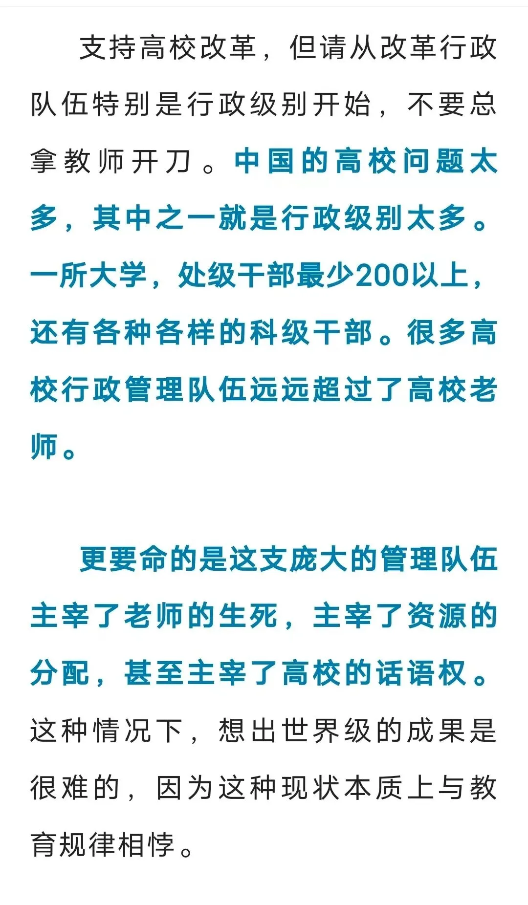
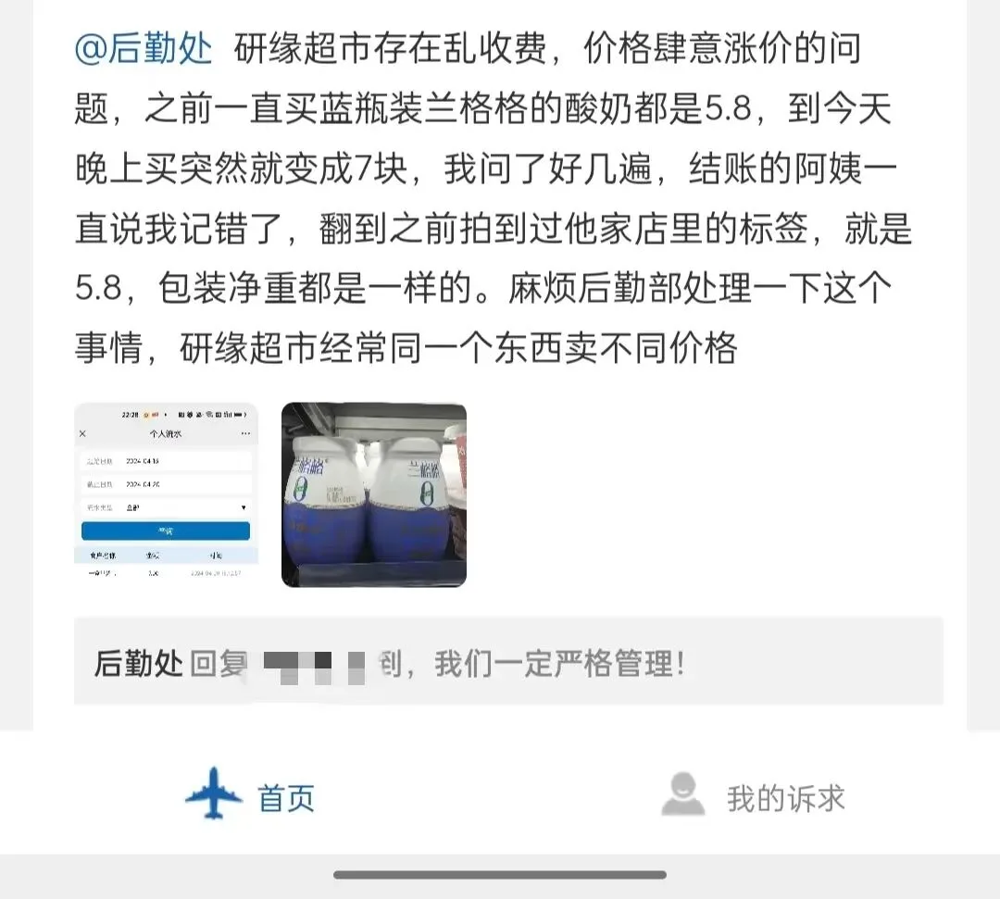
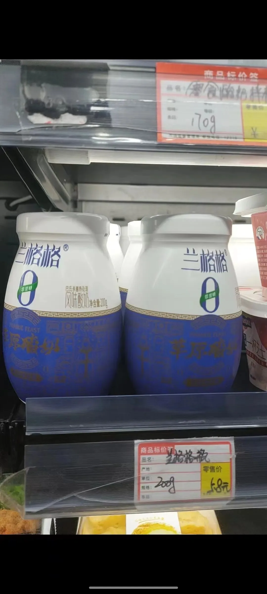
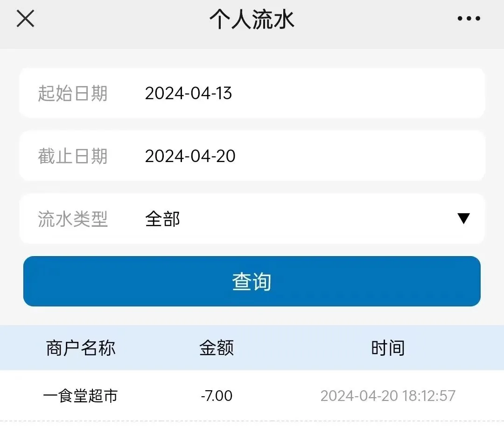

请相关部门及时关注并跟进问题。

## 1 教务系统

## “投稿：

现有的“本科课程查询”系统看起来更智能了，实际上用着还是不方便。原来课程大纲那个官网板块还在的时候，能够查一个学院所有的课程，不管是不是在这学期开。现在这个反倒只能查一个学期的，用着相当不便。现在搞本科合格评估，为何不考虑把其他学期的课程大纲、教学计划也按照规定修改完善一下呢？如果修改好了是不是也可以上传到这个系统里，便于大家了解和使用呢？马上学期过半了，是不是没必要把开课的事情一直拖到学期末才搞，早点搞完大家可以早点看看。”

## 2 推文

## “在公众号看到一篇推文，节选了比较核心的一部分，想听听大家的看法”

## 3 接诉平台

> “投一下稿，现在发现接诉即办越来越敷衍没用，学生发现了问题后勤部一句加强管理就敷衍了事，既不退还给学生多收的钱，也不说怎么整改，那是不是研缘超市现在还在以这个价格继续售卖，是不是还有其他物品也悄悄涨价，多赚学生的钱。接诉即办，后勤部不能做到真正为学生服务，就别假模假样的设这个程序，表面上多么认真负责，其实一点用也没有。”

## 4 宿舍

> “宿舍管理继续吐槽，其实人家想换宿舍也没啥不可以的，有些室友关系很差作息时间不一样，怎么就不能调宿舍呢？非要捆绑在一个宿舍受罪影响心情影响学习，结过婚的不是还可以离婚吗？换室友有啥不可以的？宿舍管理太死板了，感觉后勤的那些人贼眉鼠眼的没啥能耐就会瞎折腾。要知道自己的定位，不是啥领导。要知道为学生提供便利为宗旨，不要胡来了，有不少同学因为休息不好影响学习有谁管有谁问了？管理要灵活。。。据说有些同学给后勤那些人发过红包了，单间住几年都没事，你说恶心不恶心！！！”

## “望京宿舍的空调可以开了没，能不能安排物业来洗空调”

“投稿：关于宿舍，请宿管办公布每一级目前单人寝室的数量。最近了解到，不少硕博连读学生竟然从博一开始一直都是住的单人寝室。”

（见《[【读者投稿】证书体测争议巨大 管理生活谁予解决](https://mp.weixin.qq.com/s?__biz=Mzg2MjcwNzQ1Mw==&mid=2247488086&idx=1&sn=f0869b7516afd50d159ce8fabf4d422f&chksm=ce0299c4f97510d2b48a26b837f576d08d9817f6f98fac6ce956de91125d89d1a41921158c95&scene=21#wechat_redirect)》第3条）

## 5 食堂

## “社论君好：

最近看有学生说起教工食堂与学生餐厅不可分开。这说得可是太对了，不知道为什么一定要分开？教工之所以存在的前提不是因为先有学生吗？那么教工与学生同食又有哪里不对呢？我最近常去朋友的学校吃饭，经常发现人家学校的老师们及其家人多是和同学们在同一餐厅，不分彼此地一同就餐。每每见此，就非常困惑我们学校的做法。”

## “看望京食堂的西红柿炒蛋为什么经常烧糊，不会做的话我可以来”

（见《[【读者投稿】证书体测争议巨大 管理生活谁予解决](https://mp.weixin.qq.com/s?__biz=Mzg2MjcwNzQ1Mw==&mid=2247488086&idx=1&sn=f0869b7516afd50d159ce8fabf4d422f&chksm=ce0299c4f97510d2b48a26b837f576d08d9817f6f98fac6ce956de91125d89d1a41921158c95&scene=21#wechat_redirect)》第4条）

## 6 证书问题

> “关于最近讨论热烈学历学位证书加研究所名称的话题 我作为一个中立的非利益相关者发表自己的理解 不一定对：国科大学历学位证书上的xx所指的是培养单位 因为国科大的研究生招生不仅有大学本部里的学院还有中科院下面的研究所 这里在学校的官网有所显示 也就是说如果你报考的是中国科学院xxx所 那么在学历证书处会写上 如果你报考的是国科大学院 那么就写的是在国科大xx学院学习或在我校学习 反观社科大在建立科教融合学院后 原来的按所设系方案取消 各个系并入到学院 招生和培养也是归学院管理 如人大就会写在我校xx学院xx专业学习 因此我在理解如果想在学位证上加所名 就需要像中科院一样把社科院各研究所招生名额单列 学生就读后直接进入研究所学习或先在本校集中上课一年 大学只负责培养以外的如学生事务、后勤等工作。社科大官方解释目前是科教融合2.0版的升级，建立和完善“一院多所（系）”的本-硕-博一体化的科教融合新模式（这是目前高等院校的主流模式）。学院重新命名组建后，专职教师、特聘教授、岗位教师和研究生导师，按照“教师随学科走”的原则融合到新组建的学院；研究生、本科生按照“学生随专业走”的原则，进入到新组建的学院。学院的党政机构、学术组织等需要在原有基础上按照有关规定进行相应的调整。如果现在回到此前按所设系的模式 估计会打所有领导的脸。”

（见《[【读者投稿】证书体测争议巨大 管理生活谁予解决](https://mp.weixin.qq.com/s?__biz=Mzg2MjcwNzQ1Mw==&mid=2247488086&idx=1&sn=f0869b7516afd50d159ce8fabf4d422f&chksm=ce0299c4f97510d2b48a26b837f576d08d9817f6f98fac6ce956de91125d89d1a41921158c95&scene=21#wechat_redirect)》第1条）
