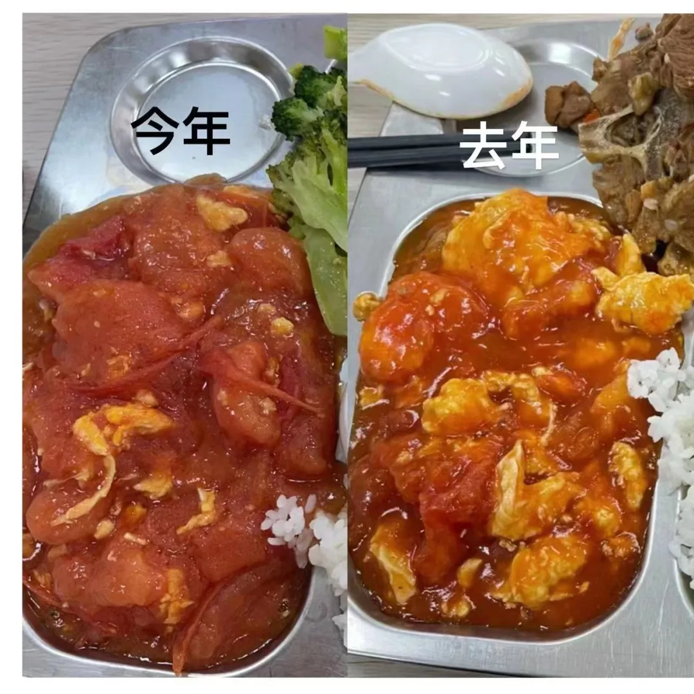

请相关部门及时关注并跟进问题。

## 1 接诉平台

> “今天和朋友想在接诉即办投诉的时候，两个人一对突然发现相互的接诉即办显示出来的内容是不一样的，可以说是为了遮丑而选择性公布投诉了。不知道这种人工选择行为从何时开始，但突然发现确实感到了一阵生理性不适。”

## 2 科研经费问题

## “【科研经费的浪费】

先放结论：社科大的【学生科研经费浪费严重，已有的经费分配规则造成了资源浪费】

以学校“研创计划”为例，普通项目的经费额度为【一万元】，分两次拨付，立项前拨付五千，结项后拨付五千。获奖项目可额外获得五千元奖金。

科研处将经费分两笔报销并设置奖金的出发点，必然是【鼓励学生有质量的完成科研项目，锻炼科研能力】。但是，从实践中看，只要项目能说得过去，各学院在结项审查时都不会说让学生无法结项，从而都能获得结项的五千元。也就是说，通过【是否结项】来把控项目质量的方式几乎失灵了。那是否有更合适、更高效的经费分配办法呢？

个人认为当然是有的，粗略的构想应当是【立项经费正常拨付，结项经费按照各学院结项质量评审排序，由高到低的梯度化分配，如结项评审的前30%获得5000结项经费，中间30%获得3000结项经费……】，这样实际上可以在各学院“放松结项审查”的实践中达到按质量分配科研资源的目标。

这样说可能招致许多同学的反对，因为在实践中，这类科研项目往往会被用来当作社科大学生补助不足的“另一类补助”，即通过报销高额的劳务费来实现对学生的生活补贴。这当然是社科大经费吃紧的不良影响，学生们想通过科研经费保障自己的生活也无可厚非。

那么我们先把对本文的观点以及可能的反驳放到一边，来看一下现实中存在的情况。

1. 研创项目的结项质量参差不齐，有些同学产出的是可以发表出来的成果，有些同学产出的仅是word中的一篇长论文。虽然不能唯期刊论，但差距也是存在的。有些同学可能说，优秀的同学可以获得5000元奖金，但是，分配给各个学院的优秀名额并不多，质量中上的同学和侥幸结项的同学获得的奖励是相同的。

2. 学校各处经费均不足，这一点同学们可能从屡次维修的宿舍，并不丰富的学生活动等方面都能看出。如果采取我说的按照结项质量梯度拨付经费，一个中等质量的项目就能省下2000元，足够支撑一到两场中等规模的学生活动了。

3. 各学院【院刊】。现在几乎每个学院都有一本自己的刊物，这是挂靠在学校学术团体项目下，今年经费由一万元涨到两万元。但是，大部分学院的院刊都只是小部分人的【圈地自萌】，有的发不出去，有的发出去了也没有人看。可以算得上是一项【面子工程】

【优化经费分配规则的紧迫性】：

今年，各学院学生科研立项大幅增加，根据科研处公告，有的大学院从去年的10几个变成了30几个项目，未来将有一大批低质量但正常结项的学生项目使用掉大笔经费；

这些经费本可用来支持更多的学生科研项目（使用梯度经费分配的方式，节省的经费能够支持更多的立项），或者投入到其他利于全体学生就学体验的项目中去；

我依然支持对优秀者给予额外奖励，只是不希望低质量的项目滥竽充数，让科研经费发挥不出应有的激励作用

希望设立一个投票，看看有多少人希望优化现行的经费分配方式，让资源配置效率进一步提高。”

## 3 超市价格

> “今天看到投诉研缘，单说兰格格这个酸奶我也有在买。研缘的售价对比周边是要便宜的。我出去实习回来会经常在大超市买一些物品，对比起来研缘要比周边便宜一些的。不能谁发声谁有理，匿名平台发布也要负责。”

（见《[【读者投稿】问题迭出下被蛀空的位阶](https://mp.weixin.qq.com/s?__biz=Mzg2MjcwNzQ1Mw==&mid=2247488092&idx=1&sn=03de2860ab42f9dd1e14395ca72ec564&chksm=ce0299cef97510d8377773a26bb49ffa154a6c912803218679d700a136213efef1fdabb31a39&scene=21#wechat_redirect)》第3条）

## 4 食堂

“或许老师高学生一等，且享受一定的特权，能够反映出社科大存在的部分问题。很少有学校像社科大这样，严格区分教师餐厅和学生餐厅的。之前反应说挨着教室的卫生间味道比较大，让放几个超市那种香香的小丸子。接诉平台有人回复说，这种对身体有害。那为什么你们领导办公的地方都那么香，对身体就没有害处了，到学生这就有害了？你们有没有坐过卫生间门口的教室里感受一下呢？高高在上的领导者，不深入实践，不深入调查，是解决不了真实存在的问题的。你们吃过几次学生食堂的饭，对于学生反映出来的问题，有多少能感同身受呢？按照党中央要求办好社科大，不是一句空话，这么多年了，看看把社科大办成啥样了。

## “那个说望京食堂西红柿炒鸡蛋我给你点10086个赞！！！

这个学期望京的鸡蛋不知道怎么了，莫不是也成了紧俏货？

早上的鸡蛋经常有乒乓球大小的。中午的鸡蛋也是神奇，去年的西红柿炒鸡蛋满满鸡蛋，今年仿佛叫西红柿炒西红柿。（下文配对比图）

（见《[【读者投稿】问题迭出下被蛀空的位阶](https://mp.weixin.qq.com/s?__biz=Mzg2MjcwNzQ1Mw==&mid=2247488092&idx=1&sn=03de2860ab42f9dd1e14395ca72ec564&chksm=ce0299cef97510d8377773a26bb49ffa154a6c912803218679d700a136213efef1fdabb31a39&scene=21#wechat_redirect)》第5条）

## 5 宿舍

## “你好，投稿宿舍问题。

最近和同学聊天，言及此事，发现我们几介草民，也能想出不少方案。

其一，既然专业能转，选课能退，为什么换宿舍如此艰难呢？是否可以参考选课机制，在新生入学后，实行一定时间的试住期，如一到两个月。如试住期间，发现与室友作息不合、习惯不一，或产生其他矛盾，便可以申请调换。

其二，据坊间传闻，各宿舍楼仍有一定数量的单人间甚至空房间，住宿资源或许并非极度紧张。那么，可否设置一定数量的单间名额，由同学们报名，抽签选取。当然，此方案的监督机制、住宿费用等一系列问题，仍有待商讨细化。

其三，按学校规定，在职学生须统一住宿，但在第一学年上完课后，很多在职学生很少长时间在校，这就造成一些在职学生的宿舍，绝大多数时间处于空闲状态。那么，可否将全日制与在职搭配安排，推出部分名义上双人实际上是单间的宿舍，供大家选择？

愚以为，学校的各种规定，都是制定者未深入学生生活实际、拍脑袋做的决定。党中央号召大兴调查研究，我校是否也应该贯彻落实？学校不大，人员有限，管理压力远不及数万人的高校。灵活机动，不正该是我校的特色吗？

“宿舍问题由来已久，那么多男女混宿的宿舍不都是单人间吗？经常有人反映被吵到，宿管阿姨也仅能上去提醒一下早点休息，一点都解决不了问题。宿舍本来不隔音，正常的两个男生或两个女生居住，是不可能一天到晚说话，大半夜发出各种不和谐的骚扰隔壁同学休息的声音的。而且有时候晚上回宿舍，经常看到宿管值班的房间的窗户用纸箱挡着的。可能学校太安全了，不需要人看着。也可能是闸机太安全了，一围就没人坏人了。也不知道这宿舍里面到底住了多少外校人和社会上工作的人员。四个字：一塌糊涂。

> “有硕士博士都能住几年单间，后勤还不要脸的公然撒谎欺骗公众说什么学校规定必须俩人一间，这是无耻至极！！后勤真的太无能了，没有好的方案，都是中小学那一套死板的规定，必须同年级的住一起！怕学生换宿舍换室友。说白了就是你们怕麻烦，其实也没啥麻烦的主要是你们懒政，没有政可言，就是懒！！！没本事就别占着茅坑不拉屎！！！！！你们后勤为啥不敢公布哪些宿舍是单人住，还剩下多少空宿舍？是你们太心虚！！！”

（见《[【读者投稿】问题迭出下被蛀空的位阶](https://mp.weixin.qq.com/s?__biz=Mzg2MjcwNzQ1Mw==&mid=2247488092&idx=1&sn=03de2860ab42f9dd1e14395ca72ec564&chksm=ce0299cef97510d8377773a26bb49ffa154a6c912803218679d700a136213efef1fdabb31a39&scene=21#wechat_redirect)》第4条）

## 6 行政问题

“为什么社科大这么一所年轻的刚刚成立的学校，行政方面会有这么多顽疾呀？（无恶意）”

## “投稿

上期稿件中发的那个推文让人感触颇深。一边是学校行政管理的触角遍布学校的方方面面。这套行政方式很严密，严密到学校的角角落落都被吞噬到自己构建的管理秩序之中，晚归有宵禁、教学有督查，住宿要查寝、上课要站直。在日常之中总是有不知哪里来的命令窥探并操纵你的生活学业，从教室到宿舍，从教职工到学生，从校园的摄像头到教室门前的电屏，毫不客气地说，在这所学校每个人的一举一动都受到行政管理的辖制，让人如在闷屋而透不过气来。

另一边呢？另一边却是这套行政管理体系早已千疮百孔，腐朽不堪，在显示自己有能之中彰显着自己的无能。无处不在的行政管理，带来的却是腐败无能。有着无孔不入的管理权力，动用能压得每个人透不过气的强大工具，想来一定可以将这所学校建设成一流大学吧？可惜大家看到的只是管理的失能，普遍的不负责任与推诿塞责。能不办的事绝对不办，需要办的事争取推走，必须办的事一定扭曲。与此同时，权力寻租的问题可一点没少，就连我们这管理秩序中小小的后勤人员，也可以有收收红包的能力。那么其他部门呢？更多层面呢？这所学校究竟存在多么严重的腐败问题，让人不由得倒吸一口冷气，不敢细想。想来就算是道德圣人，进入我们学校这套绝对化的行政管理黑箱之中，也会忍不住想利用好自己手中哪怕些微的权力吧。

毫不客气的说，在表面严密的秩序华袍之下捂盖着的是一具腐烂的尸体，变化的思维在闷不透气的体系之中悄无声响，腐败的细菌却在僵化的躯体之中繁衍生息。有人说“打学校领导的脸”，我看有些学校领导的脸是该打一打了，尤其是分管后勤安全的校领导，管的从来这么差，次次引发广泛的争议，次次一扒都是朽尸腐烂。上梁不正下梁歪，自己是不是早已经烂掉了呢？”

（见《[【读者投稿】问题迭出下被蛀空的位阶](https://mp.weixin.qq.com/s?__biz=Mzg2MjcwNzQ1Mw==&mid=2247488092&idx=1&sn=03de2860ab42f9dd1e14395ca72ec564&chksm=ce0299cef97510d8377773a26bb49ffa154a6c912803218679d700a136213efef1fdabb31a39&scene=21#wechat_redirect)》第2条）
