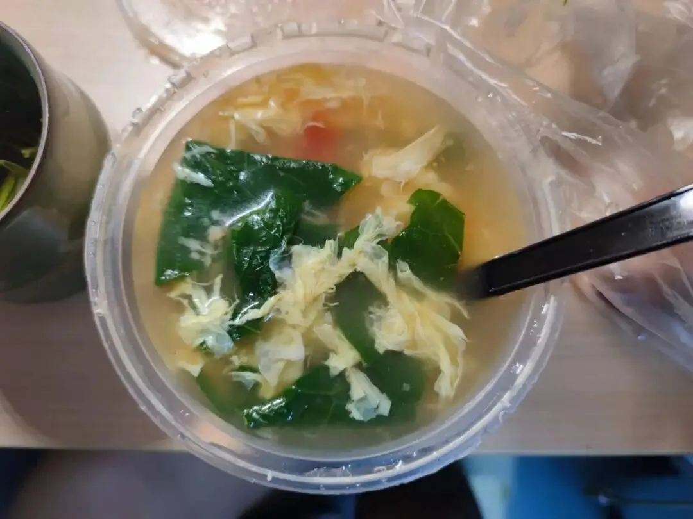

请相关部门及时关注并跟进问题。

## 1 医务室

“医务室门诊报销，每次必须要先去拿转诊单再到医院真的很麻烦。而且很多时候转诊单上写的科室到医院去挂号的时候医生让挂的并不一样，就报销不了。

而且周六日医务室不开，开不到转诊单。”

## 2 食堂

## “望京食堂晚上卖中午剩的菜，菜价明显比良乡校区高很多。”

## “望京食堂大师傅的疙瘩汤是不是该改进下了，各个配菜各有各的想法”

## 3 教室

## “望京校区的教室什么时候能开空调啊，闷热闷热的，感觉都喘不过来气。”

## 4 论文送审

“政府管理学院mpa论文送审一个多月了一份都没回来？为什么别的专业都陆续出来了。五一假期都不能好过。”

## 5 奖助补费

“投稿：弱弱的问一句，学校可以在放“五一假”前发放5月份的低保吗？比如4月30日发放，一定比5月6日发放让贫穷学子感激涕零的。”

## 6 图书馆

> “投稿图书馆静音仓消毒问题。图书馆静音仓是封闭空间，每天都被不同同学使用，但从没见到保洁阿姨消毒，在里面读书总是想打喷嚏，感觉有很多灰尘和细菌。希望同学们能自觉保持卫生，也希望阿姨能定期消毒杀菌。”

## 7 证书问题

## “关于毕业证书问题。

私以为毕业证书上加上所是非常合理的。社科大还很年轻，一个年轻的大学不参加国际国内社会上所有的排名，又无92的名头，社科大的学子仅仅拥有一个社科大的名头在社会上竞争力相对就很弱。私以为改革不是一蹴而就的，必须要有中间过渡形态。证书上加上研究所是当前中间的形态，而证书上统一写社科大不加任何所是以后的最终形态。先利用强所的研究生院的名头给学生一个保底的竞争力下限，以强带弱，再随着改革的推进，学校的融合，社科大的名头足以在社会上家喻户晓的时候，此时再取消研究所的证书，统一改为社科大甚为妥当。当前急匆匆以社科大为名头，各个专业之间吃大锅饭，名头不足，又无双一流、92为背书，研究生院感觉都快赔进去。

（见《[【读者投稿 】此地是何地？](https://mp.weixin.qq.com/s?__biz=Mzg2MjcwNzQ1Mw==&mid=2247487948&idx=1&sn=e596708e86a8e6f88041acf204633b35&chksm=ce029a5ef9751348282e9655f4598c5d729043392b5b70e6ef5145cb7f13ba73de5cfbdfa3d6&scene=21#wechat_redirect)》第4条）

## 8 经费问题

“最开始只是一个同学说社科大经费不是很多，结果到最后竟然成了别人借题发挥的根据了。希望各位理性一点，不要无脑的互相喷”

（见《[【读者投稿】身在其中的每个人](https://mp.weixin.qq.com/s?__biz=Mzg2MjcwNzQ1Mw==&mid=2247488139&idx=1&sn=76ee2b84870340c27cdbfbe0a8b3338f&chksm=ce029919f975100ffb89e7d4229bb71faecf75d63363ea0c58ffdafd305f3a8c7a10aee10504&scene=21#wechat_redirect)》第5条）
