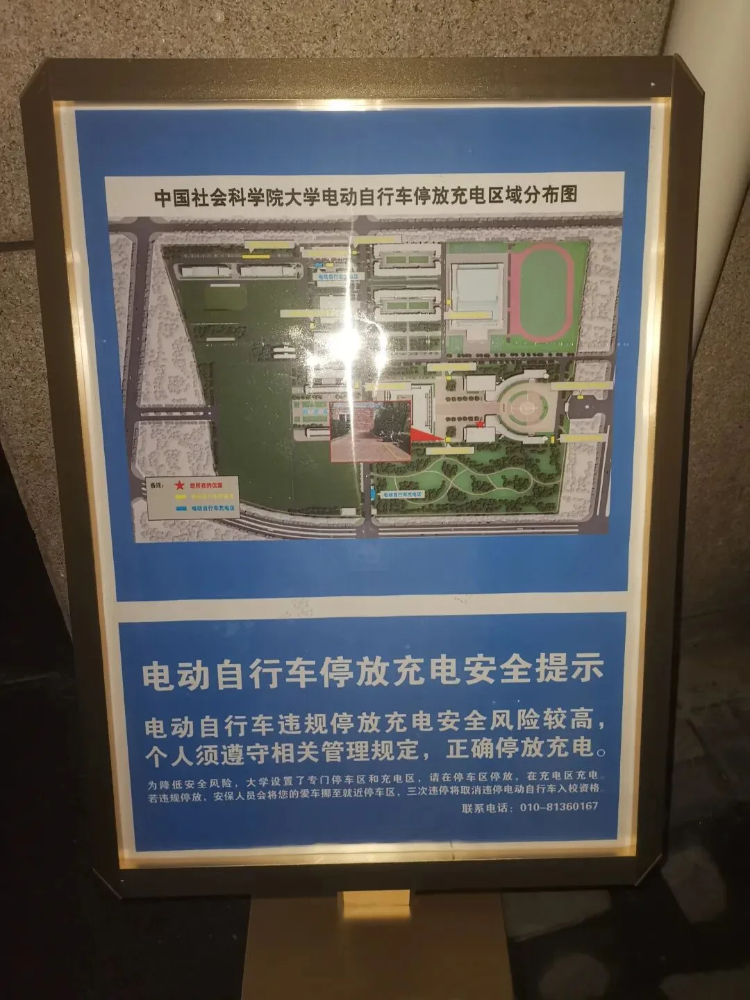
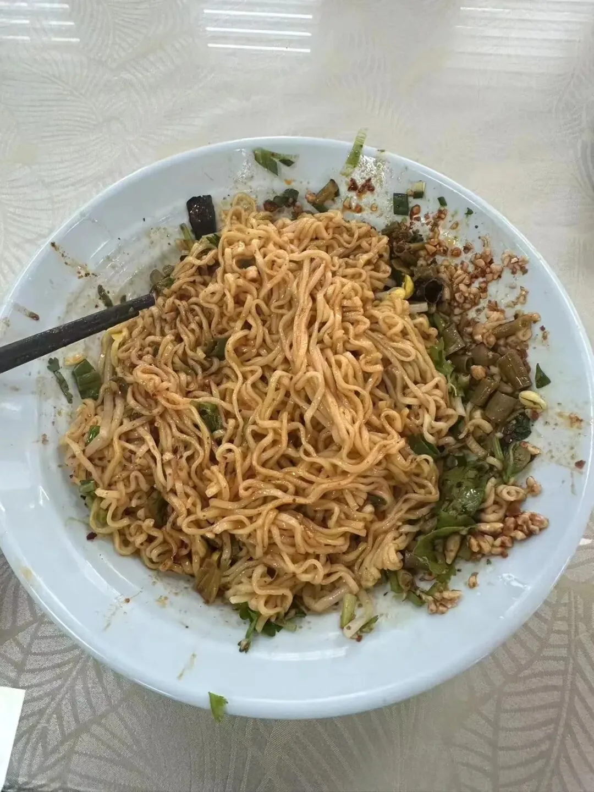
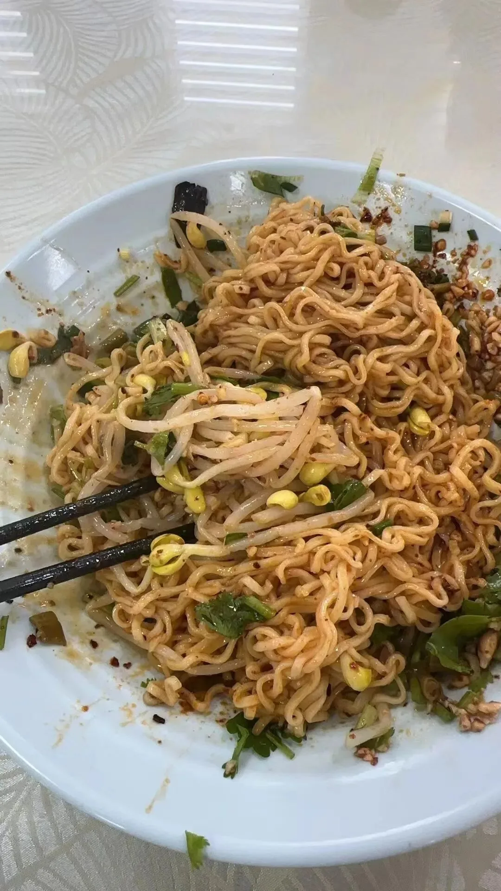
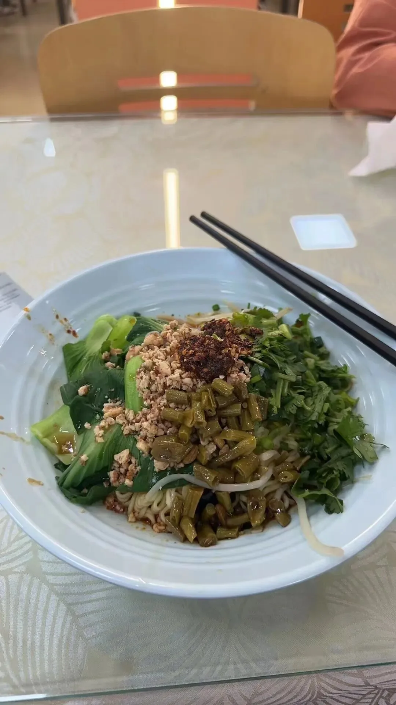
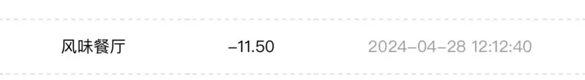
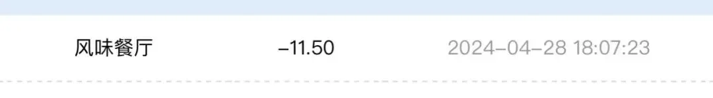

请相关部门及时关注并跟进问题。

## 1 电车停放

“表扬一下，这个就很好、很贴心，说明社科大还是能把事情办好的！也知道该怎么为大家提供方便，前提是真的重视～

社科大的其他行政如果能像对安全问题一样用心，站在学生立场思考该怎么为学生提供方便，肯定也能做好！”

## 2 食堂

“望京食堂能不能好好搞搞啊，排骨不是炖排骨还是炖排骨，牛肉不是炖牛腩还是炖牛腩，鱼肉偶尔能见一次鱼片，大多数都是巴沙鱼随便整整挑个味道，鸡叉骨见了好几天，3块5的菜系整的贼油，我真是服了

牛肉，排骨，鱼肉，羊肉哪一个拎出来不是好菜，但为什么总能想到最随便的烹饪，关键是一直这样做就没意思了吧，面做的倒还行，但总不能让孩子天天吃面窗口啊，扛不住啊”

“怀疑良乡二食堂偷工减料。我每天都点加量拌方便面，平时能看到碗的楞，今天发现面把楞都盖上了，我吃了一口才发现今天面多，而且平时没有豆芽。我觉得我被骗了，因为方便面加量多花钱。晚上又去吃一了顿，毛病依旧。

题外话，今天的面条感觉是两种面，粗细啥的不一样。”

## “接诉即办，即刻敷衍罢了！

在二食堂二楼打饭，师傅算错钱死不承认，坚持认为11➕7🟰21，我重复了几遍仍然坚持，还认为我是无理取闹和其他员工吐槽。遂发接诉即办建议提高员工培训，毕竟20以内加减法是食堂经常用到的，这都做不好，不敢想象有多少人被隐形收费。但是接诉即办回复很快也很敷衍，说这样是没问题的钱可以退回。且不说如何退回，比如师傅这种就是认为自己没算错的，（我没有离开柜台时候发现的，及时询问但是师傅一直坚持自己算的对的并且在我面前多次重复11+7=21），后勤处完全回避整改措施和提高培训的问题，只能说接诉即敷衍了。

大学生只是好说话，不是傻子！更不想无缘无故被骂！（我很抱歉影响了后面打饭的同学，不过应该道歉的是我吗？”

（见《【[读者投稿】既无科学 也不院所 更非大学](https://mp.weixin.qq.com/s?__biz=Mzg2MjcwNzQ1Mw==&mid=2247488149&idx=1&sn=64e7da45c7b571dcf7a83175aa9fcdd2&scene=21#wechat_redirect)》第2条）
