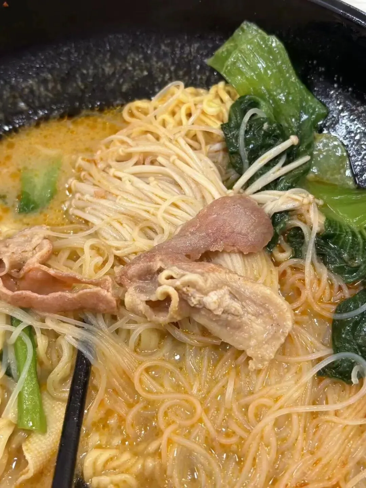
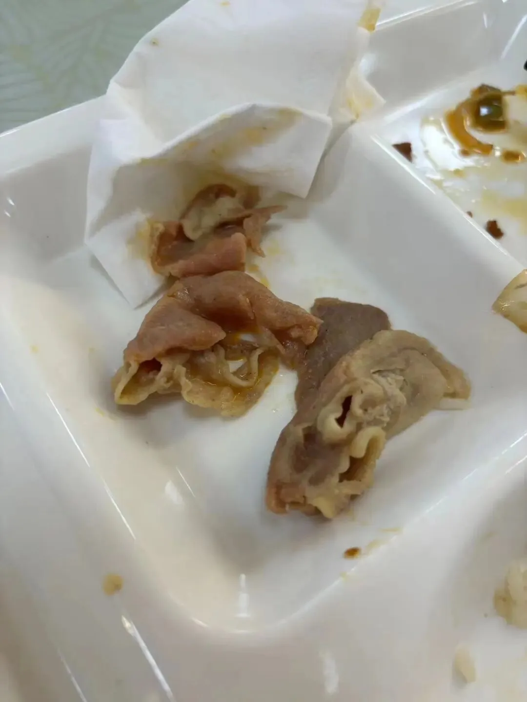

请相关部门及时关注并跟进问题。

## 1 食堂

“救命啊🆘这是什么东西啊，都是瘦肉，还能一半红一半白一半熟了一半没熟，二食堂麻辣烫档口还有没有官老爷关心学生生命权和健康权啊！

如果还对学生有那么一丢丢关心，请正面回复是肉的问题还是工艺手法的问题！接诉即办反映了也总是那种回复了和没回复一样！”

## 2 闸机

“望京校区闸机真有意思，校内学生非让扫脸，不然不让出不让进，外卖进进出出随便，防自己人不防外人是吧，形式主义做尽了保安也好样的，应该给加工资”

## 3 施工问题

“3号楼为什么长年都在施工？这半个月不到时间修了4间宿舍，如果宿舍楼里平均每间宿舍都有漏水铺防水的问题，为什么不能集中假期，集中人力统一修了？反而每次都在同学在校期间修，不仅要大费周章搬宿舍还要产生噪音影响学生休息？搞得宿舍跟个工地似的

另外，每次维修宿舍的工人每天上午不能干活，反而每次都挑下午两点开始，3点以后再施工吗？两点左右好多同学都在午休，持续不断的钻来钻去，太打扰休息了，你们行政后勤两点都上不了班，别说什么3点以后完不成任务，上午工作时间不施工，卡着2点开始使劲钻，怎么一个屁大点宿舍是多么庞大的工程嘛？晚一个小时还干不完了，还是说得看着黄历，两点是黄道吉时呢

这个垃圾宿舍从进到学校就一直在修，修到毕业了还没修完，修不好推翻重建得了”
