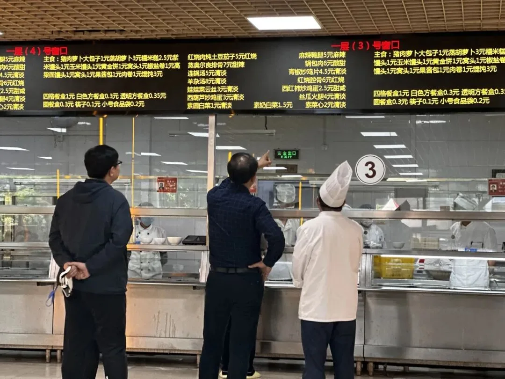
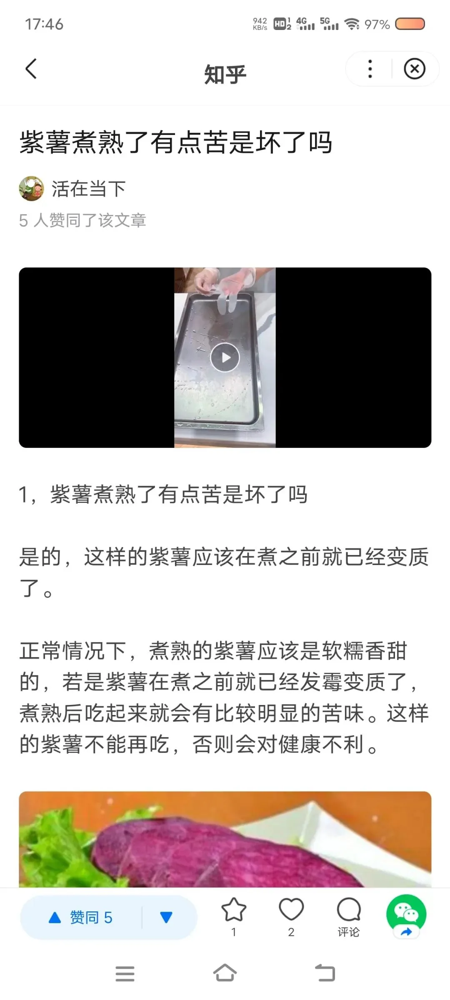
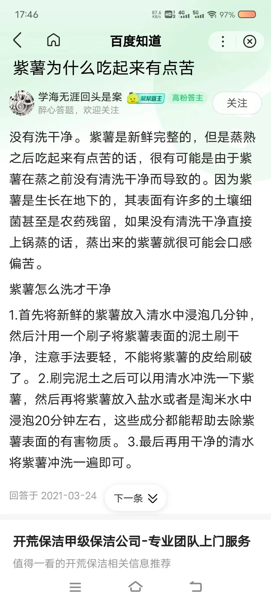
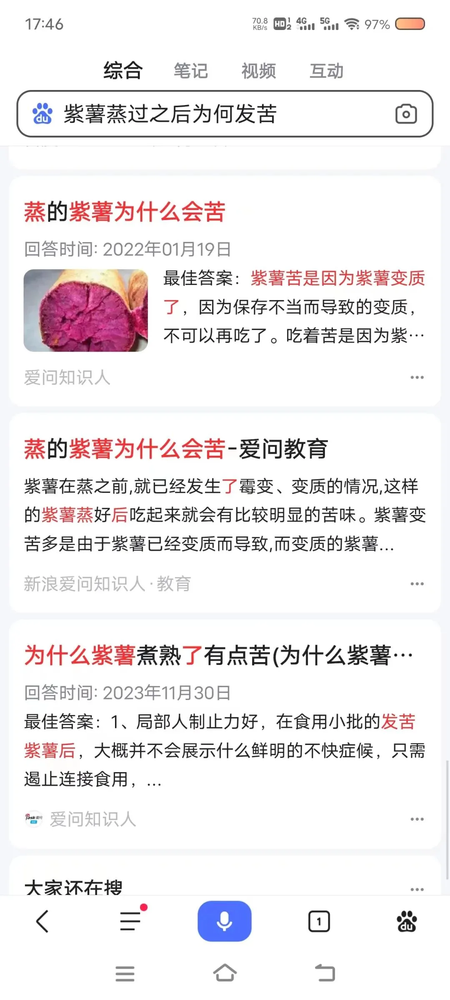

请相关部门及时关注并跟进问题。

## 1 医保报销

“搞不懂学校医保为什么只能报销颗粒药？我去望京医院看病，医生说没见过医保不报销汤药的，而且有些病就是要喝煎的药才行，真的很不理解学校为什么要这样。”

## 2 宿舍

> “宿舍吐槽，前段时间提到的单人宿舍的事情咋没有消息了，不了了之了吗？那些单人住的依然还是单人住，后勤人员能收了红包给人家安排单人宿舍，这种风气多么恶劣，何时能改变？谁来改变？”

“大学生宿舍用水费：从平均走向公平在大学生活中，宿舍用水费的分配问题长期存在，但由于没有足够好的方案而长期搁置。这里先简单谈一下现状与问题。首先是水表的现状，目前，七、八号楼宿舍（其他宿舍不确定）的热水用量是通过每个宿舍对应的水表来计量的。这种计量方式的不足在于，它不能反映出每个宿舍内个别学生的实际用水量。事实上，这些水表通常只显示到小数点后一位（0.1t=100L，￥4）。这里先粗略地计算下，假设宿舍绝大部分的用水为洗澡与洗衣服。再假设大部分人洗一次澡并洗衣物需要100L的热水，要花￥4。而大部分宿舍都是4人间，一个月一般为30天。所以一个宿舍一个月交热水费￥480？如果有这样一个宿舍小于这个数据的话，这意味着它们无法提供精确的单个人单次洗澡和洗衣物所用的热水量。而目前，由于水表的限制，宿舍用水费的分配方式通常是均摊（可能还有按一定的标准分，如按次数分等），这种方法因简单易行和且相对可行而被广泛接受，但它忽略了个体之间的差异，如洗澡频率、常用水温、洗澡方式等，可能导致一个极端不公的现象：那些经济条件较差的同学往往更加节约用水（直觉，欢迎用数据反驳），却不得不分担更多的水费。这种现象不仅违背了公平原则，也可能引发学生之间的不满和争议（之前社论似乎出现过）。再加上学校大概率不会接受工程量较大的方案，如新建一个公共澡堂或改造设备使其能够刷各自学生卡而不是一个宿舍中唯一的那张水卡的模式（同学们可能也不支持）。毕竟不说乐不乐意，现在学校能否承担更换水表或改进用水计量系统的费用，都是个问题。因此，寻找一个既经济又方便的解决方案变得尤为重要。

在水表实际精度能达到0.01t，后台能实时查看每分钟的剩余水量的前提下，笔者将提出一个可能的解决方案。这两个前提需要学校后勤处派人验证下。基于水费的充值，笔者推测是能达到的。如果没猜错，学校的那个水表是智能热水表。前者，亟需验证。至于后者，在终端是能读到剩余的水量的，假设有个无聊的人每分钟去水表/终端那查一次，这显然是达到的。一方面，充值终端和水表显然不具备足够大存储空间，另一方面，根据一点关于智能卡和物联网的知识，我们可以大胆猜想有一个或多个后台系统接受并存储了这些数据。而笔者提供的解决方案正是基于此。

一个可能的解决方案是将该平台的数据向学生开放，允许学生查看一定时段内的用水量，精确到0.01t/分钟（可以参考校园卡系统）。这样的系统不需要改动现有的水表等硬件，而是通过对软件的调整，给每个学生提供一个公正的用水费用报告。当然，这个方案的可行性有待学校后勤处与锅炉房背后的公司交涉。至少在笔者看来，在满足上述的前提的情况下，这是比较容易做到的。当然，其中可能也存在一定的问题，如能否允许其他宿舍的人查本宿舍的用水量。

总之，笔者相信通过对现代技术的理解和运用，我们可以朝着更公平的用水费用分配迈进。虽然此事不大，但这不仅是对资源的合理利用，也是对学生公平原则的尊重。期待学校能够检验笔者这个不成熟的方案，也希望在大家的努力下，我们的宿舍生活更加和谐。”

## 3 食堂

> “想问一下同学们，有没有和我们宿舍一样吃完望京食堂肚子不舒服，先是隐隐的不太舒服，然后一阵肚子疼，上完厕所就好了。（前段时间是正餐，现在早餐也有这么好的清肠作用了诶）”

“树副校亲临我校一食堂窗口进行指导，和食堂员工、同学亲切交谈，看了许久的菜单，只是一道菜都没吃…”

“社论好！今天（5.6）二食堂自选紫薯是苦的，本来以为就是这样，吃完了百度才发现不对劲。不论是发霉变质还是没洗净都是对身体不好，希望学校相关部门看见了可以改进～

据说接诉即办最近很敷衍？？我选择发一下社论，正好提醒一下不知道的同学们 紫薯发苦了不要吃了哈～”

（见《[【读者投稿】在历史与现实的维度上](https://mp.weixin.qq.com/s?__biz=Mzg2MjcwNzQ1Mw==&mid=2247488212&idx=1&sn=b4a9d8130f2af97f4e3b794fa4d6e765&scene=21#wechat_redirect) 》第2条）

## 4 学位证书

## “投稿：关于学位证书教育部有相关规定 各位看官自行判断：

https://mp.weixin.qq.com/s/1pNAkaUo8walS5z-kWFu7w

接上条：学历证书同样有规定 或存在可操作空间。《教育部关于当前加强高等学校学历证书规范管理的通知》教学〔2002〕15号”

（见《[【读者投稿】在历史与现实的维度上](https://mp.weixin.qq.com/s?__biz=Mzg2MjcwNzQ1Mw==&mid=2247488212&idx=1&sn=b4a9d8130f2af97f4e3b794fa4d6e765&scene=21#wechat_redirect)》第4条）

## 5 除虫

## “投稿，请求学校进行一下除虫，学校里虫子的密度直逼森林公园，走路都有虫子糊脸”

（见《[【读者投稿】在历史与现实的维度上](https://mp.weixin.qq.com/s?__biz=Mzg2MjcwNzQ1Mw==&mid=2247488212&idx=1&sn=b4a9d8130f2af97f4e3b794fa4d6e765&scene=21#wechat_redirect)》第1条）
