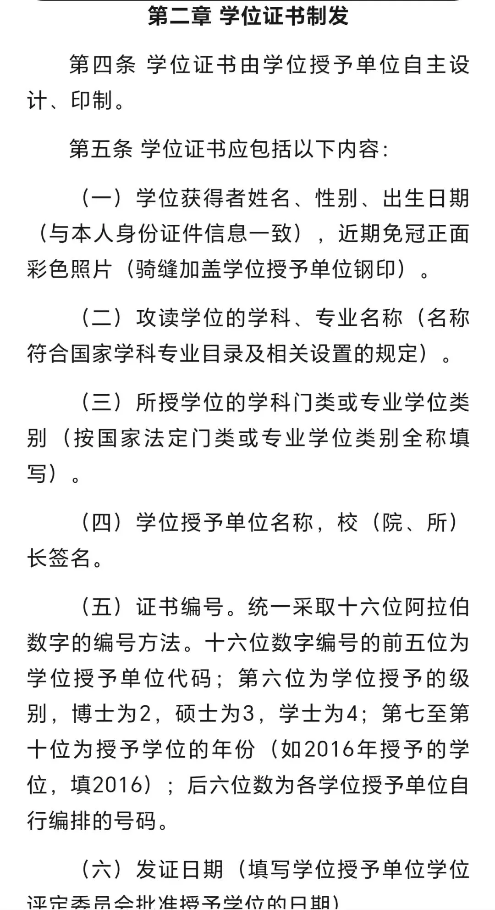

请相关部门及时关注并跟进问题。

## 1 校园卫生

> “想给后勤处提一个郑重的建议：请组织人员把教学楼、北综合楼、图书馆和相关自习室的桌椅和门擦一擦。在我校，但凡是长期自习的地方，桌椅全都油腻不堪，甚至可以说是油渍斑斑，随手一摸都是油。根据个人经验，其他高校如北大、清华、人大的教室桌椅，没有像我校这样油腻到如此程度的，难道是桌椅材料的原因吗？恐怕还是后期清洁的原因吧。恳请后勤处能注意到这个问题，组织相关人员做一下简单清洁，并形成固定制度。擦这些其实工作量并不大，无非是桌面、椅子和门把手，辛苦程度应该比清洁地板要小。如果半个月能擦两次，也不至油腻到这个地步。由于对我校行政效率和能力早已丧失信心，所以本人向来不想跟行政部门呼吁些什么，但是看到有些同学自习前都不得不自己用湿巾把桌面擦一遍，椅子擦一遍，不禁感到有些哑然失笑。不知道这个小事，后勤部门能否做到呢？不知道行政楼会议室的桌椅是不是也这么油腻呢？不知道学校行政能不能把做会务的细致心思花在服务师生日常需求上呢？哈哈哈，不知道了。”

## 2 医保报销

“回复1：那个医保报销，如果要开中药，下次记得让大夫把汤药开成颗粒，效果基本上差不多，但是会更贵一点，颗粒属于甲类，报销比例90%。

医保报销范围应该是政府规定的，不是学校规定。”

（见《[【读者投稿】亟待解决的问题与进行指导的领导](https://mp.weixin.qq.com/s?__biz=Mzg2MjcwNzQ1Mw==&mid=2247488224&idx=1&sn=e14ba4d6893a793c3ab3f3914dba0dfc&chksm=ce029972f9751064bf5d9f992f58be6b8665bd639b6602605043a2a9069abdf7189b383f679f&scene=21#wechat_redirect)》第1条）

## 3 食堂

“社论君好，食堂早餐可以多点粗粮嘛，玉米胡萝卜什么的，有时候早上七点半去已经没了。。。”

（见《[【读者投稿】亟待解决的问题与进行指导的领导](https://mp.weixin.qq.com/s?__biz=Mzg2MjcwNzQ1Mw==&mid=2247488224&idx=1&sn=e14ba4d6893a793c3ab3f3914dba0dfc&chksm=ce029972f9751064bf5d9f992f58be6b8665bd639b6602605043a2a9069abdf7189b383f679f&scene=21#wechat_redirect)》第3条）

## 4 证书问题

“接5.6日推送第四条，选取其中相关文字，以佐证所谓“ 或存在可操作空间”，供大家参考：

第二章：

第四条 学位证书由学位授予单位自主设计、印制。

（四）学位授予单位名称，校（院、所）长签名。

第四章：

第十四条 学位授予单位负责：

（一）设计、制作和颁发学位证书；

（二）收集、整理、核实和报送本单位学位授予信息，确保信息质量；

（三）将学位证书的样式及其变化情况、学位评定委员会通过的学位授予决定及名单及时报送省级学位主管部门备查。”

## “

教育部规定应包含以上内容，却并未禁止加上研究所的名称。希望各方重视，校方认真研讨，用好学位证书自行设计印制权，将社科大的招牌真正打好，不忘主席嘱托，坚持本校定位，向“将本校办成世界一流文科大学”和“马克思主义坚强阵地”“培养人文社会科学拔尖人才的研究型大学”的目标不断进发。 “志之所趋，无远弗届，穷山距海，不能限也”，虽然离目标还很远，这条路也会艰难，但希望学校师生共同努力，办好社科大，吾等与有荣焉。”

（见《[【读者投稿】亟待解决的问题与进行指导的领导](https://mp.weixin.qq.com/s?__biz=Mzg2MjcwNzQ1Mw==&mid=2247488224&idx=1&sn=e14ba4d6893a793c3ab3f3914dba0dfc&chksm=ce029972f9751064bf5d9f992f58be6b8665bd639b6602605043a2a9069abdf7189b383f679f&scene=21#wechat_redirect)》第4条）
