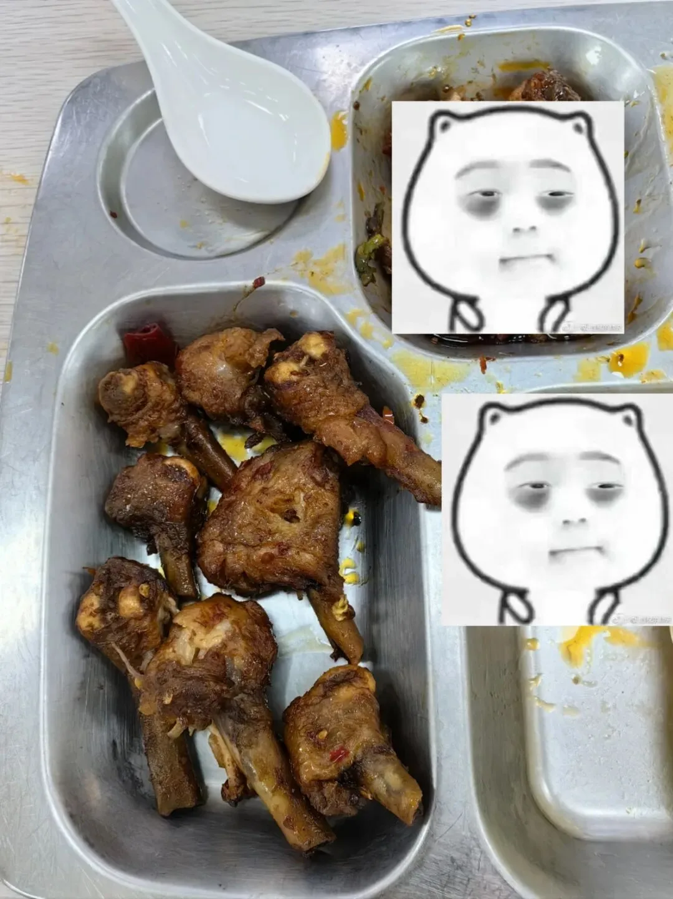
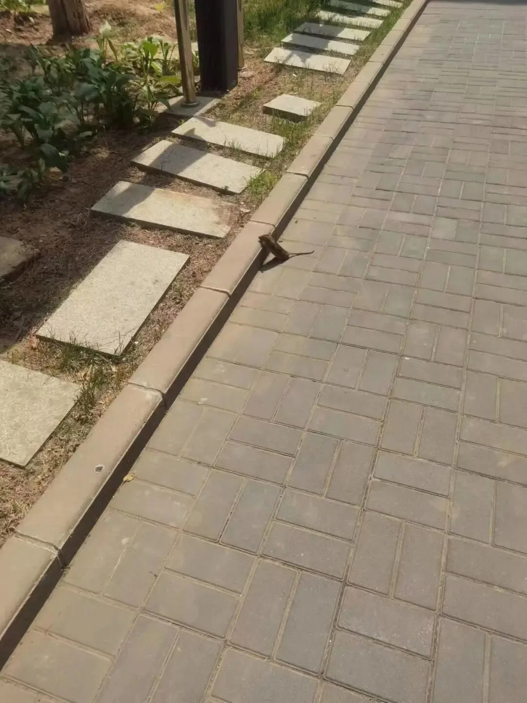

请相关部门及时关注并跟进问题。

## 1 明知故犯

> “社论君好，吐槽一下贵校学生会刊发的这篇所谓“宫崎骏”打开社科大。宫崎骏先生曾经明确反对过将他的作品投喂ai绘画，这是否是一种明知故犯？此外难道贵校学生会已经没有办法依靠自己的水平拍出审美在线的照片了吗？何时轮到ai拼接的shi kuai来为我们增添荣誉感和爱校感？”

## 2 食堂

## “投稿望京食堂。请问我吃一份辣子鸡，祸害了几只鸡？”

## “5.10晚饭，望京食堂，这鸡胗，能辣死人，请问厨师自己能吃下去吗？”

## 3 宿舍

> “望京这边宿舍能不能把浴室水温最高温调低一点啊，早上去洗澡拧到最冷边还是滚烫的热水。真的是，早前不用调的水温也算能接受，现在的奇葩水温需要一个人支配六个水龙头，我踏马不想做水龙头的神，我只是想要一个水温适宜的洗澡水。你改就算了，能不能让你所谓调水温的仪器准点啊，真的大服特服”

## 4 奖助补费

> “很多高校，博导招生都需要配套的经费，统一提交到研究生院，研究生院每月发给学生，提高一下学生的补助标准，为啥不学习一下呢？社科大这种大锅饭咋时候改革一下？希望大家广泛讨论，推动改革和优化。”

## 5 学校超市

“大家有没有觉得研缘超市的雪糕 有一种冻不实的感觉，都一点了，我想着就算你十点才开冰柜的电，也差不多了吧，希望研缘不要再这样了……”

## 6 鼠鼠

“社论君您好，希望相关部门可以开始除一下鼠鼠了。猫也是白养，和老鼠同居一隅晒起太阳来了。”

## 7 闸机问题

> “看了投稿，闸机问题，门口的闸机确实灵敏度不是很高，不好用，但这也是为了校园安全，如果有人出示了假的二维码，他虽然刷不开闸机，但如果保安放他进来了，确实可能造成危险。这个的改进方法应该是让门口的闸机更加灵敏，更加高效”

（见《[【读者投稿】考虑不周引投诉 闸机不便生冲突](https://mp.weixin.qq.com/s?__biz=Mzg2MjcwNzQ1Mw==&mid=2247488238&idx=1&sn=7fc8d9618df983063135aac83cd49991&chksm=ce02997cf975106ac76a91efbd096f41754653358a22c22ba000dfaf5c22a7bb2b1b0cfee432&scene=21#wechat_redirect)》第2条）
