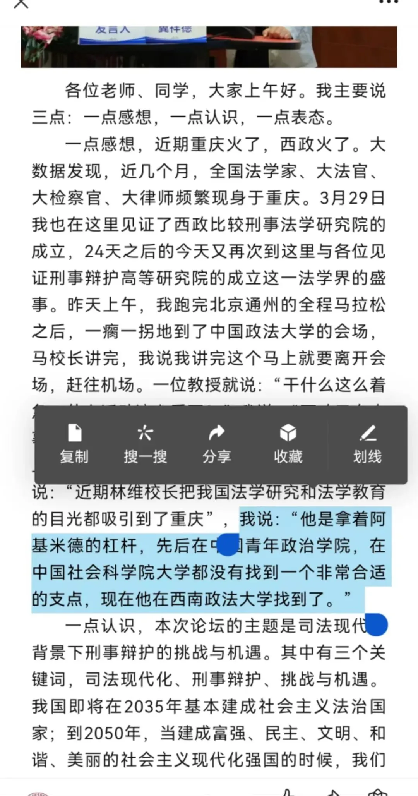

请相关部门及时关注并跟进问题。

## 1 学校超市

## “社论君好，研缘超市就要搬走了，想投个稿，内容如下：

研缘超市从2011年良乡校区建立之初就开始服务社科大（研究生院），为我们提供种类丰富且价格总体低于市场价的各种商品：比如1块3的农夫山泉、2块8的三元纯牛奶…… 研缘超市还收养了小黑，在疫情期间给同学们免费送过水果，与我们学习生活有过不少羁绊。 5月22日，也就是2个星期不到，新中标超市即将进场，研缘超市就要搬离社科大了。我们可以一起做一个“研缘超市价格记录共享文档”，既是为了记录研缘，也是为保障大家的权益留下记录（新超市是竞标价高者得，租金应该会比较高）。欢迎大家一起在表格中补充商品名称和价格吧！ 【腾讯文档】研缘超市价格表 https://docs.qq.com/sheet/DQ1RrTllkUklLa3pJ?tab=i9do84”

## 2 宿舍

> “投稿：想做个小调查，迄今为止2022年9月竣工使用的学生宿舍7号楼有多少宿舍漏水做防水还回回做不好的？十几年前的老楼做防水做个没完，新楼为什么也会出现同样的问题。相关的预算支出是重维修轻初建么，很难理解。”

## 3 法学研究与教育

“社论你好，投稿。不知道社科大、社科大法学院诸位领导看见此番言论作何感想？社科文献出版社的社长，贵校的教授，在别处畅谈前副校长，好不令人感慨啊😄

https://mp.weixin.qq.com/s/Yq-4lRcYpdyMPY69sobPhA”

## 4 毕业就业

> “投稿，希望学校把秋季毕业证书的时间能够改一改，不要太死板了。日期延后半个月就能让好多秋季毕业的学生满足下一年的招聘简历条件。好多单位现在就卡毕业时间，如果把毕业证时间往后延一点，能多参加好多单位的招聘。”
