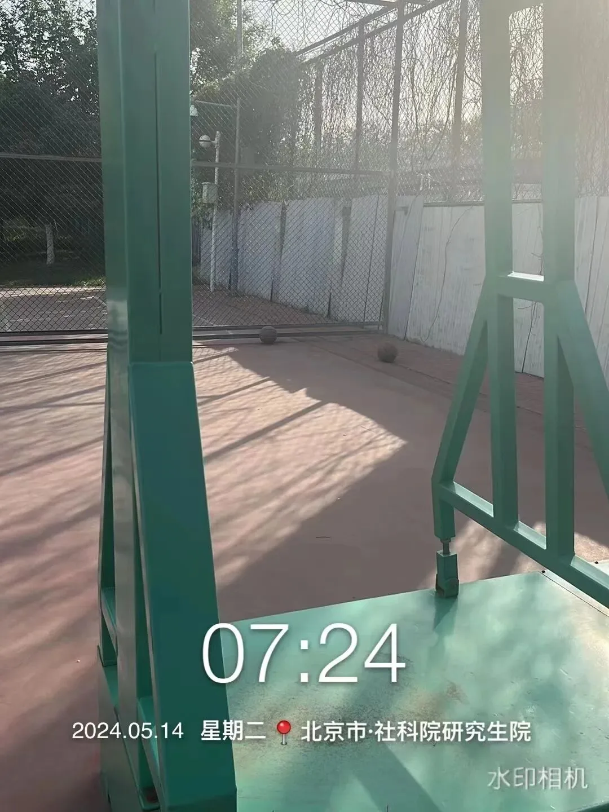

请相关部门及时关注并跟进问题。

## 1 学校超市

“支持记录价格，楼下那个超市是又贵有用东西又少，白瞎了那么一大片地方。 新来的超市如果也玩命割，社科学子真就没活路了。”

> “投稿。正常来说，招标时候应该对超市的物价进行了限制，来保证超市提供正常物价商品。也就是说，任何涨价行为都是违反合同的，只要我校是正规招标，正常签订合同，超市物价更高的事情不应该发生。”

（见《[【读者投稿】毕业季在即](https://mp.weixin.qq.com/s?__biz=Mzg2MjcwNzQ1Mw==&mid=2247488260&idx=1&sn=80c18fc9b782d13e551df5b3f257707b&chksm=ce029896f9751180c9f696b2a856c59f5d97c916527bbe2f9b7576a70a5bf0f3b671d72e4dab&scene=21#wechat_redirect)》第1条）

## 2 学校形象

> “回复昨日关于冀老师评论林老师那句话的问题。相信冀老师的话说到林老师心坎里去了，社科大虽然在积极“入主流、入体系”，但社科大具有研究机构办大学的鲜明特色，“入体系”的存在必然会导致它难以成为一所真正意义上的“主流大学”。而西政作为一所在主流国民教育体系之内的老牌政法院校，足够承载林老师的理想抱负，林老师的才华能力也担当得起西政校长的重任。林老师的调任，对社科大，对西政，对他本人都是幸事，看到林老师在西政大展宏图的样子，作为曾经的石瓦坡坡民，现在的尤卡斯鹅，我由衷为林老师感到高兴。”

（见《[【读者投稿】毕业季在即](https://mp.weixin.qq.com/s?__biz=Mzg2MjcwNzQ1Mw==&mid=2247488260&idx=1&sn=80c18fc9b782d13e551df5b3f257707b&chksm=ce029896f9751180c9f696b2a856c59f5d97c916527bbe2f9b7576a70a5bf0f3b671d72e4dab&scene=21#wechat_redirect)》第3条）

## 3 公共设施

“投稿望京校区：哪位同学素质能不能高点？知道你很累了，学校都给你安排柜子了，自取自用，玩完放回去很难是吗？幼儿园小孩都做的到的事！”

## 4 宿舍

“请问良乡校区寝室的问题何时能够得到回复呢，那么多单人寝室和空寝室，但是却不愿意调给在现宿舍里作息不合的同学。”
