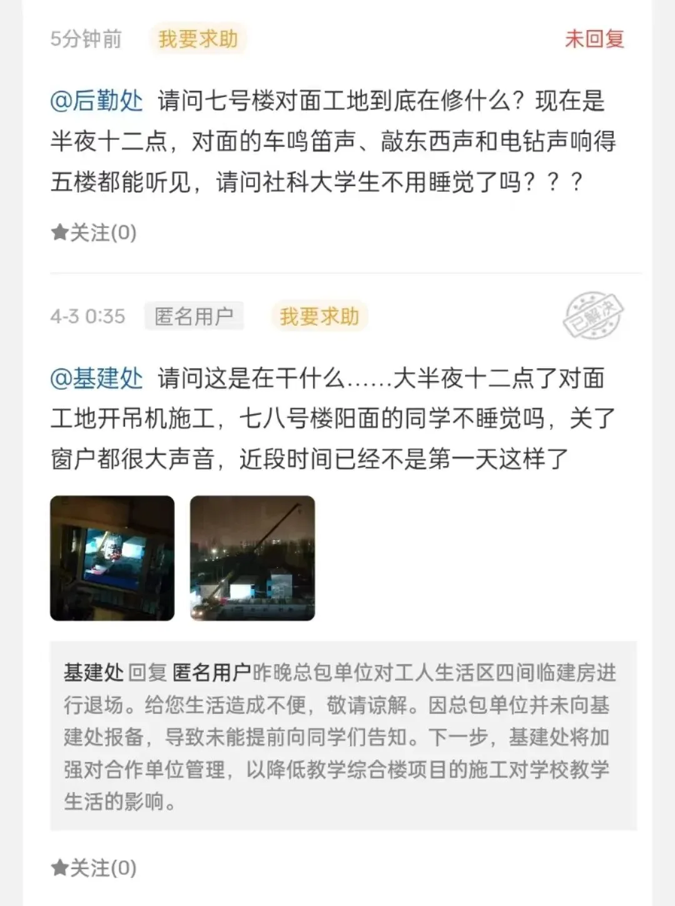
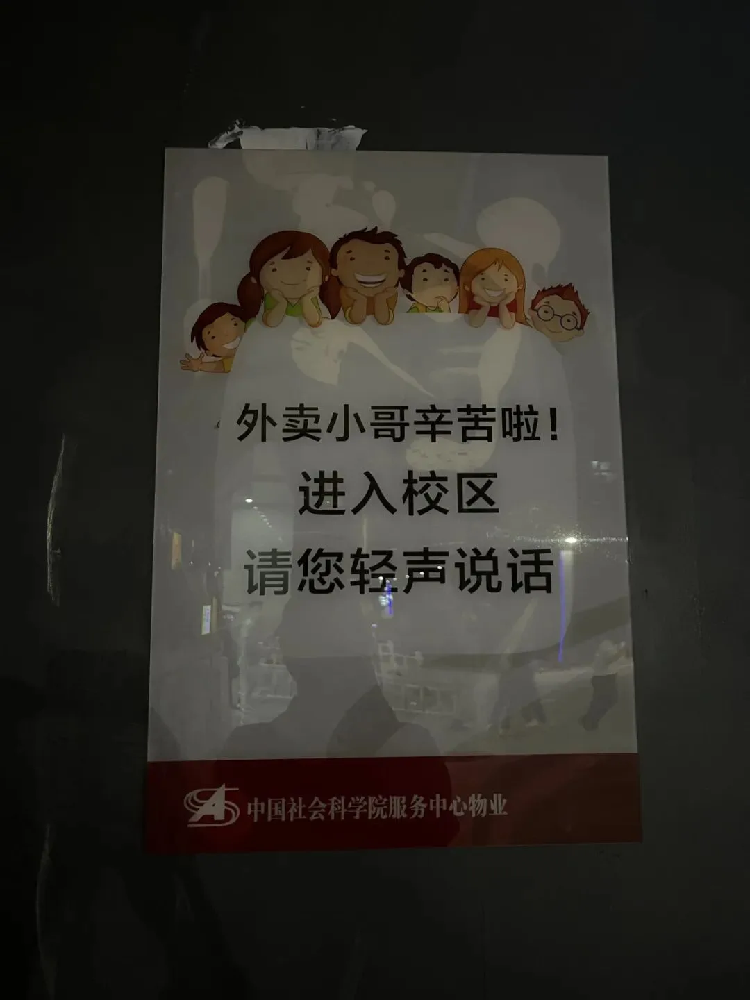
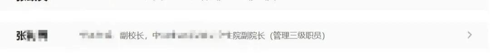

请相关部门及时关注并跟进问题。

## 1 施工

> “想问一下7号楼对面的工地是在进行什么国防重器两弹一星的秘密研发吗？怎么半夜十一点了还喧嚣不停连夜赶工，看来此项目重要性比需要用“门禁”来保护的脆弱大学生还要重要了。半夜十一点的学生是需要用门禁来强令休息的，但半夜十一点的休息是可以被施工打扰的。看来此项目是本科教学验收和评上双一流的最关键一步，我祝它成功吧。”

> “社论君好，投稿七号楼对面工地。 现在是半夜0:07，但依然回荡着工人的叫喊声、车队的鸣笛声和施工的响声。可以理解施工队赶工期等问题，但请问也能否理解一下学生的休息问题？号称人文关怀的学校到底是以人为本还是以建筑为本？另外这已经不是第一次反映同类问题了，之前就已经在接诉即办平台提过，但改动效果显然甚微。”

> “投诉学校施工噪音问题，提请相关部门注意： 最近这几天中建三局工地的施工时间开始过早，七点不到，就在咚咚咚，敲敲敲。晚上十二点以后也还在施工，噪音影响到学生休息了。社科大的楼房隔音效果这么差劲。很烦扰。建议学校和施工方沟通一下，遵循符合劳动法及社会规范的施工时间 ”

> “投稿，晚上23:40分开始，学校内工地竟然开始施工，钢管声和马达声响彻云霄。还让不让人睡觉了，二半夜的施工啊？ 补充投稿，现在是凌晨1:11，外面又开始施工了，管子摔地面的声音还是很响”

## 2 宿舍

> “投稿：7号楼热水有很浓的管道金属锈味，这学期越来越明显。在水流动的时候可能不仔细闻闻不到。但是在擦头毛巾、头发等纤维密集易留味处都会残留很多锈味（看不见的锈物）。对皮肤、身体健康会有持久损害。直观化证据参见各楼水表箱的水垢。”

## 3 外卖柜

“（望京校区）外卖柜旁边的告示，为啥要写外卖小哥呢，外卖员也有女生啊，很奇怪。 作为一个人文社科学校，我觉得可以做得更好。”

## 4 三级职员

“社论好，投稿一则感慨。注意到学校官网“现任领导”一栏中我们“敬爱的”老编同志已被提为管理三级职员。

根据原人事部（现人社部）《事业单位岗位设置管理试行办法》相关规定，三级管理职员对应厅级正职。考虑到贵校似乎并非中管高校，不太可能配置正厅级副校长， 所以本人大胆揣测这位老编可能马上要晋升校长😆

不得不感慨的是，老编在学工维稳捂嘴、后勤安全宵禁之外，除了爱好张贴一些摄影书法作品、利用学校公众号发发自己的闲情逸致、压榨学生近乎打白工之外，好像并无其他值得“勇毅书写”的成绩担当，可说较之于某人都是“有不及而无过之”。不知消息灵通人士和广大的其他社科大人又会有何见解呢？”
