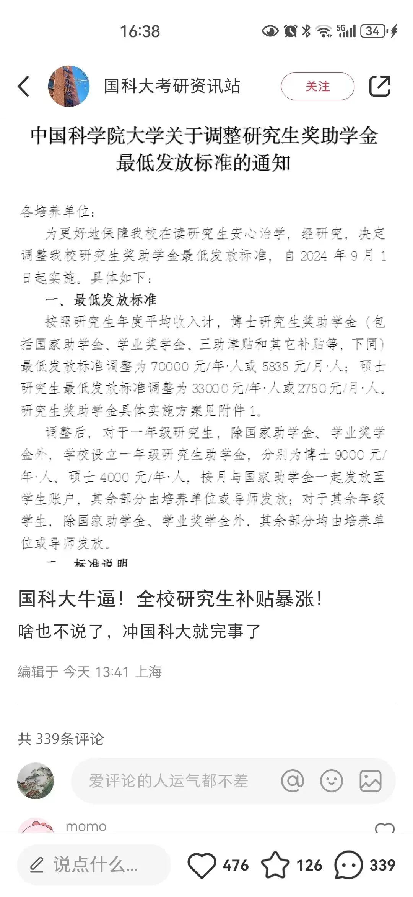
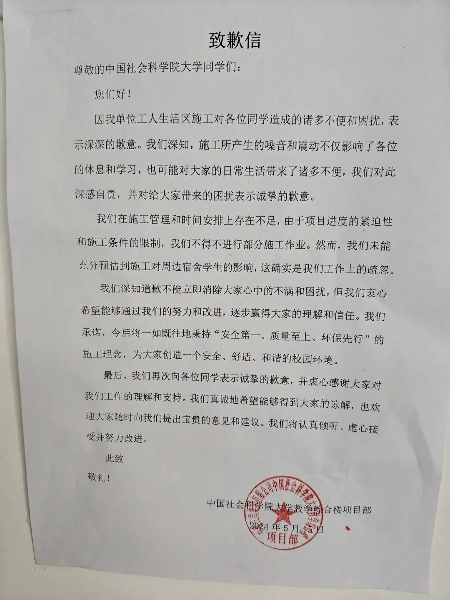

请相关部门及时关注并跟进问题。

## 1 校园活动

“最近很多院校都在办音乐节，美食节，咱们小院也可以组织起来，提升同学们的幸福感！”

> “学校校庆也没人组织，不会办的话学学其他在京高校啊。严重怀疑相关部门人员就是吃白饭的，从来不想着主动工作。就青春社科大发了推文，校友办的推文做的简直无法直视，转发青春社科大推文人家没开白名单，你倒是主动联系一下啊。同一个学校的，搞的跟外单位一样。学校主管各部门媒体的单位就不能通知一下让各单位公号之间都开通转载白名单么？即使学校层面不通知，各二级单位自己就不会主动联系一下？你们就是把好好的部属高校办成地方三本！人家清北校庆老早就筹划了，别说没钱，没钱问社科院要！”

## 2 奖助补费

## “一切尽在不言中。PS：有位领导说：xx大不可能像国科大那样，你们不要幻想了。”

## 3 施工问题

> “匿名投稿（良乡校区）：今天看见关于之前施工的道歉信啦，感觉内容可以说是“浅浅认错，死活不改”呢，说自己存在不足，但是对施工时间依然没有给出任何的承诺，没有解决问题的道歉信不知道存在的意义是什么呢~”

（见《[【读者投稿】扰民困扰多多](https://mp.weixin.qq.com/s?__biz=Mzg2MjcwNzQ1Mw==&mid=2247488280&idx=1&sn=54fad21c690c28326888df6f236c7fa5&chksm=ce02988af975119cf18a98f6e825d456ab522e9009babefe8dd49dc5e33f8d223aab9b4a50bf&scene=21#wechat_redirect)》第1条）
