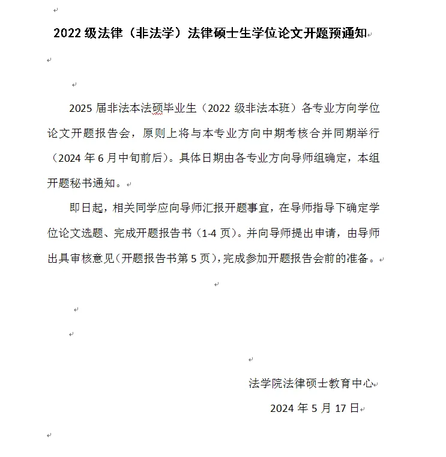
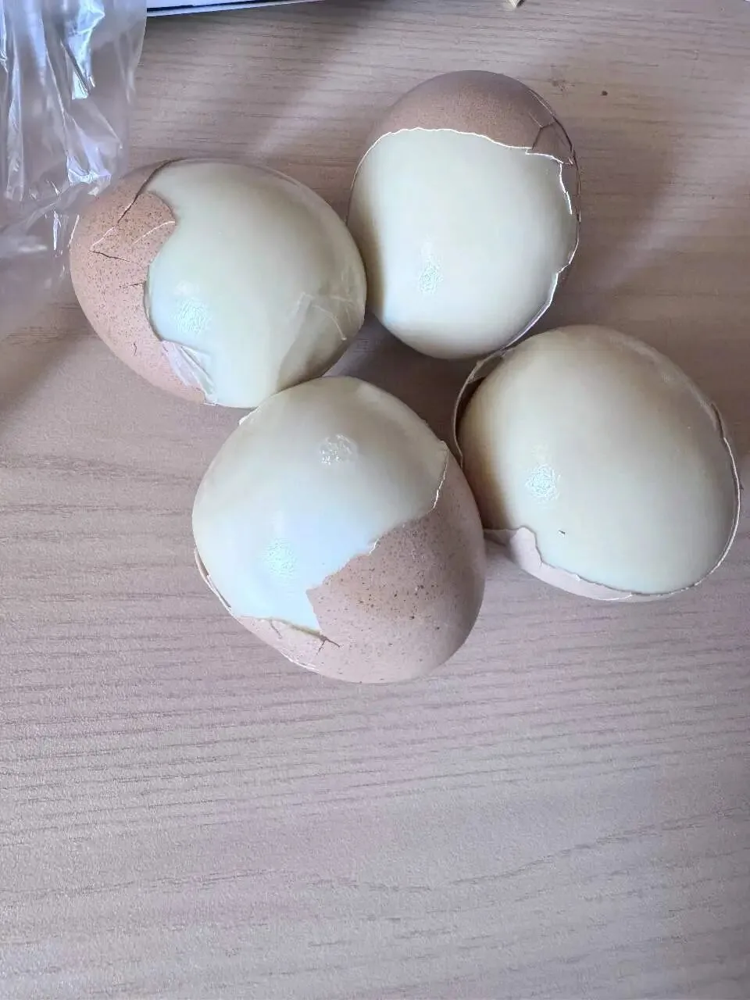
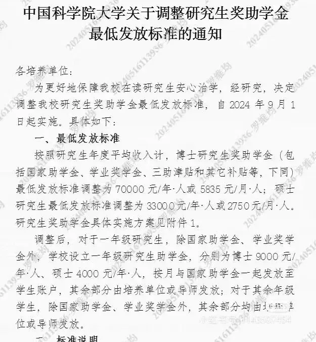

请相关部门及时关注并跟进问题。

## 1 学校职工

> “投稿【看看我👀】今年以来良乡校区图书馆的保洁阿姨都有专门的休息室供阿姨存放物品、喝水、午休。上周物业要求保洁阿姨们从休息室搬出来，现在是把所有东西都放在女洗手间，阿姨们只能在洗手间放两把椅子坐着。这种情况不是发生一次两次了。 请问学校物业的管理层除了履行好维护学校基础设施正常运行和环境整洁的义务外，能否关心关心保洁人员们的生活？换位思考一下，如果是物业领导忙了一天后让你去厕所里休息喝水，你作何感想？如果说没有地方让保洁休息，那为什么原来休息室可以呢？如果说休息室别有用途，现在空着锁着是什么意思？ 保洁也是一份职业，请让提供保洁服务的人也能平等享受到对这份职业的尊重。请尽快给保洁人员一个干净、卫生、独立的休息空间！”

## 2 开题

“2025届法硕开题 你们法硕中心到底是哪个聪明的小脑袋子瓜子想出来的开题前一个月发通知说要开题啊？这活儿干不了赶紧换人干吧。”

## 3 食堂

“\[小小表扬\]周六中午望京食堂的韭菜绿豆芽很好吃，清爽可口，赞一个。希望继续保持，多出绿豆芽（之前一直是黄豆芽，没见过绿的）”

> “投稿望京校区，应该不难看出这鸡蛋变质了吧？我今天早上拿了六个，真怕吃坏了，之前我在家也是煮鸡蛋，这个鸡蛋是放了大概三天才会有这个效果的吧，洗菜不干净可以理解，这个我不理解，水煮蛋跟茶叶蛋一样黄，相机根本照不出来，吃了两个我决定不用好心揣测了，剩下的四个打开都是要腐败的样子，需要我拿着这个东西去领导办公室找吗？”

## 4 研究型大学

## “投稿。一直自称以科研立校的学校，获得这种成绩，实在称不上佳绩。”

## 5 奖助补费

## “投稿，中科大已经提高补助了，社科大什么时候提高补助”

（见《[【读者投稿】庆而少庆 助而缺助](https://mp.weixin.qq.com/s?__biz=Mzg2MjcwNzQ1Mw==&mid=2247488289&idx=1&sn=5b025e3a1ce98841d9a6e5c94d3bd61b&chksm=ce0298b3f97511a523efe2a8d05a46970639a431c55db48966356f422ef62d5260577de559fa&scene=21#wechat_redirect)》第2条）

## 6 校庆

## “7周年这个时间没啥好组织的吧，不整不零的～不过校友办的推文确实蛮拉胯的”

（见《[【读者投稿】庆而少庆 助而缺助](https://mp.weixin.qq.com/s?__biz=Mzg2MjcwNzQ1Mw==&mid=2247488289&idx=1&sn=5b025e3a1ce98841d9a6e5c94d3bd61b&chksm=ce0298b3f97511a523efe2a8d05a46970639a431c55db48966356f422ef62d5260577de559fa&scene=21#wechat_redirect)》第1条）
