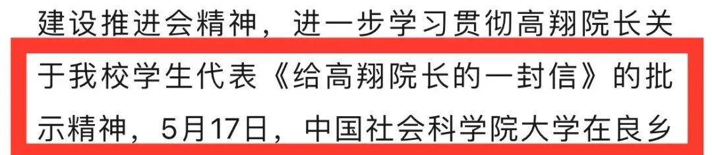
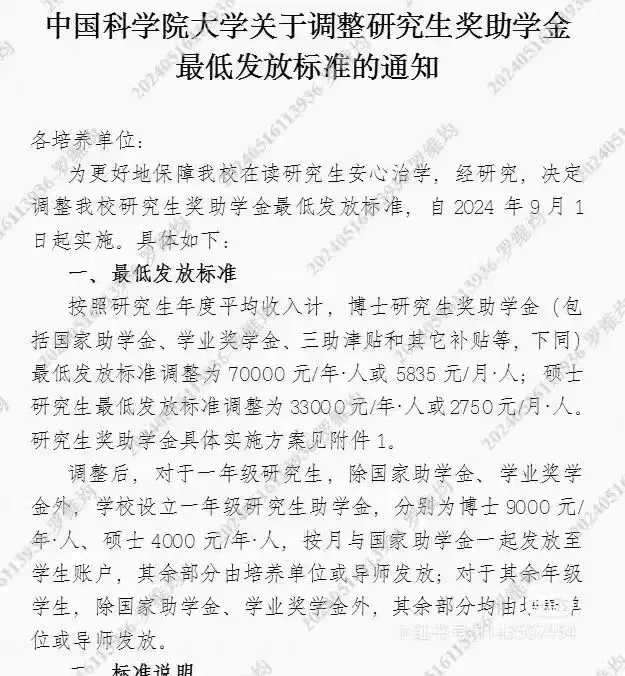

请相关部门及时关注并跟进问题。

## 1 图书馆

> “有没有同学一样觉得校外登录图书馆特别不好用？ 最近点击数据库列表页面，一直打不开，只能手动搜索。 有的数据库根本登陆不进去。比如中国经典古籍库我从来没在校外登录成功过。 今天想试着“读者荐购”，也点不进去。 好多时候只好厚脸皮借其他高校的vpn。用咱们图书馆查点资料太费劲啦。”

## 2 信

## “请问大家，在哪里可以读到这封“信”以及“批示”的全文？”

## 3 开题

> “刚通知，不到一个月就开题。我想问到底是中期考核不重要了，还是开题太随意了。你这样还不如都取消呢？搁这里搞心态。75%的就业率，你们自己反思下吧。好多导师根本不管学生，题目都没定就玩这一套。”

（见《[【读者投稿】更显人文关怀](https://mp.weixin.qq.com/s?__biz=Mzg2MjcwNzQ1Mw==&mid=2247488312&idx=1&sn=a49a2b9e2261ca3da9d2d6bbd9de399c&chksm=ce0298aaf97511bcd0f442a21b2b99611797715d1fbf2596f711c865a332018197705c896db6&scene=21#wechat_redirect)》第2条）

## 4 奖助补费

## “‘中科大的硕士补助比我们社科大的博士补助还高出1000元！’

就问社科大，好意思吗？搞社科的就该喝西北风？”

## “针对第五条，国科大什么档次，社科大什么档次，别给自己抬咖了”

（见《[【读者投稿】更显人文关怀](https://mp.weixin.qq.com/s?__biz=Mzg2MjcwNzQ1Mw==&mid=2247488312&idx=1&sn=a49a2b9e2261ca3da9d2d6bbd9de399c&chksm=ce0298aaf97511bcd0f442a21b2b99611797715d1fbf2596f711c865a332018197705c896db6&scene=21#wechat_redirect)》第5条）

## 5 校庆问题

“学校校庆是从1978年算 不是2017年 是46周年，不是7周年，作为社科大人要搞清楚这个”

> “校庆这个，去年45周年都没有动静，别说不5不0的了，活脱脱不知道相关部门都是干啥吃的，社科大某种意义上来说还在创业期，希望相关部门都动起来，跟着国科大学习学习也行啊，看人家全国各地那么多所，很多都不在北京，人家办的大学还蛮好的，社科大这种入主流入体系一体化一盘棋，希望不是空口号，反正很多人没看到什么改变。懒政和不作为改改吧。”

（见《[【读者投稿】更显人文关怀](https://mp.weixin.qq.com/s?__biz=Mzg2MjcwNzQ1Mw==&mid=2247488312&idx=1&sn=a49a2b9e2261ca3da9d2d6bbd9de399c&chksm=ce0298aaf97511bcd0f442a21b2b99611797715d1fbf2596f711c865a332018197705c896db6&scene=21#wechat_redirect)》第6条）

## 6 人文关怀

“投稿，回这期“学校职工”一条。没想到一所标榜人文社科特色的高校里面行政管理人员能这样冷酷无情，将辛勤劳作的职工赶到洗手间休息，不知道腾出来的休息间要用来干什么，安放行政管理人员的良心吗？

最近这样的事情、以及缺乏补贴的事情，其实折射出的是这所高校的某些行政管理者长期不把教职工学生当人看的思维方式。有时候真是觉得学校有些行政管理人员既没有脑也没有心，没有好好管理学校的能力，心肠却比东门那块石头都硬。职工可以去在洗手间休息，学生则应该拿着最低的补贴，反正他们不是在我视野之内的“人”。什么叫人文关怀？把人当人看就叫人文关怀。很难想象有些人在高唱“把落实理念的思考、措施以制度呈现”之下所谓的“制度文化和文明导向”就是如此体现的，这又将会让社科大人耳濡目染上些什么呢？

这种缺乏人文关怀的冷酷管理，其背后是一个脱离人民群众的问题。之所以能有这样不近人情的安排，是因为有些行政管理人员的确不近人情太久了。某些人应该走出权力的保护壳，在一门心思想着怎么从某级职员变成某级职员之外，亲自去体验体验在洗手间之中办公休息、领着在全北京倒数有名的生活补助将是什么感觉了。”

（见《[【读者投稿】更显人文关怀](https://mp.weixin.qq.com/s?__biz=Mzg2MjcwNzQ1Mw==&mid=2247488312&idx=1&sn=a49a2b9e2261ca3da9d2d6bbd9de399c&chksm=ce0298aaf97511bcd0f442a21b2b99611797715d1fbf2596f711c865a332018197705c896db6&scene=21#wechat_redirect)》第1条）
