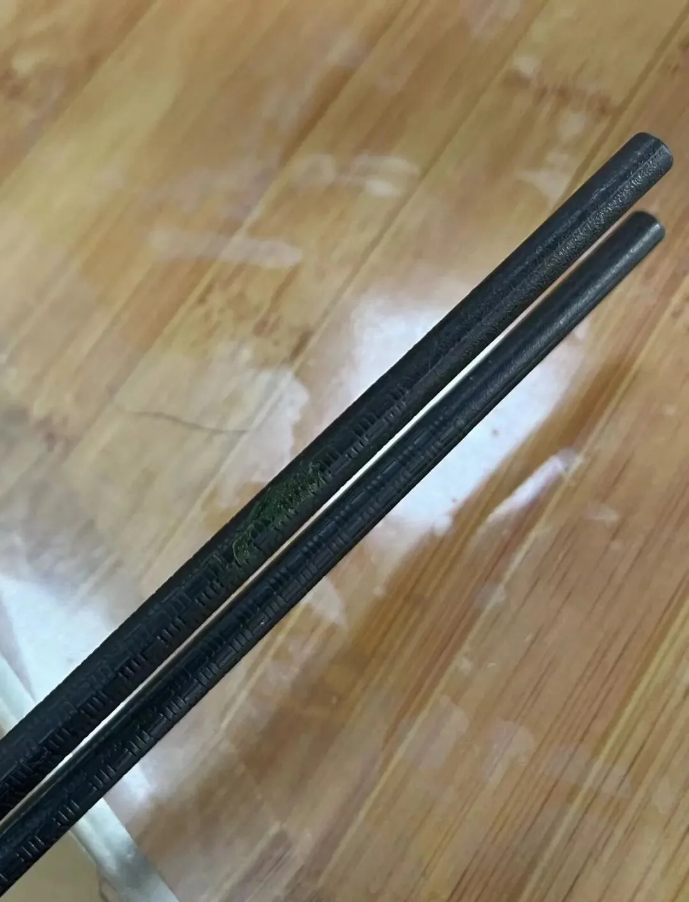

请相关部门及时关注并跟进问题。

## 1 校园网问题

> “望京校区第不知道多少次校园网维修之后，网络的难用程度再创新高。速度慢的痼疾之后又出现了反复掉线的症状，看个十分钟的视频恨不得掉线重连三次。真的想请问各位网络中心的老师们，一次又一次技术检修到底检修出了什么？是网费不够还是工资不足，怎么搞个无线网能搞成现在这样惊心动魄高潮迭起呢？”

## 2 学校超市

“自习室既然新开了个超市，这么小学校两个超市也完全够了，能不能把安信捷在的地方改成个健身房呀。”

## 3 食堂

## “良乡校区二食堂筷子，有没洗干净的菜叶。不予评价。”

## 4 宿舍

“【读者投稿】亟待解决的问题与进行指导的领导[（见第二条）](https://mp.weixin.qq.com/s?__biz=Mzg2MjcwNzQ1Mw==&mid=2247488224&idx=1&sn=e14ba4d6893a793c3ab3f3914dba0dfc&scene=21#wechat_redirect)

【读者投稿】身处平行时空之中[（见第五条）](https://mp.weixin.qq.com/s?__biz=Mzg2MjcwNzQ1Mw==&mid=2247488121&idx=1&sn=5eceff2754b9ee4d84e24a52ba7d4ef4&scene=21#wechat_redirect)

【读者投稿】问题迭出下被蛀空的位阶[（见第四条）](https://mp.weixin.qq.com/s?__biz=Mzg2MjcwNzQ1Mw==&mid=2247488092&idx=1&sn=03de2860ab42f9dd1e14395ca72ec564&scene=21#wechat_redirect)

【读者投稿】证书体测争议巨大 管理生活谁予解决[（见第三条）](https://mp.weixin.qq.com/s?__biz=Mzg2MjcwNzQ1Mw==&mid=2247488086&idx=1&sn=f0869b7516afd50d159ce8fabf4d422f&scene=21#wechat_redirect)

【读者投稿】难似登天的易如反掌[（见第五条）](https://mp.weixin.qq.com/s?__biz=Mzg2MjcwNzQ1Mw==&mid=2247488080&idx=1&sn=cb7b828ef62a01ba174313b4f7ffdea9&scene=21#wechat_redirect)

合并以上关于寝室换寝艰难和单人住双人间得不到解决的问题，一个与学生接触最多、最直接服务学生的部门，最后却是学生骂的最多的部门，难道不应该反思反思你们的工作方式和那些只能说给“听话的、好收拾”的学生的所谓的规定。公寓办向来是坚持贯彻欺软怕硬、非领导打招呼不安排的原则，被室友干扰睡眠已经无法忍耐提出换寝要求，却被你们视为麻烦、脆弱、克服不了问题，有领导撑腰打招呼的提出要求，你们则不予余力一定办好。

所以，又是一年毕业季，请问社科大，什么时候才能改变这种，寝室作息不合住不下去还非被公寓办逼着继续住的现状？什么时候能够公布出单人间和空房间的寝室号？什么时候开始调查以往公众号投稿的公寓办收礼收红包的事情？”

## 5 开题

> “投稿：针对开题。虽然这个学校的行政能力是挺垃圾的，但是开题这种事情，作为“研究生”不应该自己就早做准备吗？还要等通知开题了才去找选题啊？这学校已经在某些方面拖后腿了，自己还没能动性，那不妥妥要溺死在这潭死水里啊！”

（见《[【读者投稿】有信自远方来](https://mp.weixin.qq.com/s?__biz=Mzg2MjcwNzQ1Mw==&mid=2247488322&idx=1&sn=3e13a3b4f031ed4495174cf1180bd31f&scene=21#wechat_redirect)》第3条）
