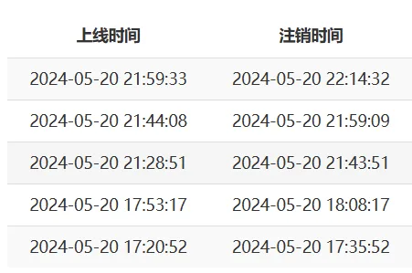
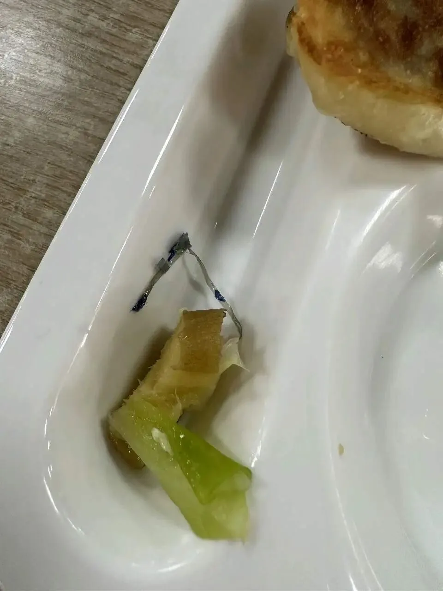

请相关部门及时关注并跟进问题。

## 1 校园网问题

“我请问为什么每次校园网进行所谓的“更新”结局都是负面的啊？望京的校园网从20号下午开始每十五分钟自动断联。这是在干什么，不觉得很滑稽吗😿

投稿配图，谢谢编辑。正正好好十五分钟就被踢掉，我还是包月的没欠钱哇，我都不敢让手机电脑同时连校园网，还要让我怎么办。”

## 2 校园文化

“新传院领导，能给新传换款院徽么？粗粗的一个圆环代表了什么？什么都看不清。不知道谁设计的这么丑一个院徽”

## 3 食堂

“最近看到学校食堂夜宵很少做疙瘩汤了，不知道以后可不可以多做几次，好喝，爱喝，享受喝，是精神支柱，喝不到会难过的程度。。。比心🫰🏻”

“投个稿社论～周一晚一食堂二层排骨炖腐竹吃出了塑料袋……希望学校管理下餐饮卫生安全”

## 4 开题

“开题确实是这样，早就建议学校要制度化开题、答辩等时间，正常的高校除了疫情那会，开题、答辩时间都是固定的，新入学的也都知道。

但社科大这个德行是不能指望了，再加上导师的放养传统，就需要学生自己留心打听，尤其是硕士来这边读的，头一遭经历正经开题，通知的突然确实比较被动。

过分苛责学生实在没必要，不过提前一个月通知倒也不至于过分仓促，加油吧！”

（见《[【读者投稿】惊心动魄的网络检修 高潮迭出的公寓担当](https://mp.weixin.qq.com/s?__biz=Mzg2MjcwNzQ1Mw==&mid=2247488326&idx=1&sn=72ad25376187bdfb09d6f2b573662e2e&chksm=ce0298d4f97511c288a9e905d71bfc9a70443cda686ce8585b549036d5583988b737054893d9&scene=21#wechat_redirect)》第5条）
