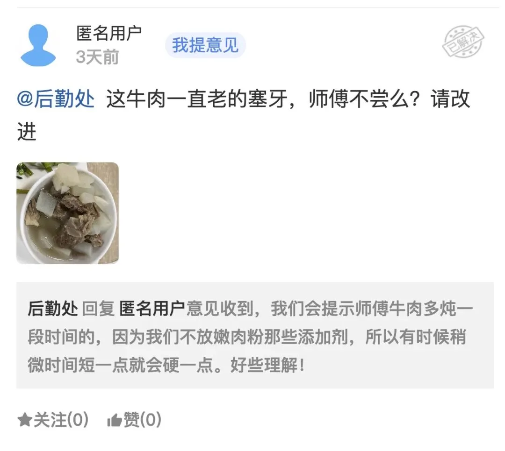

请相关部门及时关注并跟进问题。

## 1 宿舍

“给吹风机装的门真的有必要吗？隔音没见隔到哪去，隔几米远都听见声音。而且里面一点不透气，要是有同学开热风吹头发，里面就跟蒸笼一样，吹个头发又捂出汗，澡白洗了。”

“投稿：我们学院是高中还是大专啊，怎么这学期周周宿管上门或者查寝啊。这下真的三流学校抓纪律了”

## 2 食堂

“3天前投稿，今天同学去二楼吃照样肉老塞牙，而且我3天前只是匿名，并未仅对我匿名，但我同学的接诉上看不到这条，我想请问后勤处你们到底改不改进？

评价@后勤处

建议用高压锅吧 我吃一半倒一半还塞满嘴牙 要不要今天没菜吃 保证不点 我几个同学都说塞牙 一直不改 我们都已经好久不吃了 希望下次不塞牙

（这条是他回复完，我给的评价）

3天前塞牙，到今天我牙还疼呢

感觉就是不仅不改，还故意隐藏提出的意见”

## “今天（5.21）中午二食堂自选的肉，毛都没剃干净，社科大啊，社科大，怎么弄啊～

一个破食堂，骂了多少次，还是在一些非常基础的问题上都搞不好。学校去跟隔壁北理工商量下，让我们允许吃他们的饭吧。（下午在忙其他的事情，差点忘了发）”

## 3 课程问题

> “水课问题： 社科大的大领导们是真的不知道我们现在最大的问题在哪里吗？天天排那个督导去听课，你是办高中吗？还要加强课堂纪律？你这是典型的抓不到重点！我们的重点是什么？我们的问题是什么？正是我们的课太水了，大部分的课都完全学不到东西！你课讲得水，还逼学生听，这不是逼我们精神吃屎吗？通过点名留住学生的课，是最下流的课！我们学校真正的好课不需要点名学生也会去。那么我们当务之急不应该是提高课堂质量吗？督导们天天点来点去，天天查来查去，想必他们自己也很烦吧。”

## 4 学校超市

## “投稿，我校所有超市都应该支持校园卡支付，这是方便学生们的举措”
