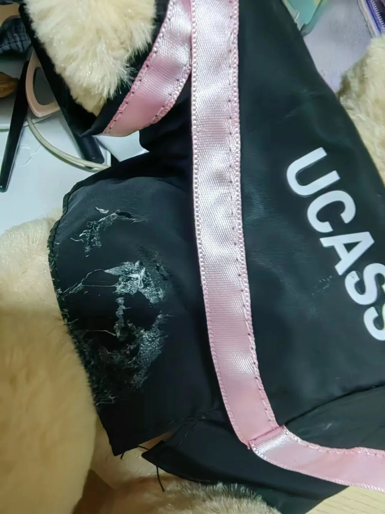
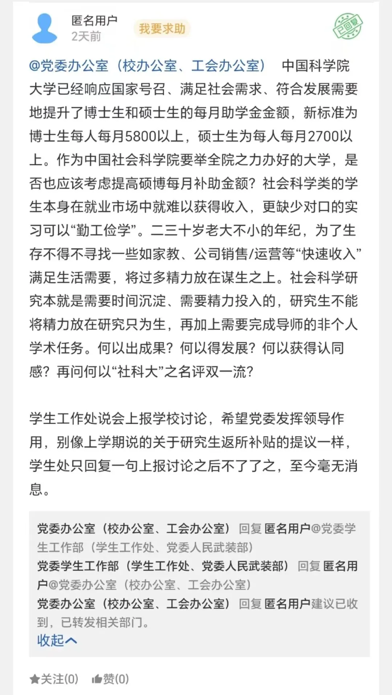

请相关部门及时关注并跟进问题。

## 1 超市

“新超市普遍涨价，冰杯贵了一块，三元的酸奶也没了，研缘干的好好的不懂为什么要重新招标”

## “看完这几天同学们的吐槽，冒出来好想让胖东来整顿一下校风校貌的想法，哈哈哈”

## 2 宿舍

> “如果宿管老师查寝，请顺便把楼道里的非必要的灯顺手关了，大灯一开就亮一天其实挺浪费资源的，公家的钱也是钱。还贴着条写着要随手关灯，但是我看一楼值班的老师也从来没说把自己对面的那个大灯关了”

## 3 图书馆

> “我想反映一下良乡校区图书馆的预约惩罚制度的不合理之处。目前的惩罚制度是3次没有按时签到或返回，这个月剩下的时间内都不可预约或使用图书馆的自习室。我认为这种制度并不合理。首先，没有按时签到或返回座位自动释放，已经是对未能按时签到或返回同学的惩罚（新占有座位的同学可以把他的书和其他物品放到一边，我觉得但凡讲道理的同学都不会发生争执）；其次，想问问各位领导，你们每个月都是按时上班没有迟到一分钟吗？如果迟到三次及以上，学校有没有相应的惩罚制度呢？比如，这个月剩下时间的工资不让你拿了。有吗？所以，我建议缩短惩罚时间，如未能按时签到或返回，释放座位且一天内不能预约。或者迟到3次，3天内不能预约。惩罚期太长非常影响学习。谢谢~”

## 4 校园网问题

“社论君你好，望京校区的校园网比80年代电视的天线信号都难用，可否出一个投票，看看大家的使用体验如何？”

## 5 社科文创

“狠狠避雷社科汇文创，拿个烂塑料袋子就送过来了没有外包装，送来的小熊是这样的，是从垃圾堆里捡来卖的吗？钥匙扣质感也很差。匿”

## 6 社团

“社论好，投一个稿。没想到学校这次对本校社团开刀了。学生社团本来大部分就已经因为拨付经费吝啬有很多用爱发电的成分，学校这次看来是准备连最这最后一点钱也不打算给了，直接从根源上砍掉社团。

呵呵，不知道这样的学校对得起哪个想要让这所学校看起来还算一所大学的人。前几天有人痛批学校管理缺乏人性，我看的确是。希望这些半用爱发电坚持办活动，但最后却被如此回馈的社团能告诉大家，那些冷酷无情的官老爷是怎么看待老师和学生的辛勤付出的。既要马儿跑的快，又要马儿不吃草，最后还要把马杀掉，不得不为这样社团管理的勇毅书写点一个大大的赞。”

“求求有些团委的人干点人事吧，能不能来点正常人管理学校的社团。全校的社团让你们毙掉了一半，这一半里还大多是活动办的很勤、同学们有口皆碑的社团，有些还是肩负院校任务的。谁也没想到还在照常举办活动的时候竟落得这样的结局。

要说有少数几个社团被毙那的确可能是社团的问题，但这么多社团被你“拟注销”，你是不是应该反思反思自己工作是怎么干的？通知通知不会发，提醒提醒不到位，最后为了掩盖自己的工作过失一注销社团了事，这是什么工作办法？

不得不说，如果就是这种管理能力，想着不是服务而是怎样不服务、或者说想的都是怎样彰显自己的威风八面，那管不了就不要从中作梗了，各社团不如团结起来，自我管理自我服务自我教育吧。”

“我想请问一下在这个节骨眼上团委对着社团大杀四方是怎么回事？校园文化建设是学校各类评选中很重要的一环、甚至可以说是一所学校的门面所在，也对招生应该有一定的吸引作用，而各类社团在文化建设中又发挥很大作用。一口气借年审时限注销这么多社团，先不说别的，如此工作本身就有问题吧？学校放心在招生与评比的节骨眼上任由一群无能而只会逞威风的人在那儿群魔乱舞，好像不是一个有利学校建设大局的选择。

之前就一直听人吐槽团委社团管理的优良作风与各类问题，今日算是见识到了，那不如先从清查这种人开始吧。

要想办好社科大，学校早该查查行政队伍中有多少这样尸位素餐、思想统一不到学校大局之上，却在暗地腐蚀学校的两面人了。一句话，如果任凭这样的人卡着社科大的脖子，就算一万年学校也别想办好。”

## 7 回复

## “麻烦投稿的人能不能长点脑子再投？天天无脑喷。希望加强部分学生“素质”教育”

（见《[【读者投稿】接诉即办只接不办？](https://mp.weixin.qq.com/s?__biz=Mzg2MjcwNzQ1Mw==&mid=2247488343&idx=1&sn=f47708071274e79e36959ee28f5d328c&chksm=ce0298c5f97511d359c46671df5820f03f6393a92248eb33bafc5e42d392a5452eeb7efd529d&scene=21#wechat_redirect)》）

## 8 接诉即办

“接诉即办，只接不办。见过踢皮球，没见过来回踢的。当然我估计又是被隐藏掉的，别人看不到这条接诉即办。”

（见《[【读者投稿】接诉即办只接不办？](https://mp.weixin.qq.com/s?__biz=Mzg2MjcwNzQ1Mw==&mid=2247488343&idx=1&sn=f47708071274e79e36959ee28f5d328c&chksm=ce0298c5f97511d359c46671df5820f03f6393a92248eb33bafc5e42d392a5452eeb7efd529d&scene=21#wechat_redirect)》第2条）
