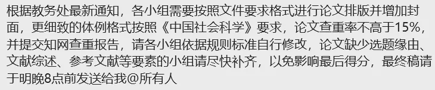
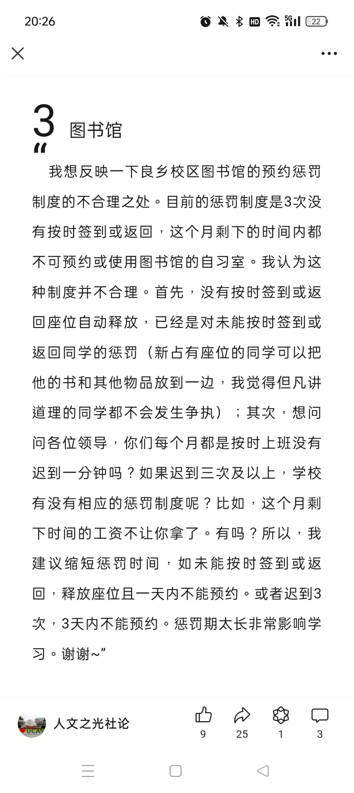
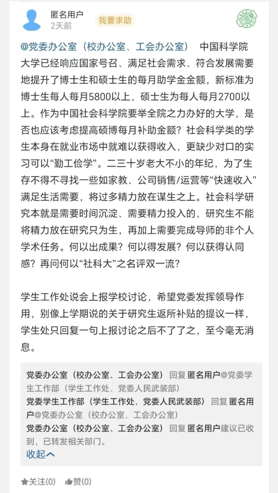

请相关部门及时关注并跟进问题。

## 1 教务问题

“我们对于学术写作的论文的相关要求，有一定的疑问，这些要求，有没有对于上课的学生的现实状况进行考察，上这门课的同学，大多都是大一大二，大多都是第一次写文章，文章的写作过程又是在课程进行当中，好似小组协作的模式降低了同学们的写作难度，但是同学们之间不同的观点交流又会增加成本，然后在文章已经写完，报告已经做完之后，突然“接到通知”，然后一通毕业论文的要求赛过来，要求只在一两天内对论文进行严格修改。

这就是我们的教务处，“实事求是”这几个字究竟如何写？

试问教务处的相关老师，有没有对同学们的相关情况进行考察？或者有没有意图对于学生的情况进行了解？

官僚主义，今天又一次得到了现实的印证。”

## 2 食堂

## “

就问一流文科大学敢不敢”

## “社论君你好！望京食堂的晚饭超好吃！用力夸一夸！”

## 3 校园卫生

“投稿：求求学校做做除虫吧，我昨天在一食堂西边路上骑车，虫子奔着我鼻子、眼睛和嘴飞啊，太恶心了”

## 4 图书馆

## “

您好，我想回应一下这条。暂离好像是1个小时之内返回就行，如果回不来的话可以在手机上取消，重新预约同一个座位，所以理论上最多可以暂离两个小时，两个小时如果回不来的话，不如先把东西收拾好放到外面。

现在图书馆座位并不宽裕，如果一个月不到，能让座位空1-2个小时超过三次的话，是不是有点太浪费资源了?”

（见《[【读者投稿】接球即踢下的各类问题与祭出奇招的社团管理](https://mp.weixin.qq.com/s?__biz=Mzg2MjcwNzQ1Mw==&mid=2247488359&idx=1&sn=ff93fea22af60c55c9c7869e5e2225f7&chksm=ce0298f5f97511e35c780f461aa1fd17c67aa8a8d09e94c24d6514089b70dd51aad7a41b74e4&scene=21#wechat_redirect)》第3条）

## 5 宿舍

> “反对让宿管关掉楼道灯！拿一号楼举例，除了两侧透光，有玻璃窗的路段，中间路段就算是白天也黑咕隆咚的，有没有考虑过视力不好的同学？再一个，说省钱别太搞笑，这些电钱是能省出来加到1250的补助上吗？”

（见《[【读者投稿】接球即踢下的各类问题与祭出奇招的社团管理](https://mp.weixin.qq.com/s?__biz=Mzg2MjcwNzQ1Mw==&mid=2247488359&idx=1&sn=ff93fea22af60c55c9c7869e5e2225f7&chksm=ce0298f5f97511e35c780f461aa1fd17c67aa8a8d09e94c24d6514089b70dd51aad7a41b74e4&scene=21#wechat_redirect)》第2条）

## 6 社团问题

## “投稿一则，有关吐槽年审的问题，说下自己的看法。

年审的通知在4月下旬的社长大会就已经提前告知，并要求大家提前准备好相关的材料。之后在社团负责人群内也转发了有关年审工作的安排（校园门户的通知公告，4月24日发），通知明确年审材料截止提交时间是5月20日。负责同学也在群内强调要大家关注年审截止时间。

这次被“拟注销”的二十多个社团，除了一个是材料不合规之外，剩下的全部是“未按时提交年审材料”导致的。

前面已经一而再再而三地强调了材料的截止时间，时间也很充足（发通知到截止将近一个月的时间），可是还是没能把该办的流程办了，该交的材料交了，不应该从根源上反思自己为什么拖沓迟办、不留心相关的时限吗？反过来怪罪学校干嘛？

可能有同学从其他人那里听说了这次社团被“大削减”的事情，但不明白其所以然。在这里补充一下，希望大家能够在全面认识事情的前因后果上理性分析、客观评价。谢谢。

“投稿：请问一下这些为爱发电的社团为什么现在就知道自己被刷了呢？毕竟年审材料的补交期限刚过，还没有开始评优，也就是说，没评定呢怎么就把你给处理了啊？”

> “团w管理社团方面的可以说是skd最低能的部门之一，本来skd就死气沉沉没什么文化氛围，全靠大家用爱发电，团委不给钱支持也就算了，办事效率低的要死，还各种各样的形式主义、繁冗程序刁难，大家平时都有自己的事儿，各个社团都是大家抽自己宝贵业余时间来做的，说白了这都是给你脸了，然后你这一天各种障碍刁难消耗大家精力的，还有心意热情给大家办活动了？最后受害的还是社科大的学生，很多人都吐槽社科大根本都不像正常大学吧，团委在这里面多少锅不言而喻。”

（见《[【读者投稿】接球即踢下的各类问题与祭出奇招的社团管理](https://mp.weixin.qq.com/s?__biz=Mzg2MjcwNzQ1Mw==&mid=2247488359&idx=1&sn=ff93fea22af60c55c9c7869e5e2225f7&chksm=ce0298f5f97511e35c780f461aa1fd17c67aa8a8d09e94c24d6514089b70dd51aad7a41b74e4&scene=21#wechat_redirect)》第6条）

## 7 学校超市

> “无比怀念研缘的又一天，当这个学校10点50再没有超市可以购买东西的时候，我不禁又想说学校实在是有毛病，人家干的好好你说什么到期，还重新招标。价格贵就算了，一块两块的，现在买不到东西我是真的无语！生活质量真是直线下降，我谢谢社科大，让我大晚上走路出学校买东西，多走两步比较健康”

（见《[【读者投稿】接球即踢下的各类问题与祭出奇招的社团管理](https://mp.weixin.qq.com/s?__biz=Mzg2MjcwNzQ1Mw==&mid=2247488359&idx=1&sn=ff93fea22af60c55c9c7869e5e2225f7&chksm=ce0298f5f97511e35c780f461aa1fd17c67aa8a8d09e94c24d6514089b70dd51aad7a41b74e4&scene=21#wechat_redirect)》第1条）

## 8 接诉即办

> “接诉即办确实经常隐藏同学们提出的合理建议和反馈，比如这条我根本就没在我的“接诉即办”页面里刷到，这样掩耳盗铃的行为已经违背了“接诉即办”初衷，强烈要求后勤处“接诉即办”平台相关负责人出来给全体师生一个合理解释”

（见《

【读者投稿】接球即踢下的各类问题与祭出奇招的社团管理

》第8条）

## 9 奖助补费

“历史活动是群众的事业，随着历史活动的深入，必将是群众队伍的扩大。希望我校发扬人文之光的精神，真正关爱学生，将提升学生补助提上日程。”

“投稿：社科大最近在发什么癫？首先，呼吁这么多年的研究生补助上涨一事，学校诸多部分视若无诸，互相踢皮球，连征求学生意见或者举办听证会的举措都没有。甚至多次接诉即办反映，结果都是报关相关部门后无音讯。从这可以看出行政人员的不作为，也根本没有办好打社科大的理想信念。

办好社科大，首先要保障学生能够没有生活层面的后顾之忧，保障衣食住行等基本生活的需求。然而我校的补助连吃饱饭都满足不了……

其次，学校关停了研缘，用自习室附近的区域办新超市，不仅干扰了自习室的学习氛围（噪音污染），而且商品价格出现明显上涨。原来3.6的巧乐兹，卖4.5，3块的黑巧冰激凌卖5块……学校是不是打算联合资本继续收割一波？

再次，食堂免费房越来越小气，先是一楼的汤每次只给半碗，现在食堂把碗换成鸟食小碗，一碗汤两口喝完了，这不是节省（勾兑的小饮料有什么成本），就是想方设法地恶心人！”

（见《[【读者投稿】有信自远方来](https://mp.weixin.qq.com/s?__biz=Mzg2MjcwNzQ1Mw==&mid=2247488322&idx=1&sn=3e13a3b4f031ed4495174cf1180bd31f&chksm=ce0298d0f97511c69f313530bdaed96ab9038261de181a8c8bd48870b2a98e2af627d641fb58&scene=21#wechat_redirect)》第4条）
