请相关部门及时关注并跟进问题。

## 1 社团年审

“社论你好，投稿关于社团年审材料及被列入拟注销名单问题一则，兼有对5月24日稿件的回复，本人也是社团工作人员之一，对这个问题有一些切身体会。

（一）回复24日稿件2：这位同学所说“没有开始评优”是纯粹的杜撰，因为早在5月16日社团评优答辩名单已经发出：

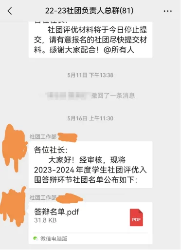

另外在学校公告中，评优与年审是两项完全不同的工作，“为什么现在就知道自己被刷了呢？”的原因显然是负责人群内发布的拟注销名单。该稿件所言根本不是事实，甚至有混淆视听之嫌，有鉴于此，我不认为该稿件有任何可信度。

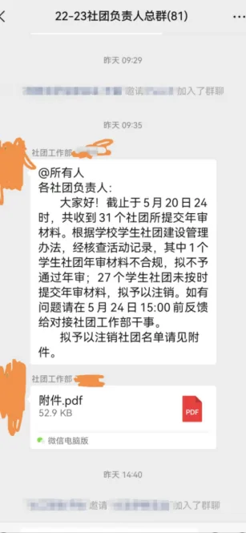

（二）回复24日稿件1:

1、该投稿人所说“二十余个社团未及时提交材料”，确有其事。各社团是否应该为此负一定责任或是接受一定批评？我想这也是应当的。

然而该投稿人言辞直指同学意图混淆是非——“不反思自己，反而怪罪学校”。从23日稿件中不难看出，投稿针对的是校团委管理职能和社团建设方面问题，并未表明自己即是利益相关人；既然未必是社团中人，难道不能是对社科大文化艺体生活热心的同学师生来稿，抑或曾经、正在参与活动的路人爱好者？为何24日这份投稿如此急切的要求大家自我反思？有何居心？经过分析排除，能有如此口吻腔调，非校团委社团工作部各位负责任的干事、部长、老师莫属。既然问心无愧，何必匿名下场，急于解释？ 2、该投稿人声称“一而再再而三地强调了材料的截止时间”，首先不妨请您讲讲，这些未及时提交材料的社团，其社长是否都出席了社长大会？如果没有，是否有人转达？校园门户公告确实有，但群内通知实际上只发过一次（4月25日）撑死算得上是一而再，连三次都没有。

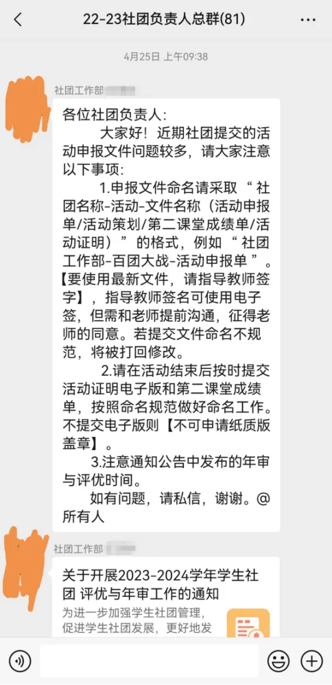

（事实上带有“年审”二字的有且只有这几条消息）

2、当然，斥责团委相关方面未通知肯定是不对的。不过通知是否到位显然要打一个巨大的问号——除非这二十几位社长都是不负责任或者理解能力低下的人，否则从实际情况来看确实没有通知到位。望该投稿人、社团工作部相关人知晓，通知不是你发出来就算是大功告成、万事大吉。根据《中国社会科学院大学学生社团建设管理办法》第七、八条，团委对社团的关系是指导监督，负责学生社团的成立注册、年审注册、注销和年审考核相关材料的复审和归档工作。记住了，这个工作如果完不成，你们是有责任的，通知了不代表通知义务已经尽到，前两年做个核酸还要求大家在群里接个龙呢。退一万步说，这些个社团确实“罪大恶极”，在哪怕5月19号发一条消息艾特全体说明天是最后截止期限，这很难吗？会让您金贵的手指抬起受累吗？

哦，如果您要说您忙不过来、顾不上这些，那恐怕这二十几位社长也可以用同样的理由回应。发完消息转头心念“反正我发都发了，不交就自己作死”，是吗？请您仔细看看您的“指导监督”责任尽到了吗？

3、最关键也是最为重要的一点：团委是否有权对上述社团进行“拟注销”决定，甚至还要求当事社团提交类似悔过性质的所谓“说明”？

我的结论是不能，依据则是《办法》中的具体条文规定。

（1）首先，我们需要先了解团委的地位以及跟社团的关系：根据《办法》第二条、第六条第一款、第七条：团委的地位是指导监督而绝对不是领导（这是党委的职能）、承担校学生社团建设管理评议委员会办公室职责、日常工作事务管理。

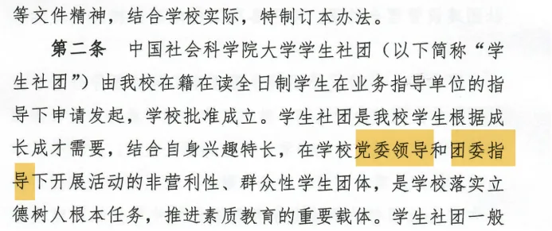

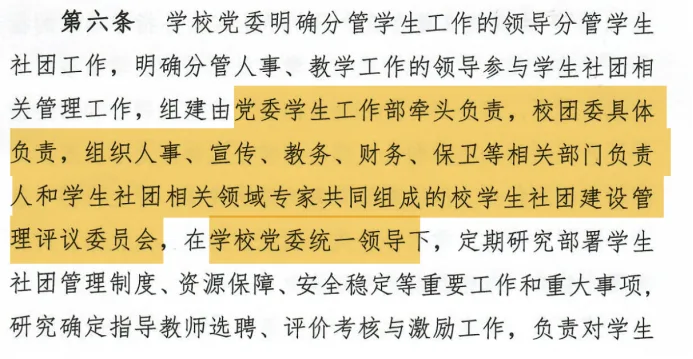

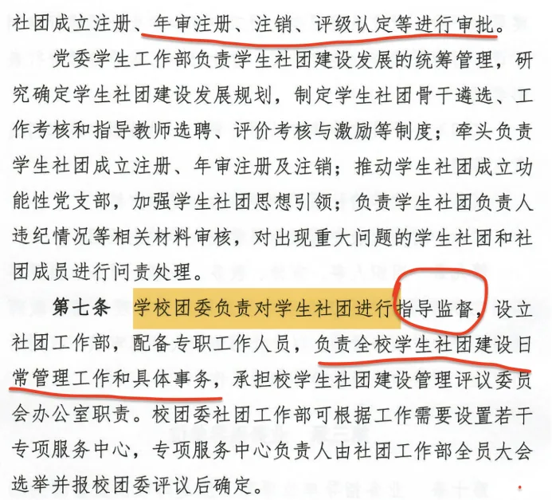

（2）那么团委对于本规范性文件享有怎样的权力呢？如第七十六条所示：仅有授权的解释权，而绝无补充制定、变更适用的权限。七十七条亦明确表示，有任何制度与本《办法》抵触都将无效。

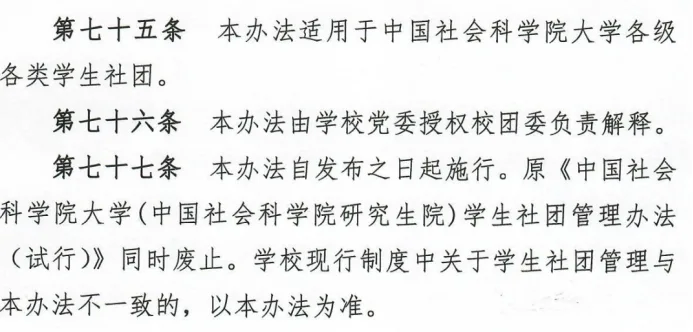

（3）言归正传，社团在何种条件下有被终止活动的可能性呢？根据《办法》，仅有未进行注册登记、直接解散取缔、注销以及第六十三条规定的情形共计4种情况：

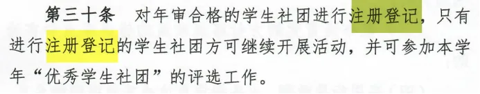

（题外之话，既然年审尚未完成，为何评优材料截止期在年审材料截止期前，答辩名单已经出台？这是纯纯不按规定工作，是团委的重大工作失误，在此有必要提醒学校党委严肃处理。）

第三十条只规定不得继续开展活动，并未从根本上取消社团资格——即注销。

B.

第八条中的第二项明确规定：团委应以学年为单位审查社团基本信息（条文规定实际就是年审材料具体内容）和违纪违规情况，并有权提出整改意见和直接解散取缔的建议。首先，社团负责人群中公示的是“拟注销”而不是解散取缔，本就不是同一概念和职权；其次，就算存在问题，也只能建议而不能直接解散取缔社团；最后，团委既然还没有收到各社团的补交年审材料，又如何“核查”了？此处又存在团委如此严重的程序失误和职权滥用。

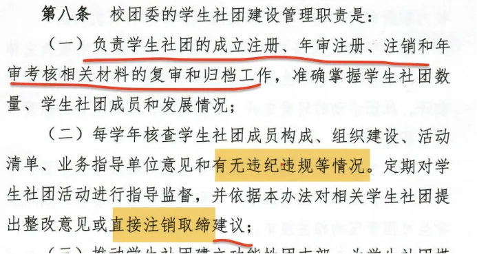

第三十三条确实规定了团委的直接解散权，很遗憾，上述社团以目前实有的证据都不满足规定情形：

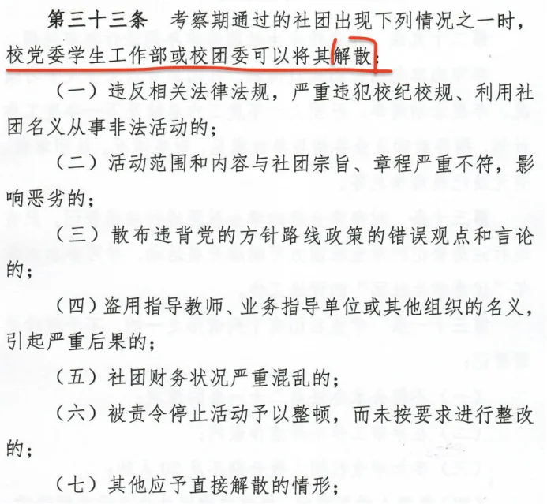

C.而关于注销的问题，更加令人匪夷所思。如下述条文，学生社团的注销只有自己提出这一种发起方式，且必须经过严格的民主流程和程序要求，根本没有一个字规定团委可以对社团进行“拟注销”的行为；且真的注销了以后才能进行公告，既然还只是“拟”，怎么就提前发出来呢？人尚未死，便可以提前发讣告么？

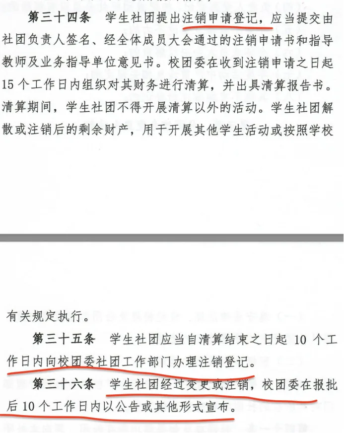

D.第六十三条规定繁多，也不涉及终局性的“注销“社团，只涉及停止活动与整顿，在此不再赘述。

《办法》条文，社科大团委官网已有公示，大家可随时查看比较本人是否虚言。总而言之，经过分析，社科大团委及其社团工作部要想解散、停止一个社团的活动，有严格的要求与限制；至于“拟注销”乃至“注销”完全不属于校团委职能范畴之所在，也并无变通适用的余地。此过程中发现社科大团委诸多工作问题：滥用职权、不遵程序、不规范使用有关概念。如此严重违背《办法》，有破坏学校社团建设工作乱作为之嫌，有故意违背党委领导之嫌，甚至有破坏民主集中制原则之嫌。在此提请学校党委严肃清理队伍阵容，严肃监督校团委，加强对于社团工作的实际领导，以免再生如此问题。”

“关于社团风波疑问 已知事实： 1、因通知不当拟注销27个社团（社科大总社团数量为58），理由是“学生数量很少、社团管理难度过大，所以需要削减社团数量”（已知一般大学社团总数量不会低于三位数） 2、一般社团活动筹划预算不超过100元，大多数社团活动不予下批经费，少部分社团活动可以获得50元的海报印刷费，但在某社团并不需要的情况下拟给某社团批2000元用以雇佣教练，但该社团本身并无该需要、无人来参与训练所以才作罢 3、开会时拟定年审材料五月末提交，正在征集意见，但迟迟没有正式结果告知群内，年审通知与社团评优工作放在一起通知并放在社团评优工作末尾之处，群内除了转发这一校园通知之外并无文字性通知要求社团提交年审材料，没有一次提醒，也并未有“一而再再而三提醒”的说法 4、以“不活跃社团”为理由告知部分社团建议其将社团注销，因为这些“不活跃社团”会影响到学校整体风貌 5、要求“不活跃社团”负责人亲自上交一份声明，以此为契机在办公室约谈“不活跃社团”负责人并“以个人名义”劝其注销社团，已知某社团负责人被“关门谈话”二余小时，不知其谈话内容，该同学离开办公室后崩溃大哭

疑问之处： 1、社科大社团数量较少，活动小而精，且大部分活动都向学院申请，何存在“管理难度过大”一问题？是否是懒政怠政问题的延续？ 2、是否存在因负责老师个人喜好问题而产生的社团偏袒问题？ 3、半年前突然加大社团活动审批难度和社团经费大幅度缩减，是否是为划分“不活跃社团”而埋下的地雷？ 4、是否存在为了让“不活跃社团”负责人注销其社团而采取的语言或行为压迫现象？”

（见《[【读者投稿】颇具遗风](https://mp.weixin.qq.com/s?__biz=Mzg2MjcwNzQ1Mw==&mid=2247488400&idx=1&sn=856378bfcaed74e398628d4ea04bbd14&chksm=ce029802f975111400337c4c2b251f35e576133dbf924421b95ebe1f6b344927c0b65e451dfd&scene=21#wechat_redirect)》第6条）

## 2 宿舍

> “宿舍问题咋解决？啥时候给解决？？还解不解决？？？据了解，社科大的所有宿舍楼都有空宿舍，都有单人宿舍，其中单人宿舍以4号楼为最多。后勤人员整天口口声声的说必须两人一间，必须同年级的住一起。很多作息时间不一样的同学住一起矛盾重重，影响休息影响学习，你们咋给解决？咋就没有好的方案呢？笨吧！！！无能吧！！！丑吧！！！”

## 3 食堂

## “投稿:社科大何时迈出这一步?

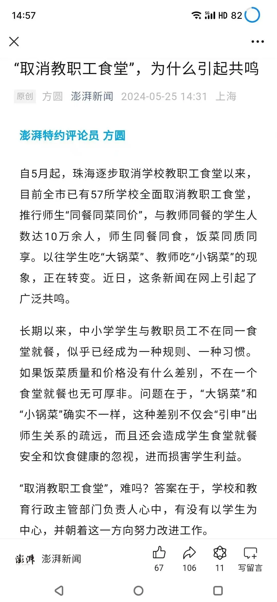

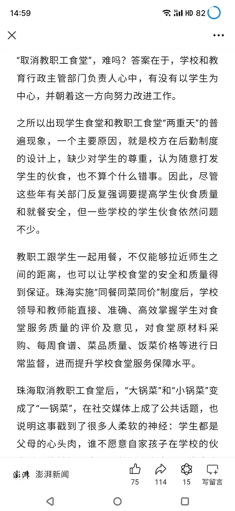

详情见《[取消教职工食堂”，为什么引起共鸣](https://mp.weixin.qq.com/s?__biz=MjM5MzI5NTU3MQ==&mid=2652337467&idx=3&sn=e4f105fe2b5a0feedd738226fc3f6dc8&scene=21#wechat_redirect)》”

“谈一些看法和感受：个人和身边同学吃过不少大学食堂，经过比较，skd食堂是最差劲的，没有之一。就这样，还能时不时吃出来虫子、异物和过期食材，最基本的干净卫生都做不到。还有一年秋季开学好几天了，食堂还只开了四个窗口，学生排队半个小时才能吃上饭，最后还是有人隔空喊话张政文校长才最终解决。问题是几千人开学吃饭，没有一丁点应变能力吗？开学了开放全部窗口不是应该做的吗？还有早上八点左右水煮鸡蛋就没有供应了，其他不少食物还都冷了。

铁一般的事实摆在眼前，还有人不停的洗地，有人说：我觉得skd食堂挺好的，不喜欢吃你可以不吃。还有人说：早上起不来怪谁？谁不让你早点起床？个人想问说这话的要点脸吗？那我是不是可以说学校办不好就别办，食堂搞不好就别搞。学生吃着最差的食堂，拿些最低的补贴，然后某些人员自己单独一个食堂，大快朵颐，对学生喊了八千遍、八万遍的提高补贴意见视而不见听而不闻，还有人员说学生都是村里来的没有素质。就是一条狗吠了八百遍也有人喂食吧？

看着skd高考排名蹭蹭蹭下降，就业考不了几个省的选调，双一流遥遥无期，也不是没有一点根据。通过一个简单的吃饭问题、补贴问题就能看到很多病症。引用学校某人员对一位学长说的话：即便你的要求合理，这个结果也不会改变！我们对你不好，你损失了什么？这些言语真的很skd。这么好的资源，这么好的牌子，在个别人手里变得不堪入目，像一坨扶不上墙的烂泥。skd完全有能力成为第二所某大，看到现在这个样子，算了，不说了。”
