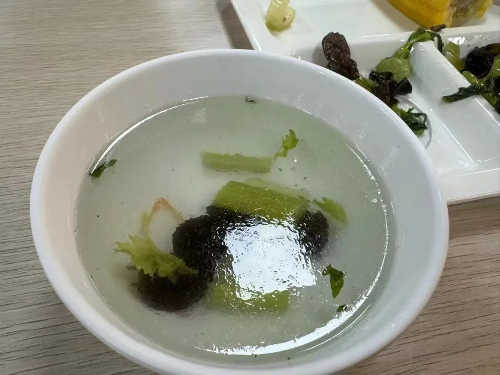
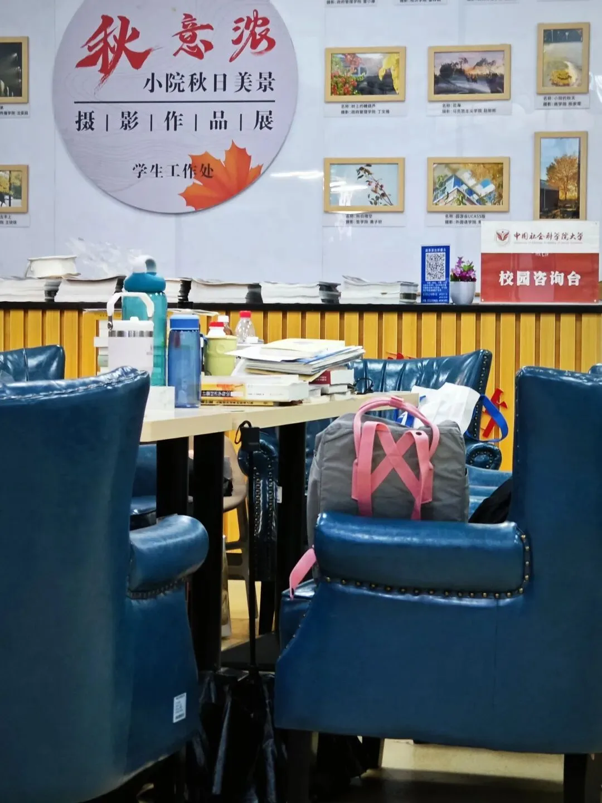
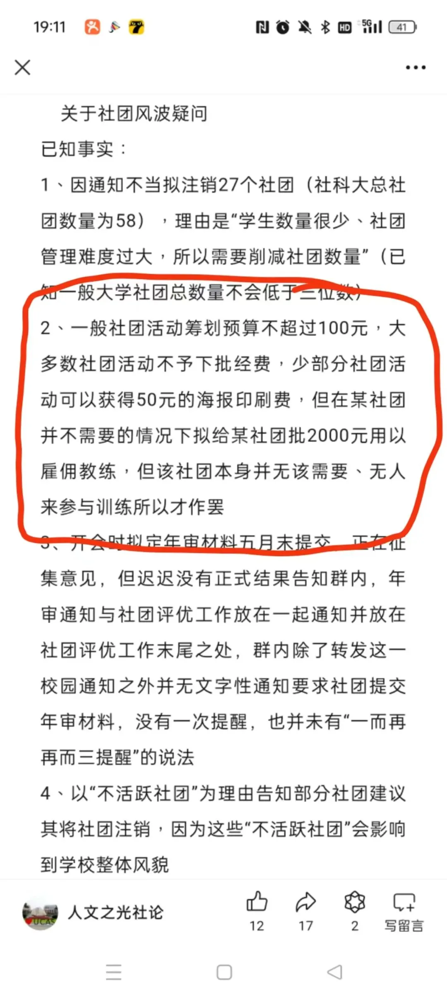

请相关部门及时关注并跟进问题。

## 1 食堂

## “良乡校区食堂早饭能改善改善么？ 菜油的糊嗓子

”

> “我对社科大食堂一贯十分满意，把不得毕业的时候给每个师父打个赏发个红包。现在物价这么贵，还能吃到和这个价格的菜，我真是感谢我祖宗八代给我这么好的学习机会。虽然这七年中菜价略有上浮，但是现在十几块钱还能去外面吃几块肉？就算吃到了放心吃吗？ 学校的饭菜有食品卫生保证，而且还有风味餐厅和清真。如果能给20级的延期同学继续提供一年的宿舍我就更感谢学校啦。考虑一下我们的实际困难吧。学校一个单间床位对我们的博士论文攻坚阶段都万分重要呢，搬出去分心。”

## 2 自习空间

## “瑞幸咖啡旁边校园驿站里面都是放好的书，也没人在学习，但位置却长期被霸占”

## 3 超市

> “地下超市卖东西一直比较贵，但因为有平价超市（研缘），大家还有的选，现在新超市也涨价，学生真就成韭菜了是吧。 正常高校因为超市多，有些贵有些便宜，也正常，但skd你tm总共两超市，还都贵，说的过去吗？ 如果真的要市场竞争，你就再引入几个超市，让他们竞争，别搁这玩割韭菜游戏。 而且新超市还在自习室旁边，那都是板房啊，哪个sb想出来放那的。 还有7-8号楼的闲置空间（所谓教师休息室、心理咨询室），是死活不肯腾出来给大家当自习室啊，就是懒政、惰政、无能！ 殊不知好多高校连寝室都有自习室，但这对社科大的管理能力来说有点困难了，是吧？（别跟我说地下自习室，如果还要脸的话） ps：社科大的这个管理，实话说，不是菜不菜的问题，说菜就堕入了能力陷阱，更深刻的是理念问题。它根本不是一个高校的建设路径，而是一个老旧的厂子，哎～悲剧。”

## 4 接诉即办

“或许社科大本来也想这样出圈吧，可惜变成了面子工程，只接不办。涉及学生利益的事隐藏、不回复、后台查人...”

（见《[【读者投稿】颇具遗风](https://mp.weixin.qq.com/s?__biz=Mzg2MjcwNzQ1Mw==&mid=2247488400&idx=1&sn=856378bfcaed74e398628d4ea04bbd14&chksm=ce029802f975111400337c4c2b251f35e576133dbf924421b95ebe1f6b344927c0b65e451dfd&scene=21#wechat_redirect)》第8条）

## 5 社团问题

> “您好，我想回应一下这条。能否公示哪个社团有教练费?学校对体育类社团从未一视同仁过，部分球队或者社团拿着最高的经费，打着最差的成绩，学工、领导、团委以各种稀奇古怪的理由给某些球队和体育社团经济支持。希望学校今后能透明管理，公示每个球队的成绩，以及对每个球队或者体育社团的经济支持。”

（见《[【读者投稿】社团年审显威风 颠倒是非惹众怒](https://mp.weixin.qq.com/s?__biz=Mzg2MjcwNzQ1Mw==&mid=2247488418&idx=1&sn=7f24dddf86d72d8874919435df70d708&chksm=ce029830f97511261ef298aa3e0563a2dadee3915ae455b9591df1e065dd01f750ab084b18b9&scene=21#wechat_redirect)》第1条）
