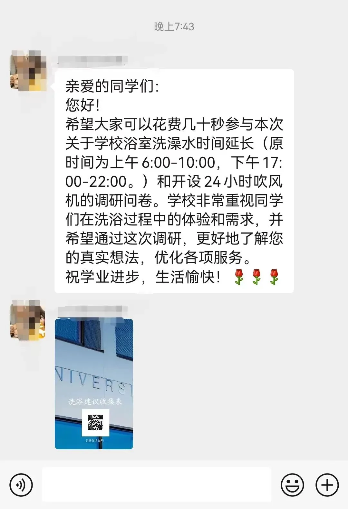
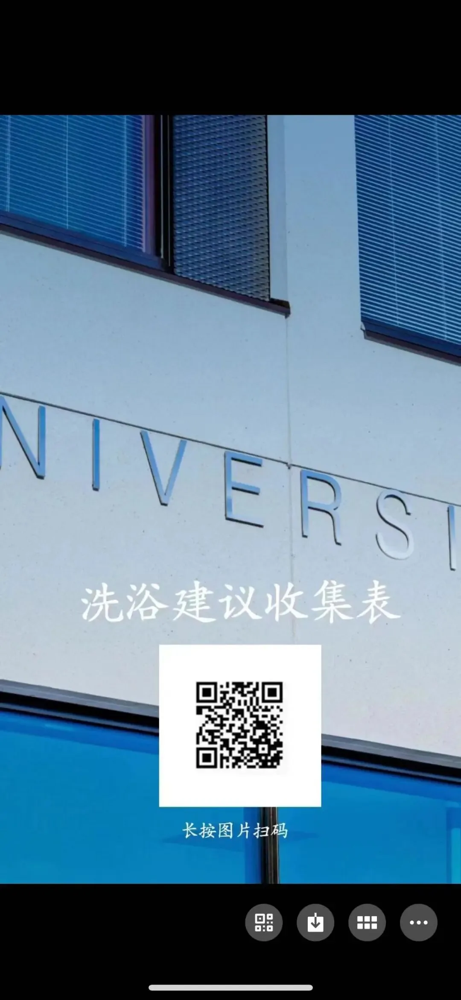
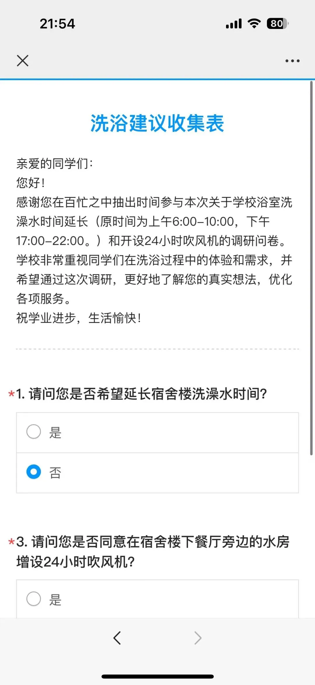

请相关部门及时关注并跟进问题。

## 1 宿舍

“这是一个转发在望京学生群里的问卷，不知道问卷统计是什么组织在搞，但希望发起人能在用数据鼓动群众之前想一想学校限制洗澡时间的原因。望京澡堂设置一楼内，有同学就住在澡堂对面，洗澡造成的噪音对这些同学睡眠影响真的很大。不说那些屡禁不止的聊天声、音乐声，就是平常使用造成的摔门声、水流声和吹风机巨大噪音也对这些同学的正常生活是一个巨大的挑战。

学校要求十二点停水，已经对想要拥有十一点正常睡眠的同学来说是一个挑战了，而这个问卷里提出将早上热水的时间提前到六点，因此住在对面的同学只能一天睡六个小时是吗？能理解住在其他楼层的同学想要洗澡的心情，但从目前的澡堂设施来看，真的很难实现。所以这个问卷除了统计出不住在一楼的人数之外，还能说明什么呢？用大多数人的利益让少数人服从，好一种用多数压倒少数的暴政啊！

做出问卷的组织如果真的想让学校延长时长，不如提建议加强隔音设施建设，或者调研一下别的学校的大澡堂是怎么建的，延长大澡堂开放时间也可以让噪音源离学生远一些。而不是用一个什么都说明不了的问卷，来激化一层同学和其他同学的矛盾。

另：截图中该同学提出的洗浴时间有误，原时间为17:00-24:00”

> “能不能干点实事，还要延长洗澡时间，一楼的人是不需要休息了是吧?不延长都要搞到十二点多，甚至一点。增加吹风机是哪个王八蛋想出来的，水房挨着的宿舍不睡了是吧！！！打着为大家服务的旗号不干人事，就不知道想想一楼的人平时就已经很忍受大家进出洗澡了，其他楼层有些人都要在一楼是用吹风，一晚上吹风就没停过。本身宿舍又不是我们自己的选的，分配来的。干点人事，学生会、学校！！！有这个功夫不如好好把学校办好，搞个双一流比什么都强。”

## 2 食堂

“投稿：一食堂可以日常多煮汤圆吗？入学以来感觉除了元宵节，很少见到汤圆。上周中午居然有，吃过一次，念念不忘”

## 3 图书馆

> “针对28日第一条图书馆清洁阿姨，不止一回看到这样投稿。真的是显着他了，表示好无语，也有点过于同情心泛滥了。据我所知，北京有很多单位都是这样的，天天diss学校没关怀到阿姨，您调查过？学校管得过来吗？单独设休息室，学校有那么大地方吗？到时候阿姨卫生没及时处理，阿姨挨批，你咋搞。你调查了阿姨自己的想法了吗？真有这份心，您做个调查实地调查一下阿姨们的想法。”

（见《[【读者投稿】推诿粉饰万策尽 不见问题得解决](https://mp.weixin.qq.com/s?__biz=Mzg2MjcwNzQ1Mw==&mid=2247488461&idx=1&sn=74873dbb4524362ba7fe11be5bc765ef&chksm=ce02985ff97511495fd012844bc6b09aa1dc24cd4511cbad1f328b59c621358a7f8113678197&scene=21#wechat_redirect)》第1条）
