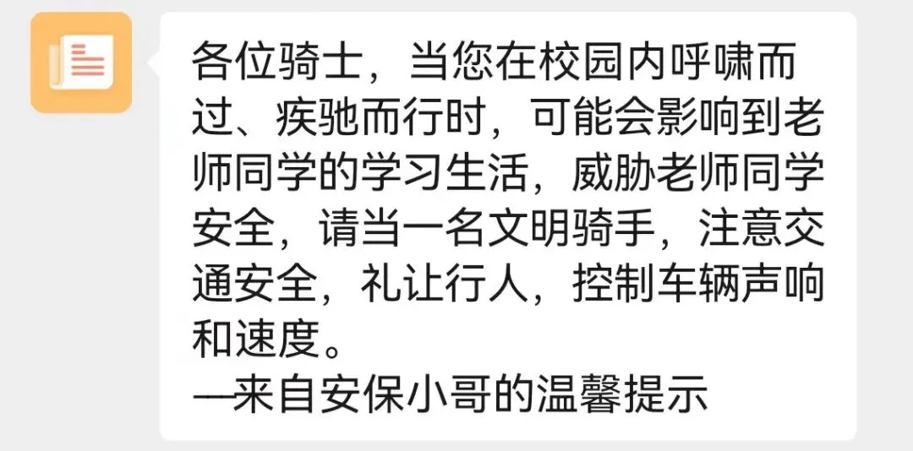

请相关部门及时关注并跟进问题。

## 1 奖助补费

## “我们学生的补贴什么时候提高？物价飞涨，我们补助一直垫底吗？”

## 2 医务室

> “想问一下大家，看中医为什么不能报销啊？看病不能挂中医科，全国或者全北京高校都是这样规定的吗？如果是担心中医药不好定性，是不是应该推动分层分情况报销什么的，不是一刀切式否定。中医也是我国传统一部分啊，但是政策一直不友好诶”

## 3 食堂

## “建议良乡校区一食堂适当把牛肉菜系放在中午”

## “早上喝粥，粥里掉了小飞虫…

## 4 论文打印

“【硕士论文单面打印】 不太理解为什么只有硕士的毕业论文必须单面打印，本科生和博士生都能双面打印。感觉无论从环保还是保存的角度双面打印都更好。”

## 5 校园安全

## “同样的话也要提醒保安的巡逻小车。

晚上小花园有很多同学散步，但是保安的车巡逻频率过高，每次都要让道。除此之外还遇到过保安开车拿快递的情况，并且停车的位置刚好挡在快递区的门口。”

6

图书馆

> “光光，之前有人投稿望京校区图书馆阿姨在一楼厕所休息，应该是投稿人误会了。我看到过两次阿姨在图书馆一楼楼梯下面休息，楼梯下面有两把椅子，我在图书馆接到电话的时候也会跑到一楼接听，有一次正好碰到阿姨，扭头想走阿姨说没事没事，让我坐在椅子上接听电话，她就出去了。一楼厕所空间比较大，阿姨会把打扫卫生的工具放里面。”

> “第三条也太搞笑了，“北京很多单位都这样”，还有哪个单位？举个例子出来。不止一条同学提出来这个问题，难道不是因为很多同学都注意到了这个问题吗？在别人上厕所的地方放置休息室，在哪个地方是合理的？谁愿意？这就是同情心泛滥了？那您可真是冷漠，对于这种利人不损己的事情也要乱喷一通还要别人调研？全社会都是你这种冷漠自私的人社会就完了。”

（见《[【读者投稿】职工关怀引疑问 生活问题有争议](https://mp.weixin.qq.com/s?__biz=Mzg2MjcwNzQ1Mw==&mid=2247488467&idx=1&sn=6be739254f573313a1bc2c4695907526&chksm=ce029841f9751157843bb2033d08f247b16db0c782dcd5367e484c6b2f2d6ff451eb81f9eb98&scene=21#wechat_redirect)》第3条）
