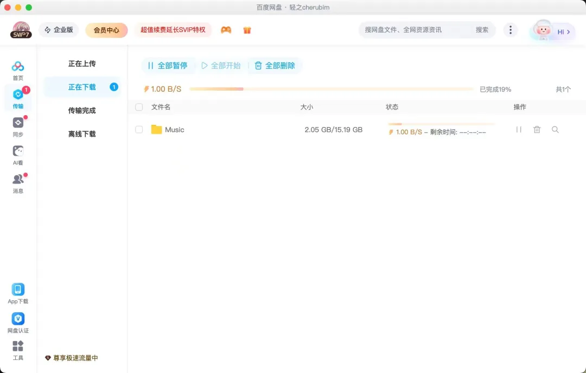

请相关部门及时关注并跟进问题。

## 1 教务问题

## “投稿：

从接宿即办这周的信息来看，大家对考表、课程信息、选课这些事情还是一如既往的在问、催。值得注意的是，这些问题每学期都有不少同学在催，但教务处还是我行我素。既然知道大家对这个有意见，为什么不考虑早点动手来安排这些事情呢？能不能从第十周就开始排考表、填课程信息呢？不能总是任八面风来然后该怎么样还怎么样。

建议是考表和课程信息尽快出，考表能这个周末就别下周再弄。如果排课、协调时间、安排教室还需要时间那就请先把下学期的开课名单、教学计划先公布出来。旧的系统被关了，新的系统又青黄不接的时候是最难受的。”

## 2 奖助补费

“补助问题，在社论上已经反映很多年了。如果不去刺痛某些人，这个问题是永远无法解决的。要想想办法。”

## 3 宿舍

> “投宿管科，后勤，已忍无可忍！趁着这次宿舍物业调整和新学期，能不能分一下男生宿舍和女生宿舍，分一下同性别工作人员，包括保洁！！！女生住在4号楼，洗个澡吹头发遇见男生，下个楼在楼梯遇见男保洁！是，我们是成年人，但是夏天我们总不能洗完澡穿的整整齐齐去吹头发！下楼丢垃圾吧！男生、女生宿舍分开就这么难吗！！就这么难吗！！同性工作人员分配就这么难吗！！！21世纪了在宿舍楼里这点安全感都给不了女生，还指望什么人文之光呀！！！忍无可忍！！！”

## 4 校园网问题

“能够对抗5g的百度网盘对抗不了望京的网络。主要之前都是10m速度最近确实有点慢”

