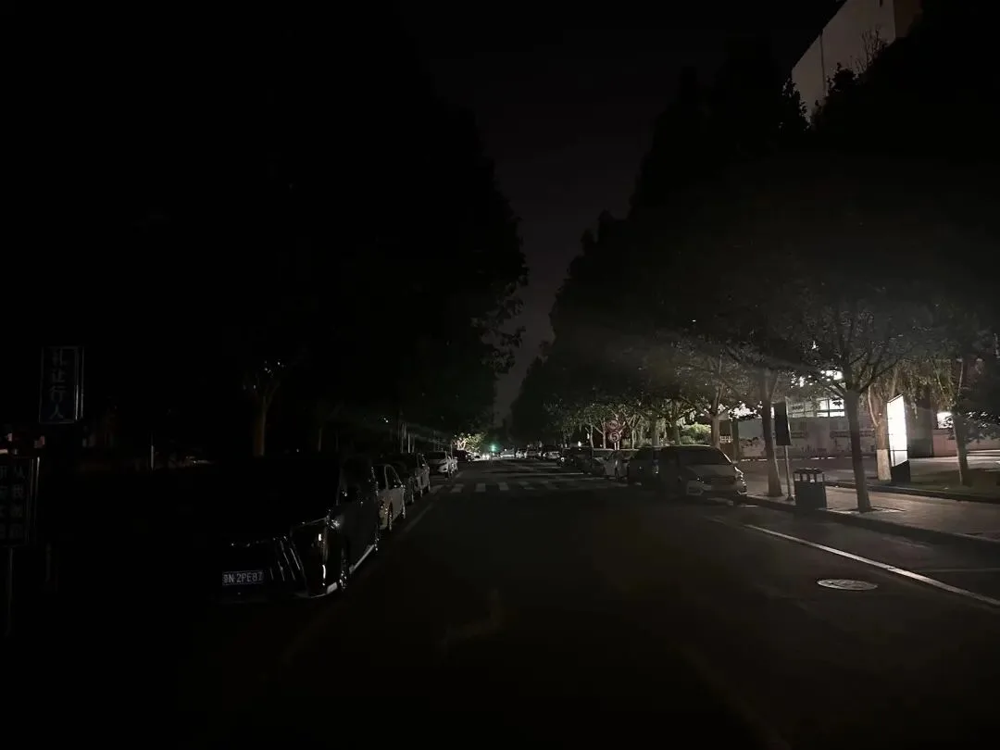
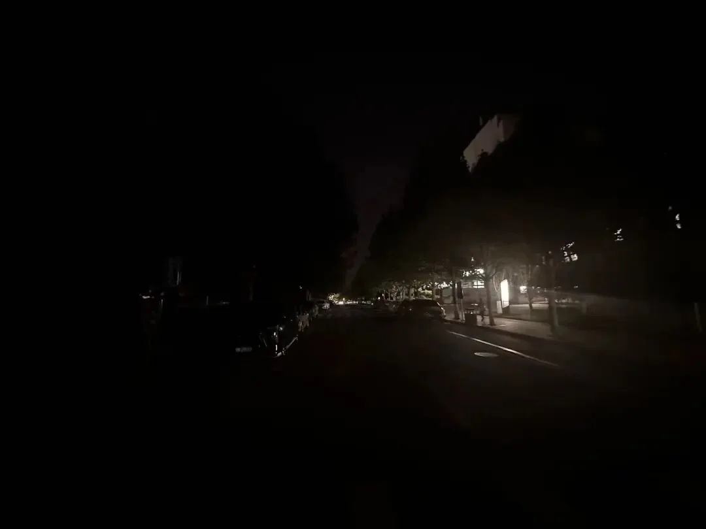
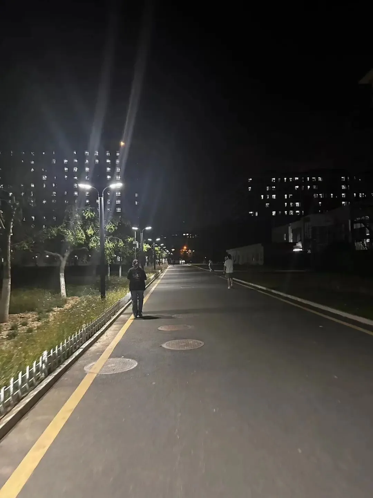

请相关部门及时关注并跟进问题。

## 1 奖助补费

“在偏远的小院问道求学是幸福的，但同时又是拮据的。希望我校领导能真正以学生为本，回应广大学子呼声，尽快提升学生补助待遇。”

## 2 校园基建

“求求良乡校区把路灯点亮吧，现在是21:42，从南门过来一路黑灯瞎火，好险被减速带颠飞。

图一二是没灯的路，图三是有灯的路”

“社科大连个自动售货机都管不好，也是让人齿冷。好几次了，去宿舍楼下无论是哪个机器，要不是大面积地缺货、要不是买了不出东西吞钱，不知是怎么回事。

你所谓的超市和个大爷一样关门那么早，有本事维护好这几台机器啊。非得逼的大家到时都跑到校外去买东西就开心了吗？可怜可怜上自习的人吧！看不出来这对学校有什么好处，或许只能说明有人招投标吃饱饱后就不管其他人了吧”

## 3 食堂

“一食堂早上又只开两个窗口（八点半左右），队伍排到桌子那，过了十几分钟才开始增开其他窗口，食堂自己觉得合适吗？”

（见《[【读者投稿】拖来拖去](https://mp.weixin.qq.com/s?__biz=Mzg2MjcwNzQ1Mw==&mid=2247488251&idx=1&sn=b2cbb542d0b53b10f7959af9e78780df&chksm=ce029969f975107f26b21a7e1d385829e80012c3a77dd5d2d14f2f3a4756c9df7a823f9eeab8&scene=21#wechat_redirect)》第2条）

## 4 宿舍

“原来的物业公司为什么要换？好不容易适应了，然后需要再去适应，学生就应该不声不响接受新的调整吗？有一个官老爷问过学生的意见吗？”

> “投稿宿舍男女生分宿舍楼问题。这位女同学没必要这么激动吧？什么叫没有安全感？大家是有干什么过激的事情吗？再说如果你要求搞男女宿舍，你帮我整理搬宿舍吗？我这么大堆东西就因为你不愿意披一件衣服就要搬，合理吗？你这嘴一叭叭就要四号楼的男生搬走，你出力搬家吗？以及你出力帮其他女生搬进四号楼吗？有这力气不如整理下仪容吧。”

（见《[【读者投稿】教务安排有疑问 生活关切问题多](https://mp.weixin.qq.com/s?__biz=Mzg2MjcwNzQ1Mw==&mid=2247488498&idx=1&sn=366c07d9ef123d90ad74ce0f2685c7ff&chksm=ce029860f9751176c3de6e34df9015cd9ed3c0c68f5b8cbfae2721ef0021ee9d2c150f56b4f4&scene=21#wechat_redirect)》第3条）
